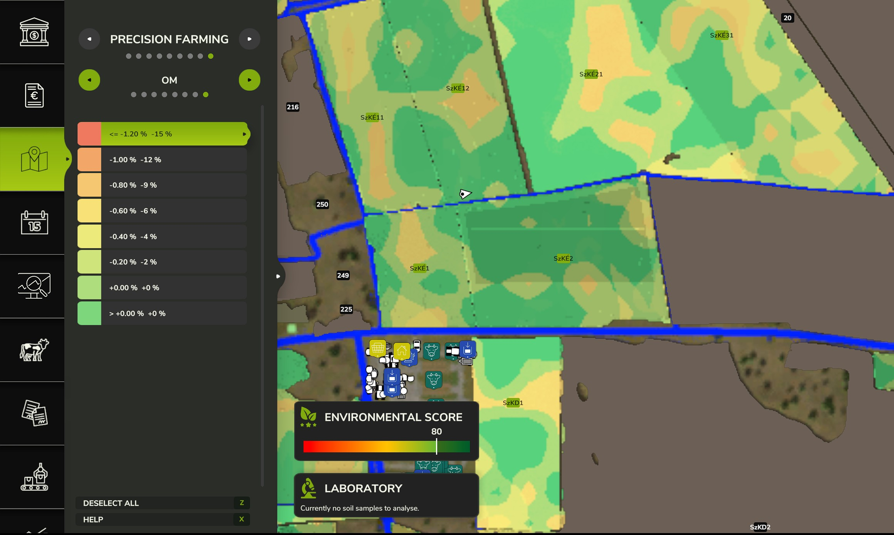
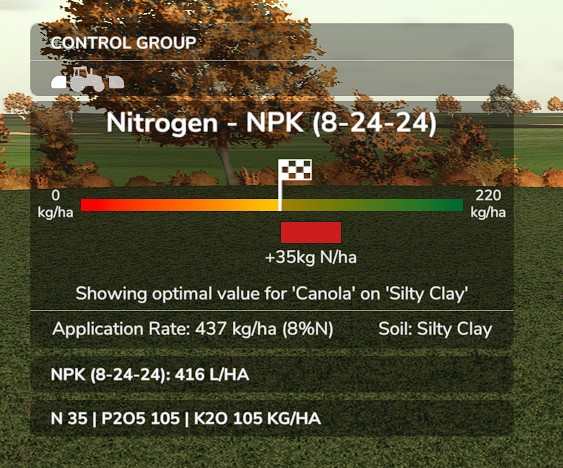

🇭🇺 [Magyar változat](HU-01-Elso-lepesek)

> [!WARNING]
> **In development (v0.1).** Things may change, and the nutrient maps in your save may reset. Always keep a backup of your savegame.

# Getting started

**The mod adds three new layers to Precision Farming (phosphorus, potassium, organic matter) and shows you which nutrient is holding your crops back.**

- You need the Precision Farming DLC and the [TR] Precision Farming Configurator.
- On a new savegame the maps start from the starting values of each soil type.
- You see the layers in the map menu and the field info box after soil sampling.
- The colour in the field info box tells you how much that nutrient costs you in yield.
- Saving and loading is not yet tested in game.
- Next: [Products and application](EN-05-Products-and-Application)

## Install

1. Download the mod: https://sharemods.com/3ezx9j54cuoa/FS25_VirtualTSZPrecisionFarmingExtension.zip.html
2. Put the zip file into the game's `mods` folder. Do not unzip it.
3. In your savegame's mod list, enable the mod **and its two requirements**:
   - Precision Farming DLC (`FS25_precisionFarming`)
   - [TR] Precision Farming Configurator (`FS25_0_TRPFConfigurator`)
4. On a dedicated server, the zip must be installed on the server **and on every client**, the same as for Precision Farming itself.

In principle the mod works on other maps, but that is not tested. See [For map makers](EN-07-For-Map-Makers).

## What happens on first start

The mod creates three new maps (phosphorus, potassium, organic matter) at the size of Precision Farming's soil map. The soil type sets the starting value: each soil type has a small range of values, spread over the pixels of a field like noise. So even within one field, some spots are a little better or poorer.

- **On a new savegame**, the three maps start from the starting values.
- **On an existing savegame the mod has never been in**, the same happens: the mod finds no saved maps, so it builds them from the starting values. The earlier history of your save (past harvests, manure) does not count. The field starts as if the mod began now.
- **On a savegame that already used the mod**, the mod loads the saved maps (`vtsz_pMap8.grle`, `vtsz_kMap8.grle`, `vtsz_omMap8.grle`). Phosphorus and potassium were stored in a different format (5 bit, absolute values) in earlier versions of the mod; those old files (`vtsz_pMap.grle`, `vtsz_kMap.grle`) are ignored, and the two maps start again from the starting values. Saving and loading is **not yet tested** in game (neither in single player nor in multiplayer).

To check that the mod loaded, look for `[VTSZ-NUT]` lines in `log.txt` (in the game's user folder):

```
[VTSZ-NUT] P map 2048 x 2048, 8 bit, step 5, new
```

`new` at the end means a fresh map, `loaded from savegame` means it was read from the save. All three maps (P, K, OM) write a line like this. If there is no `[VTSZ-NUT]` line, or an `Error` next to it, the mod did not load properly. Check that both requirements are enabled.

## Soil sampling

The three layers stay hidden until you take soil samples, the same as the Precision Farming nitrogen and pH layers. Take samples with Precision Farming's soil sampler on the parts of the field you want to see. Without a sample the map is empty.

> [!NOTE]
> Sampling only unlocks the **display**. Application, harvest and the yield factor always use the real value, even when you have not sampled yet. A field without a sample is not "protected": you just cannot see what is in its soil. On an unsampled field the mod's own automatic P/K rate also gives no value, and the machine uses the rate you set by hand.

## How to read the layers

### In the map menu

Open the Map page of the ESC menu and pick **P2O5**, **K2O** or **OM** (organic matter) in the Precision Farming layer selector. The three entries come after the seed rate layer. Each legend row shows the upper limit of its band and the approximate yield change, for example `-80 kg/ha  -4 %`. **The percentage is the value at the middle of the band, not its minimum or maximum**: a field at the edge of the band loses a bit more or less. It has no crop or pH adjustment; the field info box shows the exact figure for a field.



Colours run from red through yellow to green: red is low, green is high. In colour-blind mode the game uses Precision Farming's own colour-blind gradient. The legend window covers this range for each layer:

| Layer | Legend range |
|---|---|
| Phosphorus | −300 … +100 kg/ha P₂O₅ from the target |
| Potassium | −600 … +300 kg/ha K₂O from the target (green up to +200, blue only above that, where over-fertilising starts to cost yield) |
| Organic matter | −1.4 … +0.2 percentage points from the target (not yet checked in game on all four soil types) |

**All three maps are relative**: they do not show the content of the soil itself, but how far the soil is from the target value of its soil type. `0` is exactly on the target, minus is a deficit, plus is a surplus, and the same colour means the same on every soil type. Green means "at or above target", red means far below. (For organic matter, the yellow at about −0.6 and red at about −1.2 are not yet checked in game.) More on the [Phosphorus](EN-02-Phosphorus), [Potassium](EN-03-Potassium) and [Organic matter](EN-04-Organic-Matter) pages.

The map shows the **soil**. The potassium target is the same for every crop. For phosphorus, an acid or alkaline soil lowers the yield factor, and that shows in the line colour and in the field info text.

### In the field info box

When you stand on a sampled field, the field info box shows three new lines. Example for potassium:

```
Potassium (K2O, vs. target) (low): -100 kg/ha K2O
```

This is the map value: the distance of the soil from its target (here 100 kg below, with the yellow "low" mark). The potassium target is the same for every crop, so there is only this one number, and the automatic rate spreads exactly this gap.

The phosphorus line (`Phosphorus (P2O5, vs. target)`) shows one number as well: the plain distance from the soil type target, for example `-60 kg/ha P2O5`. The soil pH does not change the number, but it changes the line colour and the yield factor. If the soil holds enough phosphorus but the pH keeps the plants from using it, the line says `low availability (pH)`. Fix that with lime, more phosphorus does not help (see [Phosphorus](EN-02-Phosphorus)).

Organic matter shows only the distance from the target, for example `Organic matter (vs. target): -0.32 %`.

The colour of the line and the word after it show the **yield factor**, meaning how much this nutrient holds back the crop:

| Colour | Yield factor | Text |
|---|---|---|
| Green (blue in colour-blind mode) | 0.99 or more | none |
| Yellow | 0.90 – 0.99 | low |
| Red (orange in colour-blind mode) | below 0.90 | very low, with a warning icon |

When there is no crop or soil type under the cursor, the line shows only the map value, without a target.


### While spreading

On a sprayer or spreader, the HUD shows the application rate and how much N, P₂O₅ and K₂O goes out per hectare. The minimap shows the layer that fits the product in the machine. Every detail is on [Products and application](EN-05-Products-and-Application).



## Your first season

1. **Take soil samples** on the field and look at all three layers in the map menu.
2. **Read the field info box** in the middle of the field: which line is yellow or red, and how far below 0 is the map value? The scarcer of phosphorus and potassium limits the yield, and organic matter is a separate multiplier on top.
3. **Pick a product.** Phosphorus shortage needs a product with phosphorus, potassium shortage one with potassium. Mineral fertiliser does not raise organic matter: that takes manure, straw, legumes or catch crops. [Products and application](EN-05-Products-and-Application) lists the products.
4. **Use the automatic rate.** For P and K products the mod has its own automatic application rate (Precision Farming's own automatic rate only handles nitrogen).
5. **Harvest**, and see how much the crop took. Harvest lowers phosphorus and potassium, and organic matter as well.
6. **Sample again next season** and compare with the last values. That shows whether your replacement was enough.

The mod only ever lowers yield: it never raises it above what Precision Farming gives.

## See also

- [Phosphorus](EN-02-Phosphorus), [Potassium](EN-03-Potassium) and [Organic matter](EN-04-Organic-Matter)
- [Products and application](EN-05-Products-and-Application)
- [Known limitations](EN-10-Known-Limitations)
