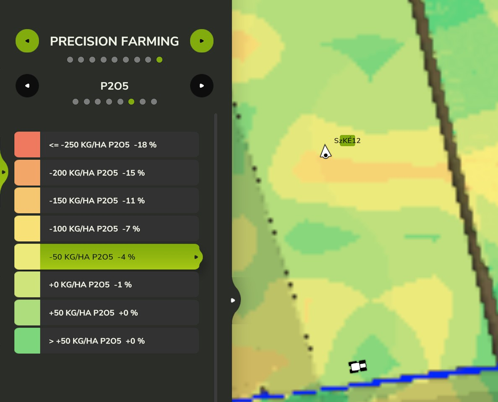
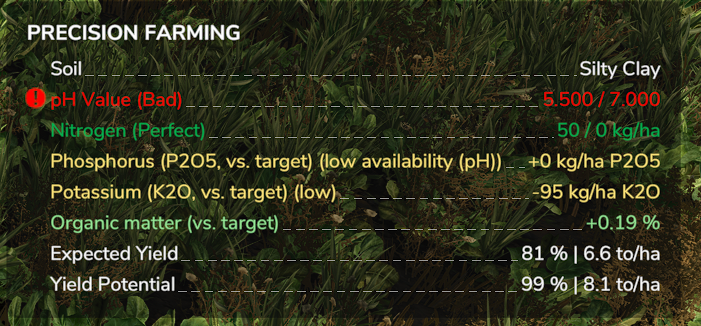

🇭🇺 [Magyar változat](HU-02-Foszfor)

> [!WARNING]
> **In development (v0.1).** The mod is in development and things may change. Always keep a backup of your savegame.

# Phosphorus (P₂O₅)

**Every harvest takes phosphorus out of your field, and when the level falls below the target, your yield drops.**

## In short

- Every field gets a **phosphorus map**. It shows the **distance from the target** in kg P₂O₅/ha: `0` is exactly on the target of the soil type, minus is a deficit, plus is a surplus.
- **Every harvest takes some out.** You can only put it back with phosphorus fertiliser or manure.
- If the soil is **below its target value** (below 0 on the map), yield drops.
- Above the target there is no penalty and no bonus. Phosphorus does not leach, and too much does not hurt.
- Fix a phosphorus shortage with fertiliser. Manures hold very little phosphorus.

## How much yield you lose when phosphorus is short

Every soil type has a **target value** (at this level phosphorus does not limit yield) and a **starting value** (what a new map begins with, in four steps within a field because soil is not uniform). The phosphorus target is the same for every crop, because critical phosphorus levels hardly differ between crops.

The map does not show the target as a number. It stores and shows the **distance from the target**, so `0` means "on target" on every soil type. The target is the zero point. The table gives the target as a content in the soil and the starting value as the distance from it:

| Soil type | Target = 0 on the map (kg P₂O₅/ha) | Starting value vs. target (kg P₂O₅/ha) |
|---|--:|--:|
| Loamy Sand | 420 | −95 … +55 |
| Sandy Loam | 500 | −125 … +50 |
| Loam | 600 | −150 … +75 |
| Silty Clay | 460 | −135 … +65 |

Targets and starting values are estimates, derived from Hungarian AL-P₂O₅ supply classes (1 mg/kg AL extract is about 4 kg/ha), with ±20–30 % uncertainty. Sources are on the [Sources](EN-11-Sources) page.

The yield factor comes from the distance to the target (the map value, corrected for soil pH, see below), and the mod interpolates linearly between the points:

| Distance from target | Yield factor |
|--:|--:|
| 0 or above | 1.00 |
| −100 kg | 0.95 |
| −200 kg | 0.87 |
| −300 kg | 0.80 |
| −600 kg and below | 0.65 |

The 0.65 floor is a game balance decision: long-term trials without phosphorus lose 20–40 %, and things run faster on the server than in reality.

**The key rule:** of phosphorus and potassium, **the scarcer one limits the yield** (Liebig's law of the minimum). If both give a factor of 0.95, the result is 0.95, not 0.90. Organic matter is a separate multiplier. The mod only takes yield away when the soil is short of something: it **never raises yield** above what Precision Farming (PF) would give.

Status: the yield curve is verified at calculation level (self-test), not yet measured in game.

## What takes phosphorus out

### Harvest

Every harvest (every cut, for grass) takes phosphorus. The table values are for a **typical yield**, and the mod scales them to the real yield: a better harvest removes more, a poor one less.

| Crop | Removal (kg P₂O₅/ha) | If straw is baled and removed |
|---|--:|--:|
| Winter wheat | 64 | +19 |
| Winter barley | 56 | +15 |
| Corn | 62 | |
| Silage maize | 65 | |
| Canola | 55 | |
| Sunflowers | 56 | |
| Sugar beet | 70 | |
| Potato | 56 | |
| Faba beans | 44 | |
| Grass (per cut) | 22 | |
| Alfalfa (per cut) | 20 | |

Removal for every crop

Grass, alfalfa and clover are per-cut values, based on 3 cuts a year (the practice on the VirtualTSZ server). For a different number of cuts the values must be recalculated, see [For map makers](EN-07-For-Map-Makers).

| Crop | Removal (kg P₂O₅/ha) | Baled straw (+) |
|---|--:|--:|
| Winter wheat | 64 | 19 |
| Winter barley | 56 | 15 |
| Oat | 44 | 13 |
| Rye | 48 | 14 |
| Triticale | 52 | 16 |
| Spelt | 40 | 12 |
| Corn | 62 | 0 |
| Silage maize | 65 | 0 |
| Sorghum (estimate) | 55 | 0 |
| Green rye | 40 | 0 |
| Vetch rye | 45 | 0 |
| Canola | 55 | 0 |
| Sunflowers | 56 | 0 |
| Sugar beet | 70 | 0 |
| Potato | 56 | 0 |
| Soybean | 42 | 0 |
| Pea | 44 | 0 |
| Fodder peas | 44 | 0 |
| Faba beans | 44 | 0 |
| Grass, field grass, meadow (per cut) | 22 | 0 |
| Alfalfa, clover (per cut) | 20 | 0 |
| Any other crop | 50 | 12 |

### Baled straw

For cereals, baled (removed) straw takes extra phosphorus, chopped straw does not. Canola straw cannot be baled in the game, so it always stays on the field.

### Forage harvesting and mowing

Whole-crop cereal harvest takes the straw as well, so the phosphorus loss equals a harvest with baled straw. This has not been checked in game yet.

### No leaching

Phosphorus does not leach and does not decompose: its level changes only with application and harvest. A field you leave alone keeps its phosphorus.

Status: the mower and combine removal looks right in the log; most crop values are not measured in game yet.

## How to put it back

The mod writes phosphorus to the map from the litres of product you spread. The same product counts once per pixel and pass (a lock), until tillage, sowing or harvest releases it.

| Product | kg P₂O₅ / 1000 l | Note |
|---|--:|---|
| Triple superphosphate (0-46-0) | 506 | default rate 230 l/ha ≈ +116 kg/ha |
| MAP (11-52-0) | 499.2 | also gives nitrogen; 200 l/ha ≈ +100 kg/ha |
| NPK (8-24-24) | 252 | |
| Single superphosphate (0-18-0) | 189 | 300 l/ha ≈ +57 kg/ha |
| NPK (15-15-15) | 157.5 | |
| Carbolime (sugar factory lime sludge, the Szalók map's own product) | 18 | |
| Digestate | 3.0 | |
| Manure | 1.75 | |
| Slurry | 1.7 | |
| Yeast vinasse (3-0.5-5) | 3.78 | |

The base game's solid fertiliser (FERTILIZER) gives only nitrogen by default, no phosphorus. CAN 27 (Pétisó 27, calcium ammonium nitrate, 27-0-0), urea and Nitrosol UAN (30-0-0) are also nitrogen only. Products, rate keys and the automatic rate are explained on [Products and application](EN-05-Products-and-Application).

Example: 25,000 l/ha of slurry gives +42 kg P₂O₅/ha. Manures hold little phosphorus, so you do not fix a phosphorus shortage with them.

Status: the phosphorus content of the products is verified at calculation level (self-test), and the spreading rules (once per product and pass) work in game. The shop products have not been tried in game yet.

## How to check it

1. **Soil sampling.** Like PF's nitrogen and pH layers, the phosphorus layer is hidden until you sample the field. Without a sample the map is empty.
2. **Map layer.** ESC › Map › PF selector › **Phosphorus**. The layer shows the distance from the target: **minus is a deficit, plus is a surplus**. The legend runs red-yellow-green between −300 and +100 kg P₂O₅/ha (in colour-blind mode PF's own colours). The colours mean the same on every soil type, because the zero is always the target of that soil type.
3. **Field info box.** Stand on the field: `Phosphorus (P2O5, vs. target): -60 kg/ha P2O5`. The number is the plain distance from the soil type target. The line colour follows the yield factor, which includes the pH effect: 0.99 or more is green, 0.90 to 0.99 is yellow "low", below 0.90 is red "very low". If the soil is at or above the target but the pH still holds the yield back, the row says "low availability (pH)" (see below).

There is only this one number. The yield factor behind the colour also includes the soil pH, but the pH never changes the number itself.

Soil sampling, the layer and the legend were tried in game in the earlier (absolute) version. The distance display in the field info row is new and not yet checked in game. More in [Getting started](EN-01-Getting-Started).

## Special rules for phosphorus

### Soil pH and availability

How much phosphorus a crop can use depends on soil pH. In acid soil it is bound to aluminium and iron; in calcareous soil (pH above 7) it sticks as calcium phosphate. The mod reads the soil pH from PF's pH map and divides the target by the pH **availability share**: away from the optimum, you need a bigger stock for the same yield.

| pH | 5.0 and below | 5.5 | 6.2 – 7.2 | 7.8 | 8.2 and above |
|---|--:|--:|--:|--:|--:|
| Availability | 70 % | 85 % | 100 % | 90 % | 80 % |

The mod interpolates linearly between these pH values. **These percentages are estimates**, not data from a source; the direction (worse on acid and calcareous soil) is supported by sources.

The **map does not change with pH**: it shows the soil only, and so does the number in the field info row. The pH effect shows in the **yield factor** (and so in the line colour) and in a warning text.

Example: on loam the target is 600 kg/ha. At pH 5.5 you need 600 / 0.85 = 706 kg/ha for full yield, that is **+106 above the map's zero**. The yield factor is worked out against that higher target. If the map shows −75 (525 kg/ha in the soil), the row shows `-75 kg/ha P2O5` and the yield factor is lower than the gap alone would give. On such a field even a pixel at 0 gives less than full yield.

**The pH warning.** When the soil is at or above the target but the yield factor is below 0.99 only because of the pH, the row's extra text is "low availability (pH)" instead of "low" or "very low". The line is yellow from a yield factor of 0.9 and red with a warning below that. The map can read 0 or a surplus while the yield is below 100 %.

**What to do.** Fix the pH with lime (see the lime products). Spreading more phosphorus does not help. The automatic rate fills only the gap to the soil type target and ignores the pH, so on an acid or alkaline field the yield factor stays below 1 until the pH is corrected.

**What it asks for at the worst pH.** At pH 5.0 (availability 70 %) the yield factor needs a stock above the map's zero by: Loamy Sand +180, Sandy Loam +214, Silty Clay +197, Loam +257 kg P₂O₅/ha. Spreading stops at +300 (see below) and the pH-adjusted target behind the yield factor is never set above that cap minus one step, so a fully fertilised field can always reach a yield factor of 1.0. Even loam at pH 5.0 (+257) stays below the cap.

At harvest the mod uses the pH of the pixel under the machine, so no soil sample is needed. PF's own pH yield factor (the effect of lime) stays separate. Whether the two effects overlap too much is not yet checked in game.

Status: the pH rule is verified at calculation level (self-test), not yet in game.

> [!TIP]
> Before you blame phosphorus for a weak field, look at its pH. On acid or calcareous soil the same phosphorus level gives less yield, and the field info row can say "low availability (pH)".

## How far the map can be filled up

The phosphorus map stores values from **−600 to +675 kg P₂O₅/ha** around the target, in steps of 5 kg. Spreading stops at a **soft cap of +300**: anything you spread above +300 is wasted. +300 is the same on every soil type. The lowest value the map stores (−600) is where the yield factor reaches its floor of 0.65.

+300 leaves room for a build-up above the target and for the pH effect (loam at pH 5.0 needs +257), but not for a large, lasting surplus.

This is a game rule. In reality phosphorus stays in the soil, and building up with extra fertiliser is normal practice.

## Tips

- **Look at pH and the sample first.** On acid or calcareous soil the plants use less of the phosphorus in the soil. Lime fixes that, more phosphorus does not.
- **If you bale the straw, count it in.** Winter wheat takes 83 kg P₂O₅ instead of 64, barley 71 instead of 56. In example rotation B (straw baled, fertiliser only) phosphorus stayed between 600 and 634 kg/ha at year ends (0 to +34 on the map) with phosphorus fertiliser, and the worst yield factor was 0.98 to 1.00 (a simulation, not an in-game measurement).
- **Do not build above the cap.** Nothing above +300 on the map is kept. Replacing the removal and reaching the target is enough.
- **A pixel at 0 can still give less than full yield.** On acid or calcareous soil the row says "low availability (pH)" even at 0 or above. Check the pH and the line text, not only the colour of the map.
- **Manure needs phosphorus fertiliser next to it.** Manures hold little phosphorus (1.7–3 kg per 1000 litres); cover the gap with triple superphosphate, MAP or single superphosphate.
- **The automatic rate helps.** For triple and single superphosphate the automatic rate works from the map. It spreads exactly the gap to the target, see [Products and application](EN-05-Products-and-Application).

Removal numbers are estimates (±20–30 %); sources are on the [Sources](EN-11-Sources) page.

## See also

- [Products and application](EN-05-Products-and-Application)
- [Crop rotations](EN-06-Crop-Rotations)
- [Potassium](EN-03-Potassium)
- [Technical details](EN-08-Technical-Details)
