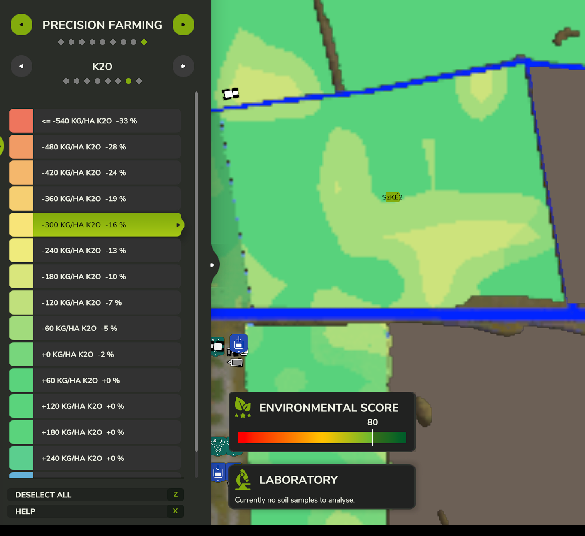

🇭🇺 [Magyar változat](HU-03-Kalium)

> [!WARNING]
> **In development (v0.1, testing).** The mod is unstable and changes may come. Always keep a backup of your savegame.

# Potassium (K₂O)

## In one paragraph

**After silage maize, sugar beet and potatoes, potassium runs out fastest, and when it does, your yield drops.**

- Every field has its own potassium (K₂O) map. It shows the **distance from the target** of the soil type in kg K₂O/ha: `0` is on target, minus is a deficit, plus is a surplus.
- The target is the same for every crop. The crop only changes how much a harvest takes out.
- Every harvest takes some out: little for grain, a lot for silage, sugar beet and potatoes.
- Manure and potassium fertiliser put it back.
- The part above the target slowly leaches away.
- If the soil gives the crop too little potassium, the yield drops.
- The mod only takes yield away; it never goes above what Precision Farming (PF) gives.

## What it does to your yield

The mod only takes yield away when the soil gives too little potassium. It never raises yield above what PF gives. Of phosphorus and potassium, the **scarcer** one counts (Liebig's law of the minimum): if both give a factor of 0.95, the result is 0.95, not 0.90. Organic matter is a separate multiplier, see [Organic matter](EN-04-Organic-Matter).

### Targets per soil type

Every soil type has a **base target**. The map does not show it as a number: it shows the **distance from it**, so `0` means "on the base target" on every soil type, and the colours mean the same everywhere. The table gives the target as a content in the soil and the starting value as a distance from it (kg K₂O/ha). On a new savegame the starting value varies within a field, in four steps.

| Soil type | Base target = 0 on the map (kg K₂O/ha) | Starting value vs. target (kg K₂O/ha) |
|---|--:|---|
| Loamy Sand | 500 | −140 … +60 |
| Sandy Loam | 700 | −180 … +100 |
| Loam | 740 | −180 … +100 |
| Silty Clay | 820 | −180 … +100 |

### The target is the same for every crop

The K target is the soil type target for every crop: wheat, sugar beet and potatoes are all measured against the same `0` on the map. The crop only changes how much each harvest takes out (see the removal table below), and that is what you refill. A map maker can still add a crop extra in the config, but the default config uses 0.

### The yield factor

The factor depends on how far the actual K is below or above the soil type target. The mod interpolates linearly between the points.

| Difference from target | Yield factor |
|---|--:|
| −600 kg or lower | 0.65 |
| −400 kg | 0.80 |
| −250 kg | 0.88 |
| −100 kg | 0.95 |
| on target | 1.00 |
| +200 kg | 1.00 |
| +400 kg | 0.97 |
| +600 kg or more | 0.95 |

Example: on loam the map shows −135 (605 kg/ha in the soil, target 740). The factor is about 0.93, whatever crop is on the field. The field info row says `-135 kg/ha K2O`.

The mild penalty above the target (0.97 at +400 kg, 0.95 at +600 kg) is a game-balance rule with a small real basis: a lot of K hinders magnesium uptake. The size is an estimate; there is no measured data behind it.

Status: `vtszSelfTest` checks the factors at calculation level. The harvest yield factor and the distance display have not been tried in game yet.

## What lowers it

### Harvest

Every harvest (every cut, for mowing) takes K out. The removal **follows the actual yield**: less for a poor yield, more for an excellent one. The values below are for a typical yield.

| Crop | K₂O removal (kg/ha) | + baled straw |
|---|--:|--:|
| Winter wheat | 44 | +90 |
| Winter barley | 42 | +120 |
| Corn | 55 | |
| Canola | 30 | |
| Sunflowers | 84 | |
| Sugar beet | 175 | |
| Potato | 240 | |
| Silage maize | 190 | |
| Green rye | 150 | |
| Vetch rye | 155 | |
| Grass (per cut) | 87 | |
| Alfalfa (per cut) | 93 | |

Grass and alfalfa are given **per cut**. The VirtualTSZ server has 3 cuts a year, so the yearly removal is about 260–280 kg.

The full list, with the cereals and pulses:

K₂O removal of all crops (kg/ha, typical yield)

| Crop | K₂O | + straw |
|---|--:|--:|
| Other crops (DEFAULT) | 50 | +80 |
| Winter wheat | 44 | +90 |
| Winter barley | 42 | +120 |
| Oat | 31 | +62 |
| Rye | 33 | +67 |
| Triticale | 36 | +73 |
| Spelt | 28 | +56 |
| Corn | 55 | |
| Silage maize | 190 | |
| Sorghum (estimate) | 170 | |
| Green rye | 150 | |
| Vetch rye | 155 | |
| Canola | 30 | |
| Sunflowers | 84 | |
| Sugar beet | 175 | |
| Potato | 240 | |
| Soybean | 55 | |
| Pea, fodder pea | 40 | |
| Faba beans | 56 | |
| Grass, field grass, meadow grass (per cut) | 87 | |
| Alfalfa (per cut) | 93 | |
| Clover (per cut) | 100 | |

Sources: LfL Bavaria Basisdaten (2025), IPNI and Ohio State (soybean), Embrapa (sorghum); alfalfa and clover derived from hay values. The numbers are estimates, accurate to about ±20–30 %.

### Straw

For cereals, the "+ baled straw" value only comes off when you remove the straw. If the combine **chops** it, the straw's potassium stays on the field: you save 90 kg K₂O/ha with wheat and 120 with barley. Cereals cut with a forage harvester header or a mower leave the field with the straw, so the straw part comes off there too.

### Leaching

K **at or above the soil type target** (0 or more on the map) slowly leaches away, more on light soils. Anything below the target stays. The yearly loss (estimates):

| Soil type | Yearly loss (kg K₂O/ha) |
|---|--:|
| Loamy Sand | 40 |
| Sandy Loam | 25 |
| Loam | 15 |
| Silty Clay | 10 |

The loss is spread over the year: more in the wet, cool months (early spring, late autumn, winter), least in July and August. The value is per game year, and `timeScale` does not multiply it (that only applies to organic matter). The VirtualTSZ server runs about 6 game years per real-time year, so the soil loses 6 times this much K per real-time year.

Status: `vtszSelfTest` checks the leaching calculation, but we have not tried it in game yet. Phosphorus does not leach.

## How can I improve it

Amounts are per 1000 l of product (K₂O). The mod works out the nutrient from the litres you apply.

| Product | kg K₂O / 1000 l | Note |
|---|--:|---|
| Potassium chloride 60 MOP (0-0-60) | 660 | most K, cheap (game price about 3.5 per kg K₂O) |
| Patentkali (0-0-30) | 357 | sulphate, no chloride |
| NPK (8-24-24) | 252 | also gives P |
| NPK (15-15-15) | 157.5 | also gives N and P |
| Yeast vinasse (3-0.5-5) | 37.8 | by-product |
| Slurry | 5.0 | |
| Digestate | 5.0 | |
| Manure | 4.2 | |
| Carbolime (sugar factory lime sludge, Szalók's own product) | 1.2 | practically zero |

The base-game solid fertiliser (FERTILIZER) gives **nitrogen only** by default, as in PF. The potassium comes from this mod's products. A map can change this with the `baseFertilizer` setting.

Per hectare: 25,000 l of slurry gives about +125 kg K₂O, 20,000 l of manure about +84 kg. The default rate of potassium chloride is 230 l/ha (about 152 kg K₂O). For prices, rates and the automatic rate, see [Products and application](EN-05-Products-and-Application).

> [!NOTE]
> PF's own automatic rate only handles nitrogen. The mod works out an automatic rate for potassium (and phosphorus) too, see [Products and application](EN-05-Products-and-Application). We have not tested the rate keys in game yet.

## How to see it

1. **Soil sampling.** Like the PF nitrogen and pH layers, the K layer stays hidden until you sample the field. Without a sample the layer is empty.
2. **Map layer.** ESC › Map › PF selector › **Potassium**. The layer shows the distance from the base target: **minus is a deficit, plus is a surplus**. Red-yellow-green up to the target, green up to +200 (no penalty), blue only above +200, where the yield penalty starts. Legend −600 to +300 kg K₂O/ha.
3. **Field info box.** Standing on a field, you see `Potassium (K2O, vs. target): -100 kg/ha K2O`. It is one number: the distance from the soil type target, here 100 short. If K is short, "low" or "very low" appears next to it.

Tried in game (single player) in the earlier, absolute version: the layer in the PF selector, soil sampling, the legend and the field info lines. The distance display in the field info row is new and not yet checked in game, and neither is the K effect in the "expected yield" line of the field info box.

## Special rules

### Same target for every crop

The target does not depend on the crop. Before a crop that takes a lot out (silage maize, sugar beet, potatoes), look at how far the map is below 0 and plan for the removal of the harvest from the table above. The mod's help page lists the removal of every crop per harvest, with baled straw and forage harvest totals where they differ (ESC › Help › VirtualTSZ nutrients). We have not checked the help page in game yet.

### Chloride in potassium chloride

Potassium chloride 60 MOP is KCl, so it also brings chloride into the soil. Chloride-sensitive crops (potatoes, vegetables) tolerate about 675 kg Cl/ha a season, and usual crops show no harm up to about 140 kg Cl/ha (APNI, K+S). So the mod allows **at most 450 l/ha** per pass (about 495 kg of product, 297 kg K₂O, about 230 kg chloride).

No source gives a hard single-dose limit, so the cap is a lenient estimate, not a real-world rule. If you need more, spread it in two passes or use Patentkali (sulphate). The mod does not model chloride sensitivity crop by crop. The cap also applies to the automatic rate.

## Map limits

The K map stores values from **−600 to +675 kg K₂O/ha** around the base target, in steps of 5 kg, on every soil type. There is no soft cap like on the phosphorus map, but anything above +675 is lost, so building up far beyond the target is a waste.

This is a game rule. In reality, building up K is normal practice and the potassium does not disappear like this. On top of that, K above the target leaches slowly, and at very high levels (from about +200 over the target) the yield drops slightly.

## Tips

- After silage maize, do the sums: a typical harvest takes 190 kg K₂O, which about 290 l/ha of potassium chloride replaces. 25,000 l/ha of slurry gives back only about 125 kg.
- After a harvest, or on a field that starts below 0, you only add what is missing. The crop does not change the target.
- If you do not need the straw, chop it: 90 kg K₂O/ha stays on the field with wheat, 120 with barley.
- On light soils (Loamy Sand, Sandy Loam) do not build up above the target, because that is where the most leaches out.
- The automatic rate is exactly the gap to the target (the map value with the sign flipped): [Products and application](EN-05-Products-and-Application).
- If the 450 l/ha cap of potassium chloride is too tight, spread it in two passes or use Patentkali.

## See also

- [Products and application](EN-05-Products-and-Application)
- [Crop rotations](EN-06-Crop-Rotations)
- [Technical details](EN-08-Technical-Details)
- [Phosphorus](EN-02-Phosphorus)
