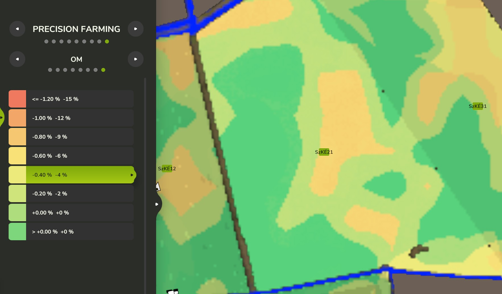

🇭🇺 [Magyar változat](HU-04-Szerves-anyag)

> [!WARNING]
> **In development (v0.1, testing).** The mod is unstable and changes may come. Always keep a backup of your savegame.

# Organic matter (OM)

## In a nutshell

**Organic matter (humus) slowly drains from your soil, and when it falls below the target of the soil type, your yield drops.**

- It gives the soil its structure and water holding, and slowly releases nitrogen.
- Precision Farming does not track it; it is the third layer of this mod.
- It is not a nutrient but a **separate yield multiplier**.
- What drains it: monthly decomposition, silage maize, forage harvesting and root crops (potatoes, sugar beet).
- What builds it: manure, chopped straw, legumes, alfalfa and catch crops.
- The VirtualTSZ server runs about 6 game years per real-time year, and the mod multiplies every OM change by a `timeScale` of 6. So you see the effect within a real-time year.

## What it does to your yield

The target value differs per soil type. We give the starting value as the distance from the target (percentage points), because the OM map is relative (see below).

| Soil type | OM target value | Starting value vs. target (percentage points) |
|---|--:|---|
| Loamy Sand | 1.8 % | −0.8 … 0 |
| Sandy Loam | 2.5 % | −0.7 … +0.5 |
| Loam | 3.2 % | −0.8 … +0.8 |
| Silty Clay | 4.0 % | −0.8 … +0.8 |

The target values are estimated from literature ranges (±20–30 %). On a new savegame even the worst starting level only gives a yield factor of 0.92; it never starts below 0.90 on any soil type.

**Yield factor for OM** (the mod interpolates linearly between the values):

| Distance from target | Yield factor |
|--:|--:|
| 0 or above | 1.00 |
| −0.2 | 0.99 |
| −0.4 | 0.97 |
| −0.6 | 0.95 |
| −0.8 | 0.92 |
| −1.0 | 0.89 |
| −1.25 | 0.855 |
| −1.5 | 0.82 |
| −2.0 | 0.75 |
| −2.5 | 0.68 |

The curve is flat near the target and steeper further down: a small shortfall hardly hurts, a big one costs a lot. You can read how the factor ends up in the harvest yield on [Technical details](EN-08-Technical-Details).

Two key rules:

- **OM is a separate multiplier, not part of the phosphorus and potassium "minimum".** Yield = PF multiplier × min(P factor, K factor) × OM factor. For P and K the scarcer one limits the yield (Liebig's law of the minimum: 0.95 and 0.95 together give 0.95, not 0.90), and OM multiplies on top. See [Phosphorus](EN-02-Phosphorus) and [Potassium](EN-03-Potassium).
- **The mod only takes yield away; it never adds any.** At or above the target the OM factor is 1.00, so the yield never exceeds what Precision Farming would give anyway.

## What lowers it

| Cause | OM change |
|---|--:|
| Silage maize (Green rye, Vetch rye and sorghum count the same) | −0.070 per harvest |
| Potato | −0.120 per harvest |
| Sugar beet (the leaf gives part of it back) | −0.036 per harvest |
| Cereals **forage-harvested or mown** (crop and straw both leave) | −0.055 … −0.088 per harvest (same as baled straw) |
| Cereals with **baled (removed) straw** | −0.055 … −0.088 per harvest (the chopped value with a minus sign: the straw's OM leaves the field) |
| **Monthly decomposition** (mineralisation) | see below |

OM change per harvest for all crops (in-game value, typical yield)

The values are the config values (real-world annual basis) times 6 (`timeScale`). The monthly decomposition runs separately, on top of these.

| Crop | Straw baled | Straw chopped | Forage harvest / mowing |
|---|--:|--:|--:|
| Winter wheat | −0.088 | +0.088 | −0.088 |
| Winter barley | −0.067 | +0.067 | −0.067 |
| Oat | −0.076 | +0.076 | −0.076 |
| Rye | −0.074 | +0.074 | −0.074 |
| Triticale | −0.080 | +0.080 | −0.080 |
| Spelt | −0.055 | +0.055 | −0.055 |
| Corn | +0.068 | +0.068 | +0.068 |
| Silage maize | −0.070 | −0.070 | −0.070 |
| Sorghum, Green rye, Vetch rye | −0.070 | −0.070 | −0.070 |
| Canola | +0.082 | +0.082 | +0.082 |
| Sunflowers | +0.096 | +0.096 | +0.096 |
| Sugar beet | −0.036 | −0.036 | −0.036 |
| Potato | −0.120 | −0.120 | −0.120 |
| Soybeans, peas, fodder peas, Faba beans | +0.110 | +0.110 | +0.110 |
| Grass, field grass, meadow grass, alfalfa, clover (per cut) | +0.057 | +0.057 | +0.057 |

Also: carrot and parsnip −0.070, green bean and beetroot 0 (cereal level). The sorghum values are estimates.

## How can I improve it

The values below are **percentage points per ha, in-game values** (per game year, 6 times the real-world annual value, `timeScale` 6). They are based on the German VDLUFA humus balance (estimates, ±20–30 %); the details are at the end of the page.

**Organic fertilisers and products** (per 1000 l, independent of the nitrogen content):

| Product | OM per 1000 l (in game) | Config value (x6 = in game) | Example |
|---|--:|--:|---|
| Manure | +0.0048 | 0.0008 | 20,000 l/ha = +0.096 |
| Slurry | +0.00204 | 0.00034 | 25,000 l/ha = +0.051 |
| Digestate | +0.00228 | 0.00038 | 20,000 l/ha = +0.046 |
| Yeast vinasse (3-0.5-5) (Élesztővinasz in the Hungarian game) | +0.0168 | 0.0028 | estimate |
| Carbolime (sugar factory lime, the Szalók map's own product) | +0.00216 | 0.00036 | estimate |

Slurry gives less OM than solid manure. Mineral fertilisers (CAN 27, NPK, Potassium chloride 60 MOP and the rest) do **not** raise OM. The "config value" column is the real-world annual basis in the config file; the game multiplies it by 6. The same products are on [Products and application](EN-05-Products-and-Application).

**Harvest and crops:**

| Source | OM change per harvest / per cut |
|---|--:|
| Faba beans, peas, soybeans (grain legumes) | +0.110 |
| Sunflowers | +0.096 |
| Canola | +0.082 |
| Corn | +0.068 |
| Alfalfa, clover, grass (per cut; 3 cuts a year on the server) | +0.057 |
| Chopped straw: winter wheat | +0.088 |
| Chopped straw: winter barley | +0.067 |

**Catch crops, incorporated or mulched** (oilseed radish and mustard +0.048, flowering mix +0.042, humus-active mix +0.072 per field, once). A catch crop counts when you destroy it. These tools work:
- *tested in game:* the mulcher (mulching gives the same as incorporating),
- *read from code, not yet tested in game:* plough, subsoiler, disc harrow, cultivator and direct seeding.
- A pixel only counts once: residue that is already mulched gives nothing on a second mulcher pass or a later ploughing.
- Roller, weeder, stone picker and harvesting give no OM (read from code).

The harvest values follow the yield only halfway: a poor harvest adds or removes less, but not in proportion.

## How to see it

1. **Soil sampling.** Like the PF nitrogen and pH layers, OM stays hidden until you sample the field. See [Getting started](EN-01-Getting-Started).
2. **Map layer.** ESC > Map > the PF layer selector: *Organic matter*.
3. **Legend.** The map is **relative**: it does not show the percentage but how far the soil is below or above the target of its soil type. So the colours mean the same on every soil type:
   - **green** = at or above target,
   - **yellow** ≈ −0.6 percentage points,
   - **red** ≈ −1.2 percentage points and below.

   (We have not checked the yellow and red marks in game yet; see the note at the end of the page.)

   The legend runs from −1.4 to +0.2. The 1.8 % of a Loamy Sand and the 4.0 % of a Silty Clay are both green when they sit on their target. You get the actual percentage from the target plus the distance (on Loam, −0.5 = 2.7 %).

   The [phosphorus](EN-02-Phosphorus) and [potassium](EN-03-Potassium) maps work the same way: they also show the distance from the soil type's target (0 = on target, minus = deficit, plus = surplus). The difference: organic matter has no crop-specific need on top of the map value, while potassium (and phosphorus on acid soil) show the crop target next to the map value in the field info row.
4. **Field info box.** The "Organic matter (vs. target)" line shows only the distance, for example `−0.32 %`. The colour follows the yield factor: green at 0.99 or more (down to about −0.2), yellow "low" between 0.90 and 0.99, red "very low" below 0.90 (own colours in colour-blind mode).

## Special rules for OM

### Monthly decomposition

The soil's organic matter keeps shrinking: at every game month change the mod subtracts from the OM map. The yearly loss is 0.365 % of the soil type's target (the VDLUFA humus demand of cereals). In the game, 6 times as much comes off per game year (`timeScale` 6):

| Soil type | Decomposition per game year |
|---|--:|
| Loamy Sand | −0.039 percentage points |
| Sandy Loam | −0.055 percentage points |
| Loam | −0.070 percentage points |
| Silty Clay | −0.088 percentage points |

The loss follows the season: almost nothing in the cool months, the most in summer (June to August carry 43 % of the yearly loss, December to February 6 %). Tillage does not speed it up; the mod does not model that.

### Decomposition releases nitrogen

Decomposing organic matter releases nitrogen, and the mod adds it to the Precision Farming nitrogen map. You get 8 kg N/ha per year for every 1 % of the OM stock (the soil type's target):

| Soil type | N release per year |
|---|--:|
| Loamy Sand | about 14 kg N/ha |
| Sandy Loam | about 20 kg N/ha |
| Loam | about 26 kg N/ha |
| Silty Clay | about 32 kg N/ha |

It follows the same seasonal pattern, with the most in summer. The PF automatic rate sees the higher nitrogen level, so it **spreads less nitrogen**. This is a net estimate (gross mineralisation is higher, but residues and roots bind most of it again), so do not expect a big nitrogen source from it.

### Time scale on the server

> [!NOTE]
> The OM values in the config are real-world annual values (VDLUFA). The server runs time fast: about 6 game years per real-time year. To keep the soil in step, a `timeScale` of 6 multiplies every OM change, so **per game year OM moves 6 times as much as the real-world annual value**. You see the effect within a real-time year.
>
> This is specific to VirtualTSZ: `timeScale` is a map setting that map makers can change (see [For map makers](EN-07-For-Map-Makers)), and it may differ on another server. This is a game rule, not reality.

With the 6 times scale the balance stays the same: a balanced rotation stays balanced, you just see it sooner.

### The humus balance in two sentences

The mod uses the German VDLUFA "Humusbilanzierung" (2014) method: every crop and every organic material takes away or brings humus equivalents (Häq, 1 Häq = 1 kg humus-C/ha), and the mod converts these to percentage points. The balance starts at the base demand of cereals (the monthly decomposition), and other crops take the difference at harvest or give it back.

Humus equivalent table (real-world annual values)

| Item | VDLUFA value | In the mod (config value, real-world annual basis; ×6 per game year) |
|---|---|---|
| Humus demand of cereals, oil crops, sunflowers | −280 Häq/ha/year | the continuous monthly decomposition |
| Silage maize, Corn, carrot, parsnip | −560 | −0.0117 percentage points at harvest |
| Sugar beet, potato | −760 | −0.0200 percentage points at harvest |
| Grain legumes | +160 (with residue) | +0.0183 at harvest |
| Perennial forage (grass, alfalfa, clover) | +400/year | +0.0094 per cut (3 cuts) |
| Straw | 100 Häq/t (VDLUFA), long-term trials about 55 | the mod uses 55 |
| Sugar beet leaf | 8 Häq/t fresh matter | |
| Solid manure (20 % dry matter) | 28 Häq/t | 0.0008 percentage points / 1000 l |
| Slurry (7 % dry matter) | 9 Häq/t | 0.00034 percentage points / 1000 l |
| Biogas digestate | about 10 Häq/t (rough) | 0.00038 percentage points / 1000 l |

1 % OM = 24 t C/ha, so 1 Häq = 0.0000417 percentage points. For straw the mod uses the long-term trial value of 55 Häq/t (the VDLUFA default would be 100), so chopped cereal straw roughly covers only the cereal's own humus demand and builds hardly any humus. There is no separate source for maize stover; that is an assumption. No humus balance table for Hungarian soils was available, so the German method was taken over. Sources: [Sources](EN-11-Sources).

## Map limits

The OM map stores at most **+2.19 percentage points** above the target (about 5.4 % on Loam) and down to −4.01 below it. Anything above the cap is **lost**, so manure spread beyond it is wasted.

This is a game rule: in reality the humus stock can be built further, only slowly. So there is no point building far above the target. A small surplus is fine, though, and cushions the next silage years.

## Tips

- **Manure alone is not enough in a silage rotation.** The dairy example (rotation D, Loam) falls from 3.25 % to 2.84 % over 6 game years even with manure after every silage maize harvest. Nitrogen limits how much manure you can spread before over-fertilisation starts to cost yield. This is a simulation with typical yields, not an in-game measurement.
- **An alfalfa break turns it around.** In rotation E the alfalfa year with three cuts gives a net of about +0.17 percentage points, and over 8 years OM stays about level (3.25 % to 3.24 %). See [Crop rotations](EN-06-Crop-Rotations).
- **Chop the straw when you can.** Baled straw takes −0.055 … −0.088 OM per cereal harvest; chopped it gives the same amount back (+0.055 … +0.088). So the straw decides whether the cereal builds or loses OM.
- **Do not forage-harvest cereals without a reason.** Forage-harvested or mown cereal takes −0.055 … −0.088, the same as baled straw; chopped straw gives it back.
- **Legumes and catch crops are cheap builders.** Faba beans +0.110, oilseed radish or mustard incorporated +0.048, humus-active mix +0.072.
- **Watch the field info box before harvest.** At a yellow "low" you are already losing yield, but you can rebuild the level in the next rotation.

> [!NOTE]
> **What is tested?** In single player, the layer, the legend and the field info box work in game, and so does mulching catch crops. We read the incorporation by plough, subsoiler, disc harrow, cultivator and direct seeding from the code and have not tested it in game. We have not yet checked the yellow (about −0.6) and red (about −1.2) marks of the legend in game.
>
> The self-test checks the products, the yield factors, the harvest values, the decomposition and the nitrogen release at calculation level, but **not yet in game**. We have not tested multiplayer and dedicated servers yet. The numbers are estimates, see [Known limitations](EN-10-Known-Limitations).

## See also

- [Products and application](EN-05-Products-and-Application)
- [Crop rotations](EN-06-Crop-Rotations)
- [Technical details](EN-08-Technical-Details)
- [Sources](EN-11-Sources)
