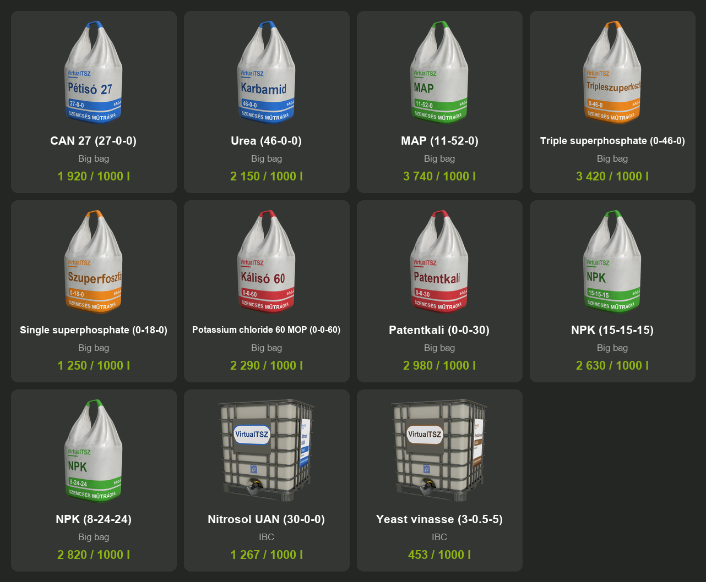
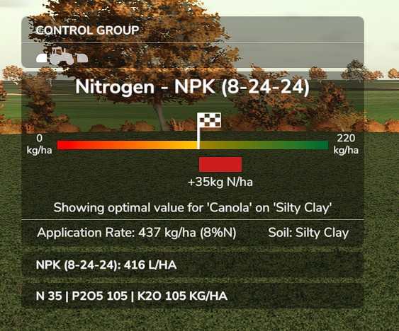
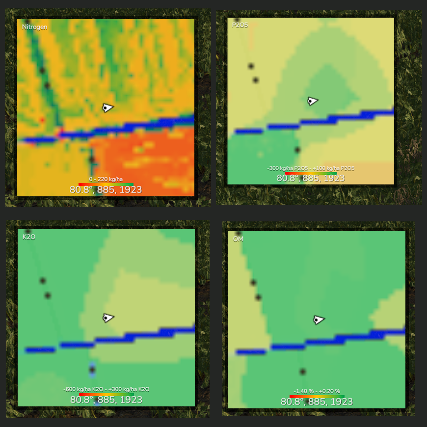
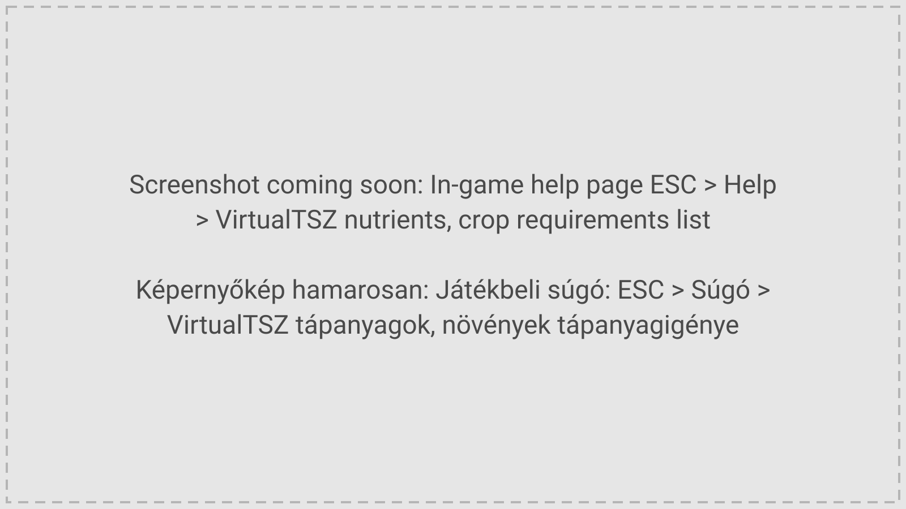

🇭🇺 [Magyar változat](HU-05-Termekek-es-kijuttatas)

> [!WARNING]
> **In development (v0.1).** Things may change, and the nutrient maps in your save may reset. Always keep a backup of your savegame.

# Products and application

**The shop has 11 new fertilisers, and you decide how much the machine spreads: by hand, or automatically from the map.**

- 9 solid and 2 liquid products, with nitrogen, phosphorus and potassium.
- For nitrogen-free products you set the rate yourself (`Left Alt + K` and `Left Alt + M`).
- The mod calculates the automatic phosphorus and potassium rate from the revealed map: it spreads exactly the gap to the target.
- The same product counts only once per pixel in a pass, so spread the full amount in one go.
- The HUD, the minimap and the help page show what goes into the soil.
- Manual and automatic rates are not fully tested in game yet: where it matters, we say so.
- No soil sample yet? Start with [Getting started](EN-01-Getting-Started).

## What you can buy

The mod adds 11 fertilisers to the shop: solids come in big bags (1000 l) for spreaders, liquids in IBCs (1000 l) for sprayers. Prices are game prices scaled from estimated 2026 EU price ratios (not official data); the currency is the game's.

| Product | Form | N-P₂O₅-K₂O % | Price / 1000 l | Good for |
|---|---|---|--:|---|
| CAN 27 (27-0-0), calcium ammonium nitrate (called Pétisó 27 in the Hungarian game) | solid | 27-0-0 | 1920 | plain nitrogen, priced like the base game solid fertiliser |
| Urea (46-0-0) | solid | 46-0-0 | 2150 | more concentrated nitrogen |
| MAP (11-52-0) | solid | 11-52-0 | 3740 | phosphorus with a little nitrogen |
| Triple superphosphate (0-46-0) | solid | 0-46-0 | 3420 | phosphorus without nitrogen |
| Single superphosphate (0-18-0) | solid | 0-18-0 | 1250 | cheaper phosphorus without nitrogen |
| Potassium chloride 60 MOP (0-0-60) | solid | 0-0-60 | 2290 | cheapest potassium (Kálisó 60 in the Hungarian game) |
| Patentkali (0-0-30) | solid | 0-0-30 | 2980 | potassium, the most expensive |
| NPK (15-15-15) | solid | 15-15-15 | 2630 | balanced three-nutrient fertiliser |
| NPK (8-24-24) | solid | 8-24-24 | 2820 | mainly P and K, little N |
| Nitrosol UAN (30-0-0) | liquid | 30-0-0 | 1267 | cheap liquid nitrogen |
| Yeast vinasse (3-0.5-5; Élesztővinasz in Hungarian) | liquid | 1.8-0.3-3 (see below) | 453 | cheap potassium, little N, and a little organic matter |

Prices are per 1000 litres (the price of one big bag or one IBC), in the game's currency. The name of the yeast vinasse shows the dry-matter grade (3-0.5-5); what reaches the soil is the diluted grade as applied (1.8-0.3-3, 60 % of the name).

Density and nutrients in kg per 1000 l

Nutrient content per 1000 litres: density × 1000 × percentage. The densities are estimates (sources: [Sources](EN-11-Sources)).

| Product | Density (t / 1000 l) | N kg | P₂O₅ kg | K₂O kg |
|---|--:|--:|--:|--:|
| CAN 27 (27-0-0) | 1.00 | 270 | – | – |
| Urea (46-0-0) | 0.75 | 345 | – | – |
| MAP (11-52-0) | 0.96 | 105.6 | 499.2 | – |
| Triple superphosphate (0-46-0) | 1.10 | – | 506 | – |
| Single superphosphate (0-18-0) | 1.05 | – | 189 | – |
| Potassium chloride 60 MOP (0-0-60) | 1.10 | – | – | 660 |
| Patentkali (0-0-30) | 1.19 | – | – | 357 |
| NPK (15-15-15) | 1.05 | 157.5 | 157.5 | 157.5 |
| NPK (8-24-24) | 1.05 | 84 | 252 | 252 |
| Nitrosol UAN (30-0-0) | 1.275 | 382.5 | – | – |
| Yeast vinasse (3-0.5-5) | 1.26 | 22.7 | 3.78 | 37.8 |

Yeast vinasse also adds +0.0028 percentage points of organic matter per 1000 litres (in the unit of the OM map, see [Organic matter](EN-04-Organic-Matter)).

Nitrogen goes onto Precision Farming's own nitrogen map; the mod does not change that.

### Price per kg of nutrient

Per kilogram of nutrient, Nitrosol (about 3.3 per kg N) and potassium chloride (about 3.5 per kg K₂O) are the cheapest. The phosphorus products cost 6.6 to 7.5 per kg P₂O₅, and Patentkali is the most expensive potassium source (about 8.3 per kg K₂O). Prices are estimates in the game's currency (the figures here are game money per kg of nutrient, not euros): CAN 27 has the base game's solid fertiliser price, the other solids are scaled from estimated 2026 EU price ratios and density, and Nitrosol follows the base game's price per kg of nitrogen for liquid fertiliser.

## Manure, slurry, digestate and base game fertiliser

Precision Farming's organic fertilisers also bring P, K and organic matter. Amounts per 1000 litres:

| Product | N kg (Precision Farming's values) | P₂O₅ kg | K₂O kg | OM percentage points (real-world value, before x6 timeScale) |
|---|--:|--:|--:|--:|
| Manure | 7 | 1.75 | 4.2 | 0.0008 |
| Slurry | 4 | 1.7 | 5.0 | 0.00034 |
| Digestate | 5.5 | 3.0 | 5.0 | 0.00038 |

Two examples:
- **25 000 l/ha slurry:** +100 kg N (written to the nitrogen map by PF), +42 kg P₂O₅, +125 kg K₂O, and +0.0085 percentage points organic matter × 6 (`timeScale`) = +0.051 percentage points.
- **20 000 l/ha manure:** +140 kg N, +35 kg P₂O₅, +84 kg K₂O, and +0.016 percentage points organic matter × 6 = +0.096 percentage points.

The OM value in the table is the real-world value per game year (calculated from VDLUFA humus values); in game the mod multiplies it by 6 (`timeScale`), because on the VirtualTSZ server about 6 game years pass in one real year. Details: [Organic matter](EN-04-Organic-Matter).

**Base game solid fertiliser** gives only nitrogen by default, just like in Precision Farming. P and K come from this mod's products. The `baseFertilizer` setting can switch on P and K for it (300 l/ha then gives +36 kg P₂O₅ and +36 kg K₂O): this is a map maker setting, see [For map makers](EN-07-For-Map-Makers). The base game **liquid fertiliser** is nitrogen only and does not touch the P, K or OM map.

## Setting the rate by hand (products without nitrogen)

Precision Farming only manages the rate of products that contain nitrogen. For the four nitrogen-free products (triple superphosphate, single superphosphate, potassium chloride 60, Patentkali) the mod adds its own l/ha setting:

| Product | Default l/ha | Step | Min | Max |
|---|--:|--:|--:|--:|
| Triple superphosphate (0-46-0) | 230 | 25 | 10 | 800 |
| Single superphosphate (0-18-0) | 240 | 25 | 10 | 800 |
| Potassium chloride 60 MOP (0-0-60) | 230 | 25 | 10 | 450 |
| Patentkali (0-0-30) | 210 | 25 | 10 | 800 |

The defaults are about 250 kg/ha of product. Keys: `Left Alt + K` raises the rate, `Left Alt + M` lowers it (rebindable). The rate is per vehicle, synced in multiplayer (not tested in multiplayer yet), and not saved: after loading it goes back to the default.

**Why is potassium chloride limited to 450 l/ha?** Potassium chloride 60 (KCl) is a chloride, and chloride harms some crops (potatoes, vegetables). 450 l/ha is about 495 kg of product, 297 kg K₂O and about 230 kg chloride per pass. The sources give seasonal limits (chloride-sensitive crops tolerate about 675 kg Cl/ha, typical crops show no harm up to about 140 kg Cl/ha), but **no source gives a hard single-pass limit**, so 450 l/ha is a lenient, estimated cap. Split larger needs over two passes (which needs tillage, sowing or harvest in between, see the product lock below) or use Patentkali. The mod does not model chloride sensitivity per crop.

## Automatic rate for P and K

Precision Farming's automatic rate only looks at nitrogen. The mod adds to it: it calculates the l/ha you need from the revealed P or K map.

### Base nutrient

The automatic rate works from a **base nutrient** (N, P or K). By default it is the nutrient with the largest content in the product: the base of triple superphosphate and MAP is P, NPK (8-24-24) is P, NPK (15-15-15) is N (a tie goes to N, as in PF). Manure, slurry and digestate are the exception: their base is N, as in Precision Farming. `Left Alt + B` cycles through the nutrients in the product, and the HUD shows the current one. Changing the product resets it to the default.

### The formula in words

Nutrient to apply (kg/ha) = target value − current value, never below zero.

That is exactly the gap the field info box shows: if it says P −200 and K −150, the automatic rate spreads 200 kg P₂O₅ and 150 kg K₂O per hectare (from two different products, one base nutrient each). For both P and K the target is the soil type target, the same for every crop, so the rate is just the map value with the sign flipped. The soil pH is ignored: on an acid or alkaline field the automatic rate still fills only the gap to the soil type target, and the yield factor stays below 1 until the pH is corrected with lime. There is no build-up over several years and no extra for the removal of the next harvest. At or above the target the rate is zero. The l/ha follows from the nutrient content of the product and is capped: at most 2500 l/ha, and for products with a manual rate, their own maximum (for example potassium chloride: 450).

**The auto rate equals the gap in the field info box.** The next harvest removes nutrients again, and the field info box shows that as a new gap after the harvest, which the next auto rate refills. After a harvest you only add what is missing.

Example: sugar beet on loam, the field info box says `-100 kg/ha K2O`, a gap of 100. The auto rate asks for 100 kg K₂O/ha. Potassium chloride 60 MOP holds 660 kg K₂O per 1000 l, so that is about 152 l/ha, within the product's maximum of 450 l/ha. A bigger gap than 450 l/ha (about 297 kg K₂O) takes **several passes**. Because of the product lock (below), the next pass of the same product only counts on the same pixel after tillage, sowing or harvest; a different product counts at once.

### Two paths

| Product | How you switch it on | What happens |
|---|---|---|
| No nitrogen (triple superphosphate, single superphosphate, potassium chloride 60, Patentkali) | `Left Alt + ,`: the mod's own automatic rate | The rate comes from the average map value under the working width, exact to the l/ha. While it is on, the manual rate does not apply. |
| At least two nutrients, with N (NPK 15-15-15, NPK 8-24-24, MAP, yeast vinasse, manure, slurry, digestate) | Precision Farming's automatic button | With base N, PF calculates. With base P or K the mod calculates the rate and replaces PF's nitrogen value with the N content of the litres actually applied, so the PF nitrogen map and the HUD stay consistent. |
| Nitrogen only (CAN 27, urea, Nitrosol, the base game fertilisers) | Precision Farming's automatic button | Only PF works, the mod does not interfere. |

### The nitrogen cap

A P- or K-based rate never applies more nitrogen than Precision Farming's own automatic rate would apply at that spot. This stops you overdosing nitrogen because of a phosphorus shortage (too much N is punished hard). The consequence: with a nitrogen-rich product, a P or K deficit often cannot be made up, because the N cap is reached first. In that case use a nitrogen-free or P/K-rich product.

### Precision and unsampled soil

- PF handles nitrogen in steps of 5 kg N/ha, so for products with N the rate moves in steps too: about 32 l/ha per step for NPK (15-15-15), about 60 l/ha for NPK (8-24-24). The result can differ from the wanted value by about ±16–30 l/ha. Nitrogen-free products have no such rounding.
- Where the soil sample is not revealed yet, the mod's P/K automatic gives no value and the machine uses the manual rate (the HUD says "no data, manual"). Take a soil sample first: [Getting started](EN-01-Getting-Started).
- The on/off state and the base nutrient sync in multiplayer; this has not been tested in multiplayer yet.

## Product lock

A pixel changes only once per product until tillage, sowing or harvest releases the lock (tested in game). So the same product does not count a second time on the same pixel. If you want to apply more, set the full amount in one pass.

Two *different* products spread one after another both count on the mod's own maps (P, K, OM). Precision Farming's nitrogen map, however, locks by the soil's spray type, and all of the mod's products use the same type. So the nitrogen of a second product is expected not to reach the PF nitrogen map on the same pixel without tillage in between. This is a **known limitation and not planned to be fixed**: a separate soil type for each product would cost too much performance.

If you want to spread two different products that contain nitrogen one after another, you can use the [FS25_NotSoEasyDeveloperControls](https://github.com/borondy/FS25_NotSoEasyDeveloperControls) mod between the passes. According to the cleaner mod's description, its admin console command `clearFertilizerState [fieldId]` clears the field's fertiliser spray type (it leaves manure and lime alone; in multiplayer only an admin can use it). The command also releases this mod's lock, so the same product counts again afterwards. This page has not tested the cleaner mod itself.

> [!TIP]
> You typically need to clear when the previous pass also spread a shop product that contains nitrogen (CAN 27, urea, MAP, NPK, Nitrosol, yeast vinasse), and there has been no sowing, harvest or tillage since. You do not need to clear around manures (they have their own type) or nitrogen-free products (potassium chloride, triple superphosphate, single superphosphate, Patentkali).

## HUD, minimap, help page

**HUD.** While spreading, the Precision Farming sprayer box shows two lines at its bottom: the product and l/ha, and below it `N | P2O5 | K2O kg/ha`, the nutrients you apply per hectare. For the base game fertiliser, P and K only show when `baseFertilizer` is on. With the automatic rate on, the HUD also shows the base nutrient, for example `(auto K)`. The HUD line, and whether the HUD value matches the amount really spread, have not been tested in game yet.

**Seeders with a fertiliser tank** (fertilising sowing machines) work like sprayers: the HUD, the manual and automatic rate keys and the base nutrient choice are the same, and the nutrients go into the maps while you sow. Not tested in game yet.

**Minimap.** When you are in a field with a product in the machine, the minimap switches to the layer of the product's largest nutrient: MAP, triple superphosphate and NPK (8-24-24) show P, potassium chloride and Patentkali show K, the manures show N. `Left Alt + .` cycles the layers: Auto › Nitrogen › Phosphorus › Potassium › Organic matter. Changing the product resets it to Auto. In game this was only tried while spreading slurry (the layer followed the product); the rest has not been tested yet.

**Help page.** ESC › Help › VirtualTSZ nutrients lists, for every crop, what one harvest removes from the soil (N, P₂O₅, K₂O in kg/ha; grain harvest, straw chopped and left on the field). For cereals and other crops where it makes a difference it adds a second line with the totals when the straw is baled, and for a forage harvest. It shows no target values, because the maps show the distance from the soil type target. A second help page, "Fertilizer content", lists every fertilizer and lime of the loaded map with its content per 1000 l (N, P₂O₅, K₂O in kg; the OM gain in percentage points and the pH rise only where the product has one). A third help page, "Using fertilizers", is plain text: the order of work, typical use and an l/ha band for each fertilizer group, a yearly calendar, advice per crop, the game rules to watch and suggested server house rules. The realistic advice on it is general practice, not mod behaviour; the mod does not model incorporation, chloride damage or surface losses. The first two help pages read the data from the loaded map when you open them, so they follow the config and the map.xml. The help pages have not been tested in game yet.

## Keys

All of them can be rebound in the game's key settings. The mod uses its own actions and does not share Precision Farming's keys.

| Key | Action in the settings | What it does |
|---|---|---|
| `Left Alt + K` | Application rate + | Raise the manual rate (nitrogen-free products) |
| `Left Alt + M` | Application rate - | Lower the manual rate |
| `Left Alt + ,` | Automatic rate (P/K products) | Switch the mod's own automatic rate on or off (nitrogen-free products) |
| `Left Alt + B` | Automatic rate base nutrient | Cycle the base nutrient (N, P, K) |
| `Left Alt + .` | Minimap layer | Cycle the minimap layer |

## See also

- [Phosphorus](EN-02-Phosphorus) and [Potassium](EN-03-Potassium): what a shortage does
- [Organic matter](EN-04-Organic-Matter): what manure does for humus
- [Crop rotations](EN-06-Crop-Rotations): examples of using the products
- [Known limitations](EN-10-Known-Limitations)
