🇭🇺 [Magyar változat](HU-06-Vetesforgok)

> [!WARNING]
> **In development (v0.1, testing).** The mod is unstable: expect bugs, and expect changes that may reset the nutrient maps in your savegame. Do not use it on a savegame you cannot afford to lose.

# Crop rotations

**Five worked crop rotations show where your farming takes phosphorus, potassium and organic matter over the years.**

- All five start on loam, from the game's average starting values.
- You get a livestock, an arable-only, a dairy and two silage rotations, one of them with an alfalfa break.
- You see which rotation burns through humus and what stops it.
- The numbers come from a simulation, not from in-game measurements.
- The doses are examples, not instructions.

## What can you learn from these rotations?

We ran five rotations through the mod's own config, all on **loam**, starting from the average of the game's starting values: **P₂O₅ 562, K₂O 700 kg/ha, organic matter (OM) 3.25 %**.

| Rotation | Farm | Length |
|---|---|---|
| A | livestock farm, silage rotation, solid manure after silage maize | 5 years |
| B | arable farm without livestock, fertiliser only, straw baled | 4 years |
| C | dairy farm, manure and slurry after silage maize | 4 years |
| D | dairy farm, silage rotation, manure after every silage maize | 6 years |
| E | dairy farm, like D but with an alfalfa break | 8 years |

These are **simulations with typical yields**, not in-game measurements. They show one way to farm, not the only way: use the doses to see what to watch for, do not copy them. The `vtszSelfTest` console command checks the rules behind the numbers (removal, decomposition, yield factors) at calculation level.

Each chart has four strips: nitrogen, phosphorus, potassium and organic matter.

- Green triangle: an application.
- Orange triangle: a harvest or cut.
- Red dashed line: the target value.
- Numbered circle: an important point, explained under the chart.

## Assumptions

- **Soil:** loam (soil type 3); the starting values are the mean of the four noise levels. Targets: P₂O₅ 600, K₂O 740 kg/ha, OM 3.2 %.
- **pH:** phosphorus availability is 1.00, meaning the soil pH is between 6.2 and 7.2. On more acid or more limed soil the phosphorus yield factor is lower.
- **Content, not distance:** the tables and charts give the nutrient content of the soil (target plus distance). In game the P and K maps show the distance from the target (loam: P₂O₅ 650 kg/ha = +50 on the map).
- **Map limits:** P₂O₅ +300 above the target (a soft cap for spreading), K₂O +675 above the target, OM 2.19 percentage points above the target. The examples stay below these.
- **No K leaching in the simulation.** In the game, potassium above the soil target slowly falls, so the very high potassium values at the end of some tables are upper estimates.
- **Product lock:** the same product only counts again on the same pixel after sowing, harvest or tillage, so partial doses are combined into one pass. For mixed passes that contain nitrogen, the examples assume the fertiliser layer is cleared in between (see [Known limitations](EN-10-Known-Limitations)).

How to read the tables (full description)

**Further assumptions**

- **Yield scale 1.0:** typical yield. In a real harvest, removal depends on the yield.
- **Nitrogen cap:** the Precision Farming nitrogen map does not go above 220 kg N/ha (a game rule); the surplus is lost. Over-fertilising also costs yield.
- **Single doses:** at most about 125 kg N/ha of mineral fertiliser in one pass (for example 400 l/ha of CAN 27 = 108 kg N), at most 30,000 l/ha of organic manure. Larger nitrogen needs are split over two different products.
- **On the VirtualTSZ server:** no solid manure in spring, only slurry (a house rule, the mod does not enforce it). The simulation assumes 3 alfalfa cuts a year on assumed cut dates (April 25, July 10, October 10). OM changes are 6 times the real-world annual value per game year (`timeScale` 6), so 6 game years are about 1 real year.

**Tables**

- The **year** is the year of the harvest. Autumn-sown crops were sown the autumn before; the table only lists applications and harvests.
- The **Δ** columns are the effect of the operation, the columns after them are the levels *after* the operation (field average, without noise; because of the noise, the starting value varies by about ±110 kg/ha for phosphorus and ±140 kg/ha for potassium within a field).
- **Organic manure (A, C, D, E):** on a livestock farm, solid manure and slurry are unlimited, so manure goes on after every silage maize harvest. The amount is set by the **nitrogen target of the next crop**, because the manure's nitrogen (solid 7, slurry 4 kg N per 1000 l) brings the over-fertilisation penalty. You need more slurry for the same nitrogen, and it gives less organic matter. Rotation B is fertiliser only. Phosphorus and potassium fertiliser only fills the gap left after the manure.
- **Time scale:** the OM columns use `timeScale` 6: every OM change per game year is 6 times the real-world annual value, and on the server about 6 game years are 1 real year. Phosphorus, potassium and nitrogen are not scaled.
- **Yield factor** = min(P factor, K factor) × OM factor × N factor, from the levels before the harvest. The N factor is Precision Farming's curve: 1.00 at the N target, 0.95 at −10 kg, 0.82 at −40, 0.98 at +20, 0.96 at +40, 0.92 at +60, 0.82 at +120 (the difference is the nitrogen before the harvest minus the crop's N target). The K factor compares against the crop's K target: soil target + 0.5 × the crop's K removal.
- **Crop K targets** (all higher than the soil target of 740): silage maize 835, green rye 815, vetch rye 818, sunflowers 782, alfalfa 787, faba beans 768, corn 768, winter wheat 762, winter barley 761, canola 755.
- **OM decomposition and nitrogen release** happen on the first day of the month and show up in the next operation's row (the sum of the months that began since the previous row). **ΔN** is the nominal nitrogen of the dose for an application, and the actual change for a harvest (nitrogen cannot go below 0).
- **Nitrogen:** calculated on the Precision Farming nitrogen map. N targets and removal come from the Szalók `map.xml` (soil type 3, kg N/ha, target / removal): green rye 100/100, silage maize 220/220, vetch rye 100/80, corn 220/215, winter barley 180/160, winter wheat 200/180, canola 200/140, sunflowers 160/140, faba beans 60/20, alfalfa 60/60 (per cut). If the combine chops the straw or stalks (not baled), Precision Farming gives back +25 kg N. Forage harvesting and mowing give no nitrogen. Nitrogen from mineral fertiliser is exact; for organic manure it is the Precision Farming value (manure 7, slurry 4, digestate 5.5 kg N per 1000 l). Precision Farming's automatic nitrogen rate is not modelled in the tables.
- The nitrogen released from the soil (OM mineralisation) is in the "N from soil" column. We set the nitrogen doses of the examples so that nitrogen is around the crop's target at harvest (−10 to +25 kg).
- OM includes decomposition (−0.070 percentage points per game year on loam, with seasonal weights); phosphorus does not leach.
- There is no tillage-dependent OM decomposition and no nitrogen loss. The yield only includes the mod's and Precision Farming's nitrogen factors; Precision Farming's weed, tillage and other factors are not in it.
- **Harvest dates** fall inside the Szalók growth windows (winter barley and canola can be harvested until the end of June, winter wheat June–July, faba beans May–July, silage maize September to November). The day within the month only sets the order.
- **Alfalfa:** Precision Farming gives it a nitrogen target (60 kg N, 60 kg removal per cut) but does not model nitrogen fixation; the slurry after each cut stands in for it.

## The five rotations

### A. Livestock silage rotation

A livestock farm with a lot of silage: green rye + silage maize, vetch rye + corn, winter barley, canola. Solid manure goes on after both silage maize harvests, and the winter barley straw is chopped. Year 1 repeats as year 5, so you can see whether the rotation closes.

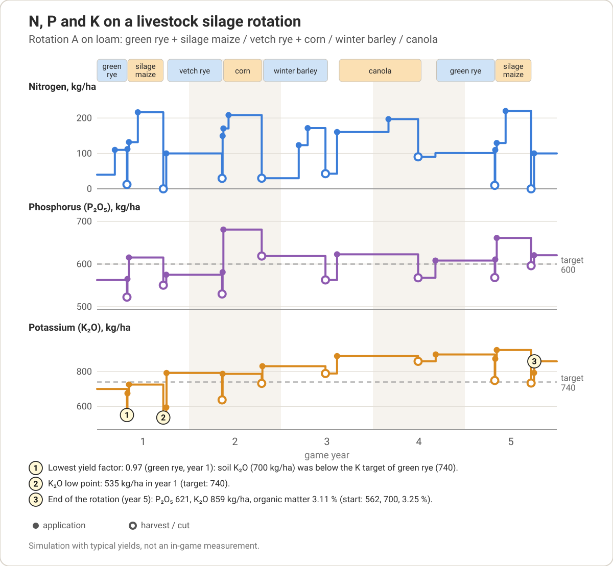

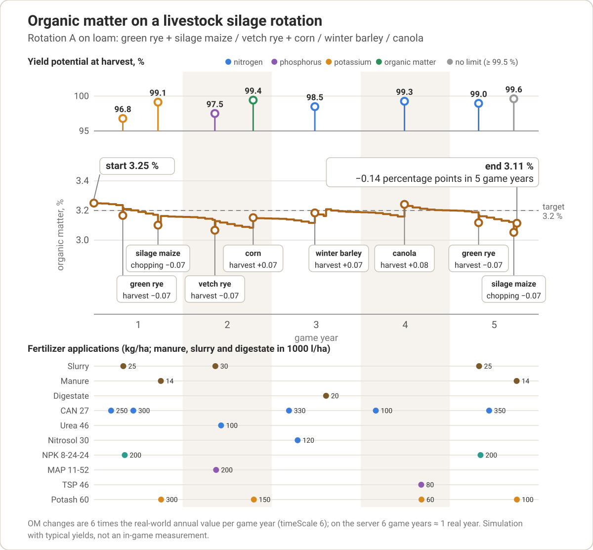

**What to note**

- Organic matter falls from 3.25 % to 3.11 % in 5 years. The silage years are the worst (−0.09 percentage points in year 1, −0.10 in year 5); corn stalks, chopped barley straw and canola only make up for part of it.
- The 14,000 l/ha of solid manure after silage maize brings +98 kg N, +24 kg P₂O₅, +59 kg K₂O and +0.067 percentage points of OM. More does not fit: the dose is sized to the nitrogen target of the vetch rye that follows (100 kg N), and an over-fertilisation of +120 kg/ha would only give a yield factor of 0.82.
- Potassium needs the most fertiliser passes: potassium chloride 60 MOP is 300 l/ha after the first silage maize, 150 after the corn, 100 in year 5. Potassium at year end stays between 792 and 899 kg/ha.
- The lowest yield factor is 0.93 in year 1 (green rye): the starting K₂O (700) is below the crop's K target (815). It is 0.97 in year 2 and 0.98–0.99 after that.

Operations and yearly balance (from the simulation)

<!-- gen:A-ops -->

| Time | Operation | ΔN | ΔP₂O₅ | ΔK₂O | ΔOM | OM decomposition | N from soil | N | P₂O₅ | K₂O | OM % | Yield factor |
|---|---|--:|--:|--:|--:|--:|--:|--:|--:|--:|--:|--:|
| Y1 Mar 10 | CAN 27 (27-0-0) 250 l/ha | +68 | · | · | · | −0.007 | +3 | 110 | 562 | 700 | 3.24 |  |
| Y1 Apr 28 | **Harvest:** green rye | −100 | −40 | −150 | −0.070 | −0.006 | +2 | 12 | 522 | 550 | 3.17 | 0.97 |
| Y1 Apr 30 | Slurry 25,000 l/ha | +100 | +42 | +125 | +0.051 | · | · | 112 | 565 | 675 | 3.22 |  |
| Y1 May 5 | NPK (8-24-24) 200 l/ha | +17 | +50 | +50 | · | −0.008 | +3 | 132 | 615 | 725 | 3.21 |  |
| Y1 Jun 10 | CAN 27 (27-0-0) 300 l/ha | +81 | · | · | · | −0.009 | +3 | 216 | 615 | 725 | 3.20 |  |
| Y1 Sep 20 | **Chopping:** silage maize | −220 | −65 | −190 | −0.070 | −0.029 | +11 | 0 | 550 | 535 | 3.10 | 0.99 |
| Y1 Oct 1 | Manure 14,000 l/ha | +98 | +24 | +59 | +0.067 | −0.006 | +2 | 100 | 575 | 594 | 3.16 |  |
| Y1 Oct 2 | Potassium chloride 60 MOP (0-0-60) 300 l/ha | · | · | +198 | · | · | · | 100 | 575 | 792 | 3.16 |  |
| Y2 May 10 | **Harvest:** vetch rye | −80 | −45 | −155 | −0.070 | −0.026 | +9 | 30 | 530 | 637 | 3.07 | 0.97 |
| Y2 May 12 | Slurry 30,000 l/ha | +120 | +51 | +150 | +0.061 | · | · | 150 | 581 | 787 | 3.13 |  |
| Y2 May 15 | MAP (11-52-0) 200 l/ha | +21 | +100 | · | · | · | · | 171 | 681 | 787 | 3.13 |  |
| Y2 Jun 5 | Urea (46-0-0) 100 l/ha | +34 | · | · | · | −0.009 | +3 | 208 | 681 | 787 | 3.12 |  |
| Y2 Oct 15 | **Harvest:** corn | −190 | −62 | −55 | +0.068 | −0.035 | +13 | 30 | 619 | 732 | 3.15 | 0.99 |
| Y2 Oct 18 | Potassium chloride 60 MOP (0-0-60) 150 l/ha | · | · | +99 | · | · | · | 30 | 619 | 831 | 3.15 |  |
| Y3 Mar 10 | CAN 27 (27-0-0) 330 l/ha | +89 | · | · | · | −0.012 | +4 | 123 | 619 | 831 | 3.14 |  |
| Y3 Apr 15 | Nitrosol UAN (30-0-0) 120 l/ha | +46 | · | · | · | −0.006 | +2 | 172 | 619 | 831 | 3.13 |  |
| Y3 Jun 25 | **Harvest:** winter barley, straw chopped | −135 | −56 | −42 | +0.067 | −0.017 | +6 | 43 | 563 | 789 | 3.18 | 0.98 |
| Y3 Aug 10 | Digestate 20,000 l/ha | +110 | +60 | +100 | +0.046 | −0.021 | +8 | 160 | 623 | 889 | 3.21 |  |
| Y4 Mar 1 | CAN 27 (27-0-0) 100 l/ha | +27 | · | · | · | −0.026 | +9 | 197 | 623 | 889 | 3.18 |  |
| Y4 Jun 28 | **Harvest:** canola | −115 | −55 | −30 | +0.082 | −0.023 | +8 | 90 | 568 | 859 | 3.24 | 0.99 |
| Y4 Sep 5 | Triple superphosphate (0-46-0) 80 l/ha | · | +40 | · | · | −0.029 | +11 | 101 | 608 | 859 | 3.21 |  |
| Y4 Sep 6 | Potassium chloride 60 MOP (0-0-60) 60 l/ha | · | · | +40 | · | · | · | 101 | 608 | 899 | 3.21 |  |
| Y5 Apr 28 | **Harvest:** green rye | −100 | −40 | −150 | −0.070 | −0.024 | +9 | 10 | 568 | 749 | 3.12 | 0.99 |
| Y5 Apr 30 | Slurry 25,000 l/ha | +100 | +42 | +125 | +0.051 | · | · | 110 | 611 | 874 | 3.17 |  |
| Y5 May 5 | NPK (8-24-24) 200 l/ha | +17 | +50 | +50 | · | −0.008 | +3 | 129 | 661 | 924 | 3.16 |  |
| Y5 Jun 10 | CAN 27 (27-0-0) 350 l/ha | +94 | · | · | · | −0.009 | +3 | 220 | 661 | 924 | 3.15 |  |
| Y5 Sep 20 | **Chopping:** silage maize | −220 | −65 | −190 | −0.070 | −0.029 | +11 | 0 | 596 | 734 | 3.05 | 1.00 |
| Y5 Oct 1 | Manure 14,000 l/ha | +98 | +24 | +59 | +0.067 | −0.006 | +2 | 100 | 621 | 793 | 3.11 |  |
| Y5 Oct 2 | Potassium chloride 60 MOP (0-0-60) 100 l/ha | · | · | +66 | · | · | · | 100 | 621 | 859 | 3.11 |  |

<!-- /gen:A-ops -->

Yearly balance (kg/ha, OM percentage points):

<!-- gen:A-sum -->

| Year | N in | of which from soil | N out | P₂O₅ in | P₂O₅ out | K₂O in | K₂O out | OM net | of which decomposition | N at year end | P₂O₅ | K₂O | OM % | Worst yield factor |
|--:|--:|--:|--:|--:|--:|--:|--:|--:|--:|--:|--:|--:|--:|--:|
| 1 | 387 | 24 | 320 | 117 | 105 | 432 | 340 | −0.087 | −0.065 | 100 | 575 | 792 | 3.16 | 0.97 |
| 2 | 201 | 26 | 270 | 151 | 107 | 249 | 210 | −0.011 | −0.070 | 30 | 619 | 831 | 3.15 | 0.97 |
| 3 | 265 | 20 | 135 | 60 | 56 | 100 | 42 | +0.057 | −0.056 | 160 | 623 | 889 | 3.21 | 0.98 |
| 4 | 56 | 29 | 115 | 40 | 55 | 40 | 30 | +0.003 | −0.078 | 101 | 608 | 899 | 3.21 | 0.99 |
| 5 | 337 | 28 | 320 | 117 | 105 | 300 | 340 | −0.098 | −0.076 | 100 | 621 | 859 | 3.11 | 0.99 |

<!-- /gen:A-sum -->

### B. Arable farm without livestock

An arable farm with no animals: there is no organic manure and the straw is sold (baled). The combine chops the corn and sunflower stalks, so Precision Farming gives back +25 kg nitrogen. Every nutrient comes from fertiliser.

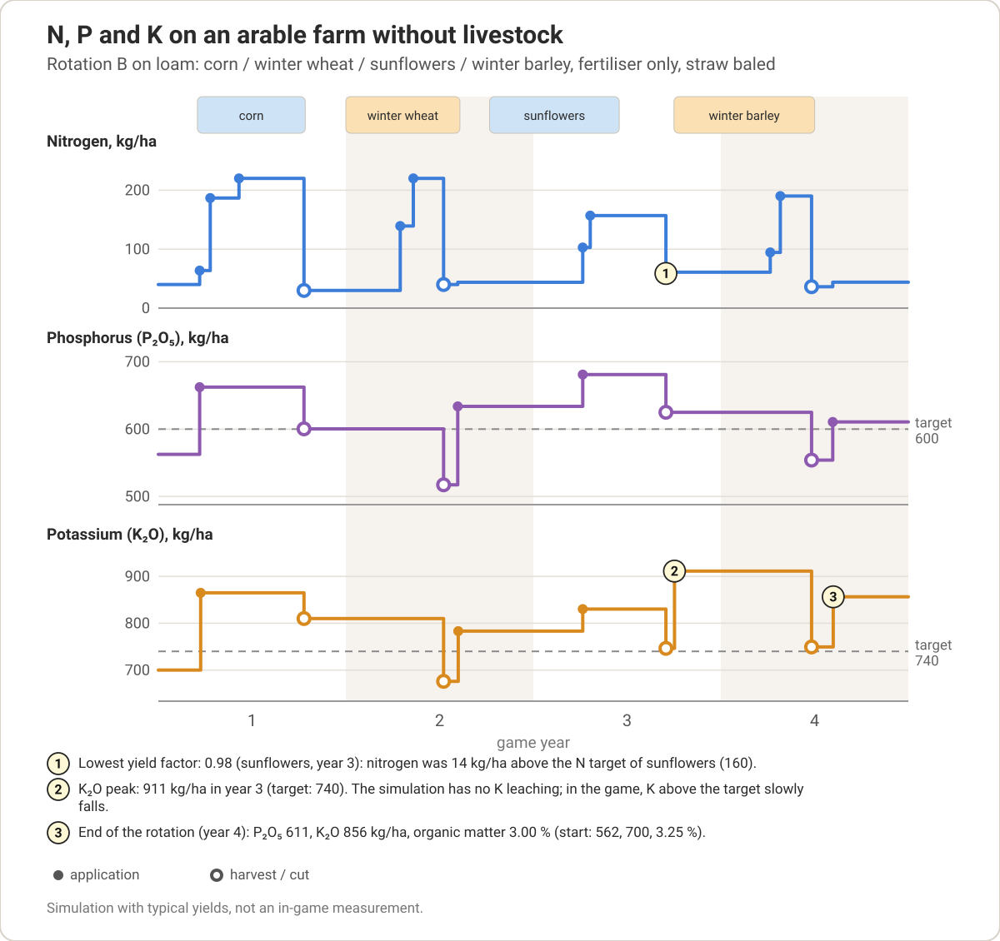

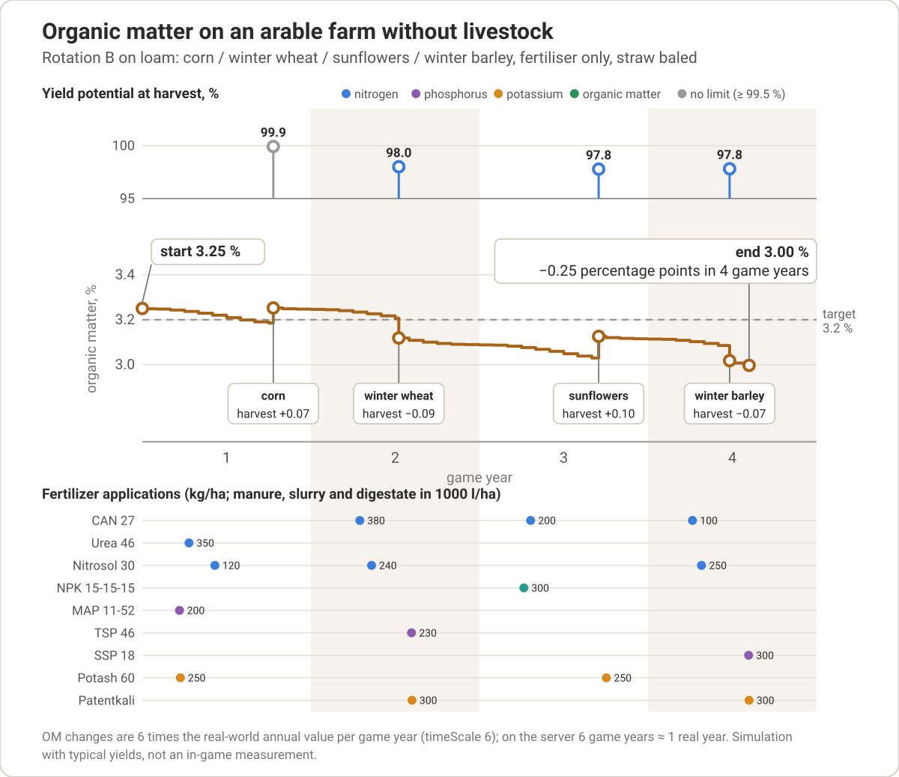

**What to note**

- Baled straw is expensive: together with the straw, wheat and barley take 134 and 162 kg K₂O in their years (only 44 and 42 with chopped straw).
- With fertiliser you can keep the levels above the targets: at year end phosphorus is 600–634 and potassium 783–911 kg/ha, and the worst yield factor is 0.98–1.00.
- Organic matter falls from 3.25 % to 3.15 % in 4 years, because the straw of both cereals is baled. Corn and sunflower stalks only cover part of it: the sunflower year is +0.012 percentage points net.
- One pass carries at most about 125 kg nitrogen, so the nitrogen for wheat and barley is split over two products (year 2: 380 l/ha CAN 27 + 240 l/ha Nitrosol UAN; year 4: 100 l/ha CAN 27 + 250 l/ha Nitrosol UAN). CAN 27 is calcium ammonium nitrate (27-0-0), called Pétisó 27 in the Hungarian game.

Operations and yearly balance (from the simulation)

<!-- gen:B-ops -->

| Time | Operation | ΔN | ΔP₂O₅ | ΔK₂O | ΔOM | OM decomposition | N from soil | N | P₂O₅ | K₂O | OM % | Yield factor |
|---|---|--:|--:|--:|--:|--:|--:|--:|--:|--:|--:|--:|
| Y1 Mar 20 | MAP (11-52-0) 200 l/ha | +21 | +100 | · | · | −0.007 | +3 | 64 | 662 | 700 | 3.24 |  |
| Y1 Mar 22 | Potassium chloride 60 MOP (0-0-60) 250 l/ha | · | · | +165 | · | · | · | 64 | 662 | 865 | 3.24 |  |
| Y1 Apr 10 | Urea (46-0-0) 350 l/ha | +121 | · | · | · | −0.006 | +2 | 187 | 662 | 865 | 3.24 |  |
| Y1 Jun 5 | Nitrosol UAN (30-0-0) 120 l/ha | +46 | · | · | · | −0.017 | +6 | 220 | 662 | 865 | 3.22 |  |
| Y1 Oct 10 | **Harvest:** corn | −190 | −62 | −55 | +0.068 | −0.035 | +13 | 30 | 600 | 810 | 3.25 | 1.00 |
| Y2 Apr 15 | CAN 27 (27-0-0) 380 l/ha | +103 | · | · | · | −0.018 | +7 | 139 | 600 | 810 | 3.23 |  |
| Y2 May 10 | Nitrosol UAN (30-0-0) 240 l/ha | +92 | · | · | · | −0.008 | +3 | 220 | 600 | 810 | 3.23 |  |
| Y2 Jul 8 | **Harvest:** winter wheat, straw baled | −180 | −83 | −134 | −0.088 | −0.020 | +7 | 40 | 517 | 676 | 3.12 | 0.98 |
| Y2 Aug 5 | Triple superphosphate (0-46-0) 230 l/ha | · | +116 | · | · | −0.011 | +4 | 44 | 634 | 676 | 3.11 |  |
| Y2 Aug 6 | Patentkali (0-0-30) 300 l/ha | · | · | +107 | · | · | · | 44 | 634 | 783 | 3.11 |  |
| Y3 Apr 5 | NPK (15-15-15) 300 l/ha | +47 | +47 | +47 | · | −0.032 | +12 | 103 | 681 | 830 | 3.08 |  |
| Y3 Apr 20 | CAN 27 (27-0-0) 200 l/ha | +54 | · | · | · | · | · | 157 | 681 | 830 | 3.08 |  |
| Y3 Sep 15 | **Harvest:** sunflowers | −115 | −56 | −84 | +0.096 | −0.046 | +17 | 59 | 625 | 746 | 3.13 | 0.98 |
| Y3 Oct 1 | Potassium chloride 60 MOP (0-0-60) 250 l/ha | · | · | +165 | · | −0.006 | +2 | 61 | 625 | 911 | 3.12 |  |
| Y4 Apr 5 | CAN 27 (27-0-0) 100 l/ha | +27 | · | · | · | −0.018 | +7 | 94 | 625 | 911 | 3.10 |  |
| Y4 Apr 25 | Nitrosol UAN (30-0-0) 250 l/ha | +96 | · | · | · | · | · | 190 | 625 | 911 | 3.10 |  |
| Y4 Jun 25 | **Harvest:** winter barley, straw baled | −160 | −71 | −162 | −0.067 | −0.017 | +6 | 36 | 554 | 749 | 3.02 | 0.98 |
| Y4 Aug 5 | Single superphosphate (0-18-0) 300 l/ha | · | +57 | · | · | −0.021 | +8 | 44 | 611 | 749 | 3.00 |  |
| Y4 Aug 6 | Patentkali (0-0-30) 300 l/ha | · | · | +107 | · | · | · | 44 | 611 | 856 | 3.00 |  |

<!-- /gen:B-ops -->

Yearly balance (kg/ha, OM percentage points):

<!-- gen:B-sum -->

| Year | N in | of which from soil | N out | P₂O₅ in | P₂O₅ out | K₂O in | K₂O out | OM net | of which decomposition | N at year end | P₂O₅ | K₂O | OM % | Worst yield factor |
|--:|--:|--:|--:|--:|--:|--:|--:|--:|--:|--:|--:|--:|--:|--:|
| 1 | 212 | 24 | 190 | 100 | 62 | 165 | 55 | +0.002 | −0.065 | 30 | 600 | 810 | 3.25 | 1.00 |
| 2 | 215 | 20 | 180 | 116 | 83 | 107 | 134 | −0.144 | −0.056 | 44 | 634 | 783 | 3.11 | 0.98 |
| 3 | 132 | 31 | 115 | 47 | 56 | 212 | 84 | +0.012 | −0.084 | 61 | 625 | 911 | 3.12 | 0.98 |
| 4 | 143 | 20 | 160 | 57 | 71 | 107 | 162 | −0.123 | −0.056 | 44 | 611 | 856 | 3.00 | 0.98 |

<!-- /gen:B-sum -->

### C. Dairy farm

A manure-rich dairy farm: after the silage maize, 25,000 l/ha of manure and 10,000 l/ha of slurry go on (sized to the winter wheat's nitrogen target), and the cereal straw is baled for bedding. The summer protein crop, faba beans, leaves nitrogen behind. The silage maize's nitrogen cannot go on in one pass, so in summer of year 1 two products go on: 400 l/ha CAN 27 and 210 l/ha Nitrosol UAN.

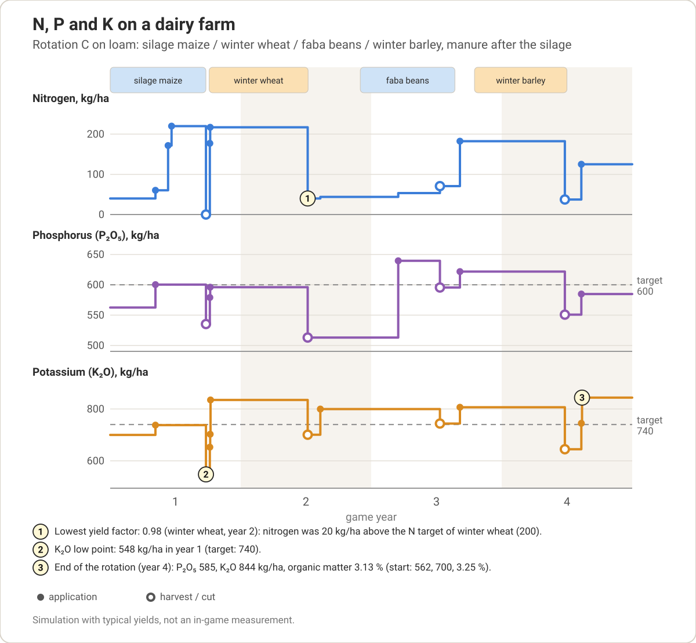

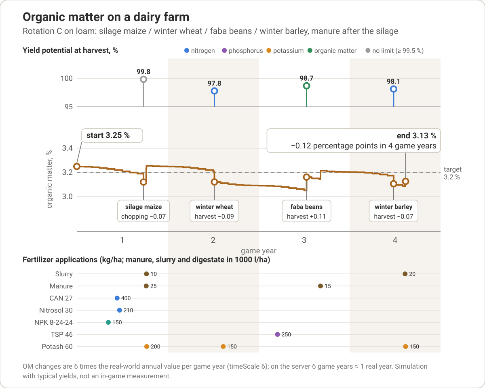

**What to note**

- The manure and slurry after the silage maize are 215 kg N together, sized to the wheat target (200), but the nitrogen map's cap of 220 limits it: the wheat starts at 220 kg N at harvest (+20, yield factor 0.98) and needs no spring CAN 27.
- Faba beans add +0.110 percentage points of OM, take only 20 kg N, and the chopped straw gives back +25 kg nitrogen (net +5), so 15,000 l/ha of solid manure is enough for the barley afterwards.
- Organic matter goes from 3.25 % to 3.28 % in 4 years: manure and faba beans offset the baled straw and the silage maize. Year 3 is +0.103 percentage points net.
- The manure returns most of the phosphorus and potassium, and fertiliser only tops up (triple superphosphate in spring of year 3, potassium chloride 60 MOP in years 1, 2 and 4). The worst yield factor is 0.95 in year 1 (silage maize, K₂O 738 below the crop target of 835), and 0.98–0.99 after that.

Operations and yearly balance (from the simulation)

<!-- gen:C-ops -->

| Time | Operation | ΔN | ΔP₂O₅ | ΔK₂O | ΔOM | OM decomposition | N from soil | N | P₂O₅ | K₂O | OM % | Yield factor |
|---|---|--:|--:|--:|--:|--:|--:|--:|--:|--:|--:|--:|
| Y1 May 5 | NPK (8-24-24) 150 l/ha | +13 | +38 | +38 | · | −0.021 | +8 | 60 | 600 | 738 | 3.23 |  |
| Y1 Jun 10 | CAN 27 (27-0-0) 400 l/ha | +108 | · | · | · | −0.009 | +3 | 172 | 600 | 738 | 3.22 |  |
| Y1 Jun 20 | Nitrosol UAN (30-0-0) 210 l/ha | +80 | · | · | · | · | · | 220 | 600 | 738 | 3.22 |  |
| Y1 Sep 25 | **Chopping:** silage maize | −220 | −65 | −190 | −0.070 | −0.029 | +11 | 0 | 535 | 548 | 3.12 | 1.00 |
| Y1 Oct 5 | Manure 25,000 l/ha | +175 | +44 | +105 | +0.120 | −0.006 | +2 | 177 | 579 | 653 | 3.23 |  |
| Y1 Oct 6 | Slurry 10,000 l/ha | +40 | +17 | +50 | +0.020 | · | · | 217 | 596 | 703 | 3.26 |  |
| Y1 Oct 7 | Potassium chloride 60 MOP (0-0-60) 200 l/ha | · | · | +132 | · | · | · | 217 | 596 | 835 | 3.26 |  |
| Y2 Jul 5 | **Harvest:** winter wheat, straw baled | −180 | −83 | −134 | −0.088 | −0.046 | +17 | 40 | 513 | 701 | 3.12 | 0.98 |
| Y2 Aug 10 | Potassium chloride 60 MOP (0-0-60) 150 l/ha | · | · | +99 | · | −0.011 | +4 | 44 | 513 | 800 | 3.11 |  |
| Y3 Mar 15 | Triple superphosphate (0-46-0) 250 l/ha | · | +126 | · | · | −0.026 | +9 | 53 | 640 | 800 | 3.09 |  |
| Y3 Jul 10 | **Harvest:** faba beans | +5 | −44 | −56 | +0.110 | −0.034 | +12 | 71 | 596 | 744 | 3.16 | 0.99 |
| Y3 Sep 5 | Manure 15,000 l/ha | +105 | +26 | +63 | +0.072 | −0.019 | +7 | 183 | 622 | 807 | 3.21 |  |
| Y4 Jun 25 | **Harvest:** winter barley, straw baled | −160 | −71 | −162 | −0.067 | −0.041 | +15 | 37 | 551 | 645 | 3.11 | 0.98 |
| Y4 Aug 10 | Slurry 20,000 l/ha | +80 | +34 | +100 | +0.041 | −0.021 | +8 | 125 | 585 | 745 | 3.13 |  |
| Y4 Aug 12 | Potassium chloride 60 MOP (0-0-60) 150 l/ha | · | · | +99 | · | · | · | 125 | 585 | 844 | 3.13 |  |

<!-- /gen:C-ops -->

Yearly balance (kg/ha, OM percentage points):

<!-- gen:C-sum -->

| Year | N in | of which from soil | N out | P₂O₅ in | P₂O₅ out | K₂O in | K₂O out | OM net | of which decomposition | N at year end | P₂O₅ | K₂O | OM % | Worst yield factor |
|--:|--:|--:|--:|--:|--:|--:|--:|--:|--:|--:|--:|--:|--:|--:|
| 1 | 440 | 24 | 220 | 99 | 65 | 325 | 190 | +0.005 | −0.065 | 217 | 596 | 835 | 3.26 | 1.00 |
| 2 | 20 | 20 | 180 | 0 | 83 | 99 | 134 | −0.144 | −0.056 | 44 | 513 | 800 | 3.11 | 0.98 |
| 3 | 134 | 29 | −5 | 153 | 44 | 63 | 56 | +0.103 | −0.078 | 183 | 622 | 807 | 3.21 | 0.99 |
| 4 | 103 | 23 | 160 | 34 | 71 | 199 | 162 | −0.088 | −0.062 | 125 | 585 | 844 | 3.13 | 0.98 |

<!-- /gen:C-sum -->

### D. Dairy farm, silage rotation

A dairy farm with a lot of silage: green rye + silage maize, vetch rye + silage maize, whole-crop barley (forage harvested). The cycle runs twice, which is **6 game years, about 1 real year** on the server. Manure from the farm is unlimited, but because of nitrogen the dose is sized to the nitrogen target of the next crop. There is no catch crop and no alfalfa break. The straw of the whole-crop barley leaves the field too, so there is no straw credit and no manure after it.

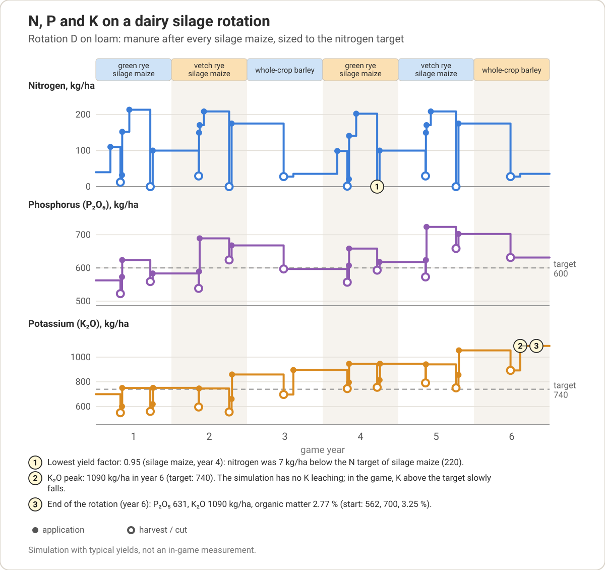

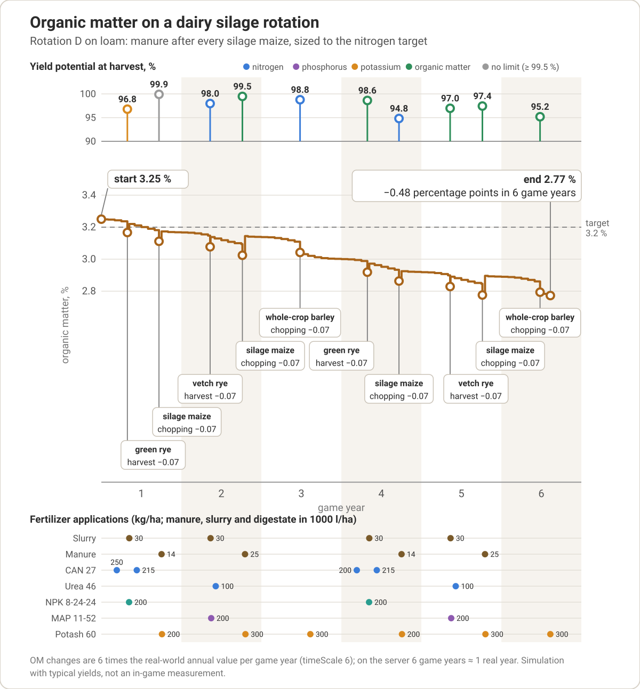

**What to note**

- Organic matter falls from 3.25 % to 2.84 % in 6 game years (−0.41 percentage points, low point 2.81). The silage years balance between −0.03 and −0.10, the whole-crop barley year (no manure, no straw) at −0.09.
- Nitrogen will not let you spread more manure: an over-fertilisation of +120 kg N would give a yield factor of 0.82, so about 100 kg N before the vetch rye and about 175 kg N before the barley is the most that fits. In spring only slurry may go on (the VirtualTSZ house rule), and it gives less OM: 30,000 l/ha of slurry is +0.061 percentage points.
- The lowest yield factor is 0.93 in year 1 (green rye, K₂O 700 below the crop target of 815). In years 1–2 the silage maize and vetch rye are also at 0.95–0.96, again with K₂O below the target.
- Potassium rises from 751 to 1090 kg/ha at year end. That is an upper estimate without leaching: in the game, potassium above the soil target (740) slowly falls.
- The weakest points are the whole-crop barley year and year 4 (−0.10). That is where you need organic matter that does not need nitrogen, and that is what the alfalfa break in rotation E is for.

Operations and yearly balance (from the simulation)

<!-- gen:D-ops -->

| Time | Operation | ΔN | ΔP₂O₅ | ΔK₂O | ΔOM | OM decomposition | N from soil | N | P₂O₅ | K₂O | OM % | Yield factor |
|---|---|--:|--:|--:|--:|--:|--:|--:|--:|--:|--:|--:|
| Y1 Mar 10 | CAN 27 (27-0-0) 250 l/ha | +68 | · | · | · | −0.007 | +3 | 110 | 562 | 700 | 3.24 |  |
| Y1 Apr 28 | **Harvest:** green rye | −100 | −40 | −150 | −0.070 | −0.006 | +2 | 12 | 522 | 550 | 3.17 | 0.97 |
| Y1 May 5 | NPK (8-24-24) 200 l/ha | +17 | +50 | +50 | · | −0.008 | +3 | 32 | 573 | 600 | 3.16 |  |
| Y1 May 6 | Slurry 30,000 l/ha | +120 | +51 | +150 | +0.061 | · | · | 152 | 624 | 750 | 3.22 |  |
| Y1 Jun 10 | CAN 27 (27-0-0) 215 l/ha | +58 | · | · | · | −0.009 | +3 | 213 | 624 | 750 | 3.21 |  |
| Y1 Sep 20 | **Chopping:** silage maize | −220 | −65 | −190 | −0.070 | −0.029 | +11 | 0 | 559 | 560 | 3.11 | 1.00 |
| Y1 Oct 1 | Manure 14,000 l/ha | +98 | +24 | +59 | +0.067 | −0.006 | +2 | 100 | 583 | 619 | 3.17 |  |
| Y1 Oct 3 | Potassium chloride 60 MOP (0-0-60) 200 l/ha | · | · | +132 | · | · | · | 100 | 583 | 751 | 3.17 |  |
| Y2 May 10 | **Harvest:** vetch rye | −80 | −45 | −155 | −0.070 | −0.026 | +9 | 30 | 538 | 596 | 3.08 | 0.98 |
| Y2 May 12 | Slurry 30,000 l/ha | +120 | +51 | +150 | +0.061 | · | · | 150 | 589 | 746 | 3.14 |  |
| Y2 May 15 | MAP (11-52-0) 200 l/ha | +21 | +100 | · | · | · | · | 171 | 689 | 746 | 3.14 |  |
| Y2 Jun 5 | Urea (46-0-0) 100 l/ha | +34 | · | · | · | −0.009 | +3 | 208 | 689 | 746 | 3.13 |  |
| Y2 Oct 5 | **Chopping:** silage maize | −220 | −65 | −190 | −0.070 | −0.035 | +13 | 0 | 624 | 556 | 3.02 | 0.99 |
| Y2 Oct 17 | Manure 25,000 l/ha | +175 | +44 | +105 | +0.120 | · | · | 175 | 668 | 661 | 3.14 |  |
| Y2 Oct 19 | Potassium chloride 60 MOP (0-0-60) 300 l/ha | · | · | +198 | · | · | · | 175 | 668 | 859 | 3.14 |  |
| Y3 Jun 25 | **Harvest:** winter barley, whole crop (forage harvesting / mowing) | −160 | −71 | −162 | −0.067 | −0.035 | +13 | 28 | 597 | 697 | 3.04 | 0.99 |
| Y3 Aug 11 | Potassium chloride 60 MOP (0-0-60) 300 l/ha | · | · | +198 | · | −0.021 | +8 | 35 | 597 | 895 | 3.02 |  |
| Y4 Mar 10 | CAN 27 (27-0-0) 200 l/ha | +54 | · | · | · | −0.026 | +9 | 99 | 597 | 895 | 2.99 |  |
| Y4 Apr 28 | **Harvest:** green rye | −100 | −40 | −150 | −0.070 | −0.006 | +2 | 1 | 557 | 745 | 2.92 | 0.99 |
| Y4 May 5 | NPK (8-24-24) 200 l/ha | +17 | +50 | +50 | · | −0.008 | +3 | 21 | 607 | 796 | 2.91 |  |
| Y4 May 6 | Slurry 30,000 l/ha | +120 | +51 | +150 | +0.061 | · | · | 141 | 658 | 946 | 2.97 |  |
| Y4 Jun 10 | CAN 27 (27-0-0) 215 l/ha | +58 | · | · | · | −0.009 | +3 | 202 | 658 | 946 | 2.96 |  |
| Y4 Sep 20 | **Chopping:** silage maize | −213 | −65 | −190 | −0.070 | −0.029 | +11 | 0 | 593 | 756 | 2.86 | 0.95 |
| Y4 Oct 1 | Manure 14,000 l/ha | +98 | +24 | +59 | +0.067 | −0.006 | +2 | 100 | 618 | 814 | 2.93 |  |
| Y4 Oct 3 | Potassium chloride 60 MOP (0-0-60) 200 l/ha | · | · | +132 | · | · | · | 100 | 618 | 946 | 2.93 |  |
| Y5 May 10 | **Harvest:** vetch rye | −80 | −45 | −155 | −0.070 | −0.026 | +9 | 30 | 573 | 791 | 2.83 | 0.97 |
| Y5 May 12 | Slurry 30,000 l/ha | +120 | +51 | +150 | +0.061 | · | · | 150 | 624 | 941 | 2.89 |  |
| Y5 May 15 | MAP (11-52-0) 200 l/ha | +21 | +100 | · | · | · | · | 171 | 724 | 941 | 2.89 |  |
| Y5 Jun 5 | Urea (46-0-0) 100 l/ha | +34 | · | · | · | −0.009 | +3 | 208 | 724 | 941 | 2.88 |  |
| Y5 Oct 5 | **Chopping:** silage maize | −220 | −65 | −190 | −0.070 | −0.035 | +13 | 0 | 659 | 751 | 2.78 | 0.97 |
| Y5 Oct 17 | Manure 25,000 l/ha | +175 | +44 | +105 | +0.120 | · | · | 175 | 702 | 856 | 2.90 |  |
| Y5 Oct 19 | Potassium chloride 60 MOP (0-0-60) 300 l/ha | · | · | +198 | · | · | · | 175 | 702 | 1054 | 2.90 |  |
| Y6 Jun 25 | **Harvest:** winter barley, whole crop (forage harvesting / mowing) | −160 | −71 | −162 | −0.067 | −0.035 | +13 | 28 | 631 | 892 | 2.79 | 0.95 |
| Y6 Aug 11 | Potassium chloride 60 MOP (0-0-60) 300 l/ha | · | · | +198 | · | −0.021 | +8 | 35 | 631 | 1090 | 2.77 |  |

<!-- /gen:D-ops -->

Yearly balance (kg/ha, OM percentage points):

<!-- gen:D-sum -->

| Year | N in | of which from soil | N out | P₂O₅ in | P₂O₅ out | K₂O in | K₂O out | OM net | of which decomposition | N at year end | P₂O₅ | K₂O | OM % | Worst yield factor |
|--:|--:|--:|--:|--:|--:|--:|--:|--:|--:|--:|--:|--:|--:|--:|
| 1 | 384 | 24 | 320 | 126 | 105 | 391 | 340 | −0.077 | −0.065 | 100 | 583 | 751 | 3.17 | 0.97 |
| 2 | 376 | 26 | 300 | 195 | 110 | 453 | 345 | −0.029 | −0.070 | 175 | 668 | 859 | 3.14 | 0.98 |
| 3 | 20 | 20 | 160 | 0 | 71 | 198 | 162 | −0.123 | −0.056 | 35 | 597 | 895 | 3.02 | 0.99 |
| 4 | 378 | 31 | 313 | 126 | 105 | 391 | 340 | −0.096 | −0.084 | 100 | 618 | 946 | 2.93 | 0.95 |
| 5 | 376 | 26 | 300 | 195 | 110 | 453 | 345 | −0.029 | −0.070 | 175 | 702 | 1054 | 2.90 | 0.97 |
| 6 | 20 | 20 | 160 | 0 | 71 | 198 | 162 | −0.123 | −0.056 | 35 | 631 | 1090 | 2.77 | 0.95 |

<!-- /gen:D-sum -->

### E. Dairy farm with an alfalfa break

The same crops and nitrogen doses as rotation D (potassium chloride 60 MOP after silage maize is 200 l/ha), but year 4 is alfalfa with 3 cuts on assumed cut dates (April 25, July 10, October 10). Precision Farming also gives alfalfa a nitrogen target (60 kg N, 60 kg removal per cut) but does not model nitrogen fixation. So the field gets 5,000 l/ha of slurry in spring, then 13,000, 13,000 and 22,000 l/ha after the cuts (the last one sized to the nitrogen target of the next green rye), and 300 l/ha of potassium chloride 60 MOP in spring. The cycle is 4 years, the example runs 8.

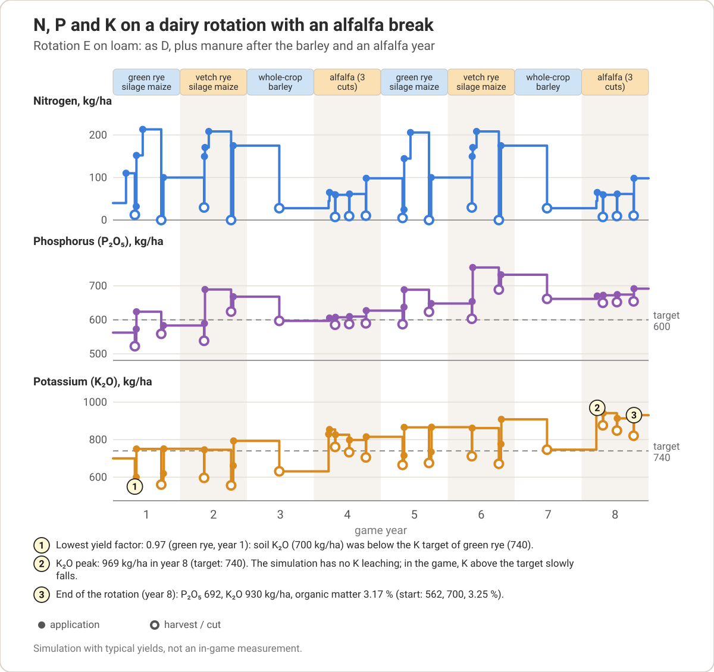

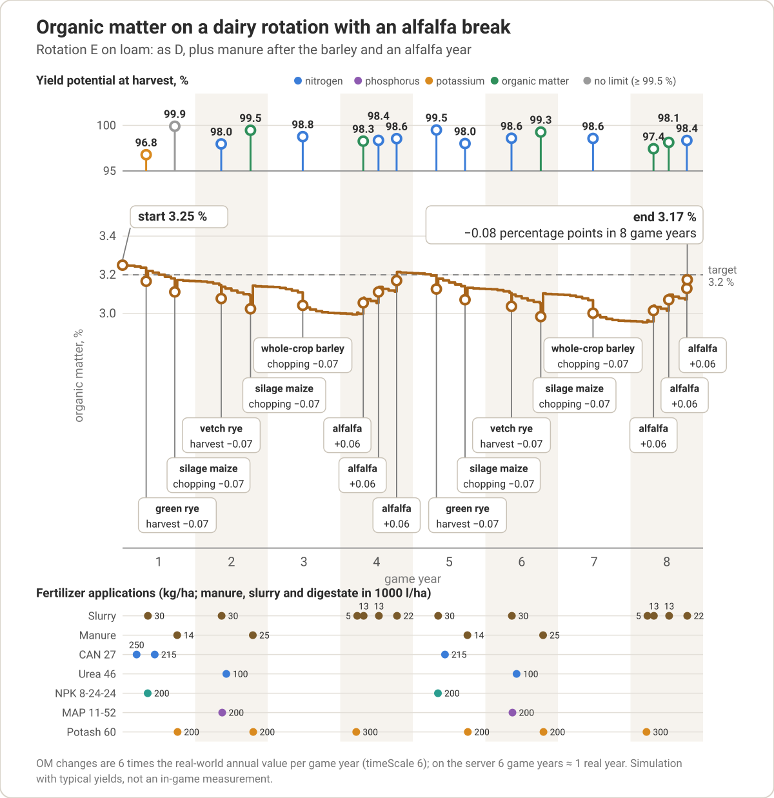

**What to note**

- Organic matter stays about level: 3.25 % to 3.24 % in 8 years (between 3.02 and 3.25). Rotation D is at 2.84 % in year 6, rotation E at 3.14 %.
- The alfalfa year gives +0.17 percentage points net: three cuts × +0.057, the slurry together +0.11, minus about −0.10 decomposition. That roughly offsets the barley year (−0.07) and the missing silage year.
- Nitrogen on alfalfa: without the slurry after the cuts, nitrogen would fall to 17 and 9 kg at the 2nd and 3rd cut (yield factor 0.80 and 0.75). With the slurry there are 67–70 kg N at the cut, and the yield factor is 0.99.
- Alfalfa takes 279 kg K₂O a year (3 × 93) and the slurry returns 265. Potassium drops to 631 kg/ha in year 3 after the barley year (below the soil target of 740) and to 746 in year 7. The model does not count the alfalfa's nitrogen fixation.

Operations and yearly balance (from the simulation)

<!-- gen:E-ops -->

| Time | Operation | ΔN | ΔP₂O₅ | ΔK₂O | ΔOM | OM decomposition | N from soil | N | P₂O₅ | K₂O | OM % | Yield factor |
|---|---|--:|--:|--:|--:|--:|--:|--:|--:|--:|--:|--:|
| Y1 Mar 10 | CAN 27 (27-0-0) 250 l/ha | +68 | · | · | · | −0.007 | +3 | 110 | 562 | 700 | 3.24 |  |
| Y1 Apr 28 | **Harvest:** green rye | −100 | −40 | −150 | −0.070 | −0.006 | +2 | 12 | 522 | 550 | 3.17 | 0.97 |
| Y1 May 5 | NPK (8-24-24) 200 l/ha | +17 | +50 | +50 | · | −0.008 | +3 | 32 | 573 | 600 | 3.16 |  |
| Y1 May 6 | Slurry 30,000 l/ha | +120 | +51 | +150 | +0.061 | · | · | 152 | 624 | 750 | 3.22 |  |
| Y1 Jun 10 | CAN 27 (27-0-0) 215 l/ha | +58 | · | · | · | −0.009 | +3 | 213 | 624 | 750 | 3.21 |  |
| Y1 Sep 20 | **Chopping:** silage maize | −220 | −65 | −190 | −0.070 | −0.029 | +11 | 0 | 559 | 560 | 3.11 | 1.00 |
| Y1 Oct 1 | Manure 14,000 l/ha | +98 | +24 | +59 | +0.067 | −0.006 | +2 | 100 | 583 | 619 | 3.17 |  |
| Y1 Oct 3 | Potassium chloride 60 MOP (0-0-60) 200 l/ha | · | · | +132 | · | · | · | 100 | 583 | 751 | 3.17 |  |
| Y2 May 10 | **Harvest:** vetch rye | −80 | −45 | −155 | −0.070 | −0.026 | +9 | 30 | 538 | 596 | 3.08 | 0.98 |
| Y2 May 12 | Slurry 30,000 l/ha | +120 | +51 | +150 | +0.061 | · | · | 150 | 589 | 746 | 3.14 |  |
| Y2 May 15 | MAP (11-52-0) 200 l/ha | +21 | +100 | · | · | · | · | 171 | 689 | 746 | 3.14 |  |
| Y2 Jun 5 | Urea (46-0-0) 100 l/ha | +34 | · | · | · | −0.009 | +3 | 208 | 689 | 746 | 3.13 |  |
| Y2 Oct 5 | **Chopping:** silage maize | −220 | −65 | −190 | −0.070 | −0.035 | +13 | 0 | 624 | 556 | 3.02 | 0.99 |
| Y2 Oct 17 | Manure 25,000 l/ha | +175 | +44 | +105 | +0.120 | · | · | 175 | 668 | 661 | 3.14 |  |
| Y2 Oct 19 | Potassium chloride 60 MOP (0-0-60) 200 l/ha | · | · | +132 | · | · | · | 175 | 668 | 793 | 3.14 |  |
| Y3 Jun 25 | **Harvest:** winter barley, whole crop (forage harvesting / mowing) | −160 | −71 | −162 | −0.067 | −0.035 | +13 | 28 | 597 | 631 | 3.04 | 0.99 |
| Y4 Mar 20 | Potassium chloride 60 MOP (0-0-60) 300 l/ha | · | · | +198 | · | −0.047 | +17 | 45 | 597 | 829 | 2.99 |  |
| Y4 Mar 25 | Slurry 5,000 l/ha | +20 | +8 | +25 | +0.010 | · | · | 65 | 605 | 854 | 3.01 |  |
| Y4 Apr 25 | **Cut:** alfalfa | −60 | −20 | −93 | +0.057 | −0.006 | +2 | 7 | 585 | 761 | 3.06 | 0.98 |
| Y4 Apr 27 | Slurry 13,000 l/ha | +52 | +22 | +65 | +0.027 | · | · | 59 | 608 | 826 | 3.08 |  |
| Y4 Jul 10 | **Cut:** alfalfa | −60 | −20 | −93 | +0.057 | −0.027 | +10 | 9 | 588 | 733 | 3.11 | 0.98 |
| Y4 Jul 12 | Slurry 13,000 l/ha | +52 | +22 | +65 | +0.027 | · | · | 61 | 610 | 798 | 3.14 |  |
| Y4 Oct 10 | **Cut:** alfalfa | −60 | −20 | −93 | +0.057 | −0.025 | +9 | 10 | 590 | 705 | 3.17 | 0.99 |
| Y4 Oct 12 | Slurry 22,000 l/ha | +88 | +37 | +110 | +0.045 | · | · | 98 | 627 | 815 | 3.21 |  |
| Y5 Apr 28 | **Harvest:** green rye | −100 | −40 | −150 | −0.070 | −0.018 | +7 | 5 | 587 | 665 | 3.13 | 0.99 |
| Y5 May 5 | NPK (8-24-24) 200 l/ha | +17 | +50 | +50 | · | −0.008 | +3 | 24 | 637 | 716 | 3.12 |  |
| Y5 May 6 | Slurry 30,000 l/ha | +120 | +51 | +150 | +0.061 | · | · | 144 | 688 | 866 | 3.18 |  |
| Y5 Jun 10 | CAN 27 (27-0-0) 215 l/ha | +58 | · | · | · | −0.009 | +3 | 206 | 688 | 866 | 3.17 |  |
| Y5 Sep 20 | **Chopping:** silage maize | −217 | −65 | −190 | −0.070 | −0.029 | +11 | 0 | 623 | 676 | 3.07 | 0.98 |
| Y5 Oct 1 | Manure 14,000 l/ha | +98 | +24 | +59 | +0.067 | −0.006 | +2 | 100 | 648 | 734 | 3.13 |  |
| Y5 Oct 3 | Potassium chloride 60 MOP (0-0-60) 200 l/ha | · | · | +132 | · | · | · | 100 | 648 | 866 | 3.13 |  |
| Y6 May 10 | **Harvest:** vetch rye | −80 | −45 | −155 | −0.070 | −0.026 | +9 | 30 | 603 | 711 | 3.04 | 0.99 |
| Y6 May 12 | Slurry 30,000 l/ha | +120 | +51 | +150 | +0.061 | · | · | 150 | 654 | 861 | 3.10 |  |
| Y6 May 15 | MAP (11-52-0) 200 l/ha | +21 | +100 | · | · | · | · | 171 | 754 | 861 | 3.10 |  |
| Y6 Jun 5 | Urea (46-0-0) 100 l/ha | +34 | · | · | · | −0.009 | +3 | 208 | 754 | 861 | 3.09 |  |
| Y6 Oct 5 | **Chopping:** silage maize | −220 | −65 | −190 | −0.070 | −0.035 | +13 | 0 | 689 | 671 | 2.98 | 0.99 |
| Y6 Oct 17 | Manure 25,000 l/ha | +175 | +44 | +105 | +0.120 | · | · | 175 | 733 | 776 | 3.10 |  |
| Y6 Oct 19 | Potassium chloride 60 MOP (0-0-60) 200 l/ha | · | · | +132 | · | · | · | 175 | 733 | 908 | 3.10 |  |
| Y7 Jun 25 | **Harvest:** winter barley, whole crop (forage harvesting / mowing) | −160 | −71 | −162 | −0.067 | −0.035 | +13 | 28 | 662 | 746 | 3.00 | 0.99 |
| Y8 Mar 20 | Potassium chloride 60 MOP (0-0-60) 300 l/ha | · | · | +198 | · | −0.047 | +17 | 45 | 662 | 944 | 2.95 |  |
| Y8 Mar 25 | Slurry 5,000 l/ha | +20 | +8 | +25 | +0.010 | · | · | 65 | 670 | 969 | 2.96 |  |
| Y8 Apr 25 | **Cut:** alfalfa | −60 | −20 | −93 | +0.057 | −0.006 | +2 | 7 | 650 | 876 | 3.02 | 0.97 |
| Y8 Apr 27 | Slurry 13,000 l/ha | +52 | +22 | +65 | +0.027 | · | · | 59 | 672 | 941 | 3.04 |  |
| Y8 Jul 10 | **Cut:** alfalfa | −60 | −20 | −93 | +0.057 | −0.027 | +10 | 9 | 652 | 848 | 3.07 | 0.98 |
| Y8 Jul 12 | Slurry 13,000 l/ha | +52 | +22 | +65 | +0.027 | · | · | 61 | 674 | 913 | 3.10 |  |
| Y8 Oct 10 | **Cut:** alfalfa | −60 | −20 | −93 | +0.057 | −0.025 | +9 | 10 | 654 | 820 | 3.13 | 0.98 |
| Y8 Oct 12 | Slurry 22,000 l/ha | +88 | +37 | +110 | +0.045 | · | · | 98 | 692 | 930 | 3.17 |  |

<!-- /gen:E-ops -->

Yearly balance (kg/ha, OM percentage points):

<!-- gen:E-sum -->

| Year | N in | of which from soil | N out | P₂O₅ in | P₂O₅ out | K₂O in | K₂O out | OM net | of which decomposition | N at year end | P₂O₅ | K₂O | OM % | Worst yield factor |
|--:|--:|--:|--:|--:|--:|--:|--:|--:|--:|--:|--:|--:|--:|--:|
| 1 | 384 | 24 | 320 | 126 | 105 | 391 | 340 | −0.077 | −0.065 | 100 | 583 | 751 | 3.17 | 0.97 |
| 2 | 376 | 26 | 300 | 195 | 110 | 387 | 345 | −0.029 | −0.070 | 175 | 668 | 793 | 3.14 | 0.98 |
| 3 | 13 | 13 | 160 | 0 | 71 | 0 | 162 | −0.102 | −0.035 | 28 | 597 | 631 | 3.04 | 0.99 |
| 4 | 250 | 38 | 180 | 90 | 60 | 463 | 279 | +0.173 | −0.105 | 98 | 627 | 815 | 3.21 | 0.98 |
| 5 | 318 | 26 | 317 | 126 | 105 | 391 | 340 | −0.082 | −0.070 | 100 | 648 | 866 | 3.13 | 0.98 |
| 6 | 376 | 26 | 300 | 195 | 110 | 387 | 345 | −0.029 | −0.070 | 175 | 733 | 908 | 3.10 | 0.99 |
| 7 | 13 | 13 | 160 | 0 | 71 | 0 | 162 | −0.102 | −0.035 | 28 | 662 | 746 | 3.00 | 0.99 |
| 8 | 250 | 38 | 180 | 90 | 60 | 463 | 279 | +0.173 | −0.105 | 98 | 692 | 930 | 3.17 | 0.97 |

<!-- /gen:E-sum -->

## D and E side by side: is the alfalfa break worth it?

The same dairy farm, the same crops and the same manuring. The difference is the alfalfa break: rotation D loses organic matter from 3.25 % to 2.84 % in 6 game years, while rotation E stays about level, 3.25 % to 3.24 % in 8 game years. At the end of game year 6, E is at 3.14 % and D at 2.84 %.

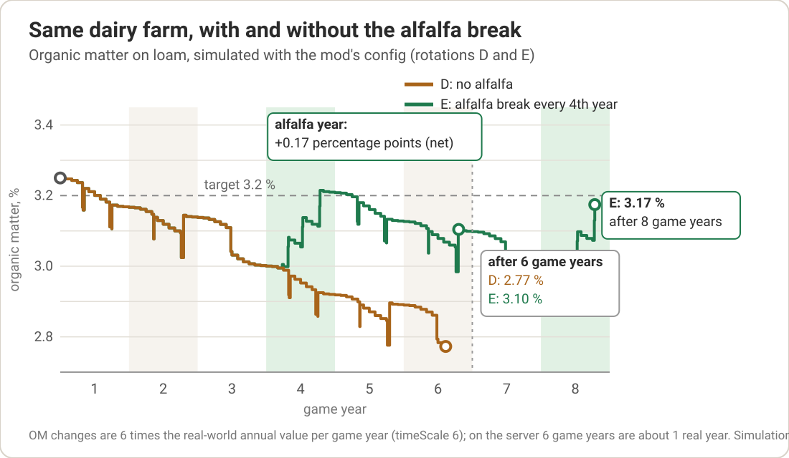

Organic matter is not just about soil quality: once it falls below the target value, the yield factor drops too (see [Organic matter](EN-04-Organic-Matter)).

## How much humus does a harvest take or give?

The OM change of the example crops at one harvest, in **percentage points per ha**, at typical yield, with `timeScale` 6. The continuous decomposition (−0.070 percentage points per game year on loam) runs on top of this, separately.

<!-- gen:omtable -->

| Crop | Straw / stalks baled | Straw chopped | Forage harvesting / mowing |
|---|--:|--:|--:|
| Green rye | −0.070 | −0.070 | −0.070 |
| Vetch rye | −0.070 | −0.070 | −0.070 |
| Silage maize | −0.070 | −0.070 | −0.070 |
| Corn | +0.068 | +0.068 | +0.068 |
| Winter barley | −0.067 | +0.067 | −0.067 |
| Winter wheat | −0.088 | +0.088 | −0.088 |
| Canola | +0.082 | +0.082 | +0.082 |
| Sunflowers | +0.096 | +0.096 | +0.096 |
| Faba beans | +0.110 | +0.110 | +0.110 |
| Alfalfa (per cut) | +0.057 | +0.057 | +0.057 |

<!-- /gen:omtable -->

What this means in practice: one silage maize harvest takes about as much (−0.070) as the stalks of a corn harvest or chopped barley straw give back (+0.068, +0.067). Forage harvesting and mowing take everything off the field for cereals, so barley and wheat show −0.035 here instead of +0.067 and +0.088 for chopped straw. When the yield is above or below typical, the OM change follows only half of the yield difference. With `timeScale` 1 every value is one sixth (the real-world annual value).

## Run the numbers yourself

You can rerun the simulation yourself (you need Python 3 and the repository):

- `python tools/rotation_sim/gen.py --wiki`: rebuilds the charts and tables.
- `python tools/rotation_sim/check_config.py`: compares the simulation with the config. Until the Szalók map is updated it prints 4 `N MISMATCH` lines (nitrogen targets of canola, sunflowers, silage maize and corn).

More in [Technical details](EN-08-Technical-Details).

See also: [Organic matter](EN-04-Organic-Matter) · [Products and application](EN-05-Products-and-Application) · [Phosphorus](EN-02-Phosphorus) · [Potassium](EN-03-Potassium)
