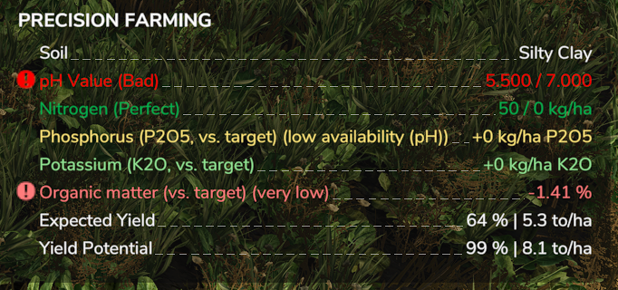
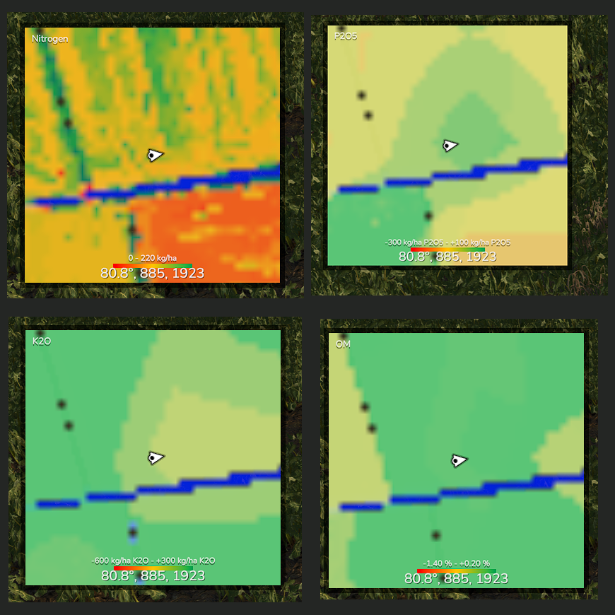

🇭🇺 [Magyar változat](HU-08-Technikai-reszletek)

> [!WARNING]
> **In development (v0.1, testing).** The mod is still being built and may change, even reset the nutrient maps. Always keep a backup of your savegame.

# Technical details

**This page explains why the mod behaves the way you see it.** It is for map makers and anyone reading the log. You do not need it to play.

Why do neighbouring pixels differ? Why does a spread sometimes do nothing? When does a harvest factor count? When does organic matter drop? This page answers that.

Developer internals (hooks, function names) appear only where a player or map maker can act on them.

## Map size, bit depth, value range

The size of the three nutrient maps **always follows the size of the Precision Farming soil map**; it is not hard-coded. On Szalók (with `FS25_0_TRPFConfigurator`) that is 2048 × 2048 pixels. If the soil map has a different size, the mod writes a warning to the log and adapts.

| | Phosphorus (P₂O₅) | Potassium (K₂O) | Organic matter (OM) |
|---|---|---|---|
| Unit | kg P₂O₅/ha from the soil type target (**relative**) | kg K₂O/ha from the soil type target (**relative**) | percentage points from the soil type target (**relative**) |
| Bit depth, step | 8 bit, 5 kg | 8 bit, 5 kg | 8 bit, 0.0243 % |
| Range | −600 … +675 (spreading stops at +300) | −600 … +675 | −4.01 … +2.19 from the target |
| Legend window | −300 … +100 | −600 … +300 | −1.4 … +0.2 |
| Save file | `vtsz_pMap8.grle` | `vtsz_kMap8.grle` | `vtsz_omMap8.grle` |

- All three maps store the **distance from the target** of the soil type, never the content itself. The soil type targets still exist in the config (they are the zero of the map and drive the pH effect on P, OM decomposition and nitrogen release), but you do not see them as a number on the map.
- The range is a **hard cap**: anything above its top is lost. On the P map there is also a **soft cap at +300**: spreading never raises a pixel above it, so phosphorus spread beyond +300 is wasted. These are game rules, not reality (in reality phosphorus stays in the soil).
- A pixel always holds a multiple of the step. That is why a soil sample can be off by 5 kg (P, K) from the "true" value.
- The legend window only affects display. Inside the window the map colour is a smooth gradient (red, yellow, green; on the potassium map it continues from green to blue above the target, so a surplus shows). The 8 legend bands exist for the filter and the colour swatches. A value outside the window gets the end colour. In colour-blind mode the gradient runs orange, white, blue.
- The maps are relative so that the same colour means the same thing on all soil types; details on the [Organic matter](EN-04-Organic-Matter), [Phosphorus](EN-02-Phosphorus) and [Potassium](EN-03-Potassium) pages.
- At startup the log says: `[VTSZ-NUT] P map 2048 x 2048, 8 bit, step 5, new`. On a loaded savegame the line ends with `loaded from savegame`.

## Application

- **Only the server calculates.** Clients just see the result. In single player, your own game is the server.
- Every spreader and sprayer that has the `sprayer` specialization writes to the maps based on the **litres** applied. The amount is: product content per 1000 litres × l/ha ÷ 1000. Product contents are on the [Products and application](EN-05-Products-and-Application) page.
- Application is **skipped below 0.5 km/h or with an empty tank**.

### The product lock

A pixel changes **only once per product in one pass**. That is what stops a double application when you drive the same row twice.

- A pixel is locked if the ground has a spray type (the spray type layer) **and** the last product applied there was the same one.
- The lock is released by **tillage, sowing or harvest** (tested in game). Until then the same product does not change the P, K and OM maps a second time.
- Two **different** products one after the other both count on the mod's own (P, K, OM) maps.
- The base game marks every shop product with the same `FERTILIZER` spray type, so the mod also stores the last product per pixel, in a 5-bit map (`vtsz_productMap.grle`, saved with the savegame, server only). It can tell **31 products** apart; more than that writes an error line to the log.
- **Adding or removing a product shifts the product IDs** (the rank of the product names, sorted by name). The saved map holds the old IDs, so for one pass the lock can be wrong: a pixel may get one application too many or too few. Do not mistake this for a bug after you add a product.

> [!NOTE]
> **Known limitation (deliberate): the Precision Farming nitrogen map locks by a different rule.** The PF N map locks by the ground spray type, and the shop products all use the same `FERTILIZER` type. If you spread two different products that contain nitrogen one after the other **without tilling in between**, the second product's nitrogen is expected not to reach the PF N map. P, K and OM still count correctly for both. A separate spray type per product would cost a lot of performance, so we did not solve it. According to the description of the [FS25_NotSoEasyDeveloperControls](https://github.com/borondy/FS25_NotSoEasyDeveloperControls) mod, its admin command `clearFertilizerState [fieldId]` clears the field's fertiliser spray type and also releases this mod's lock (in multiplayer only an admin can use it). This page has not tested the cleaner mod itself.

## Random rounding (why pixels differ)

Most changes are not a whole number of map levels. Example: 25,000 l/ha slurry adds +42.5 kg P₂O₅ = 8.5 levels (the step is 5 kg).

- The mod applies the **whole part** of the change to every pixel, splits the **remainder** into quarters of the pixels, and rounds anything smaller than a quarter **at random**.
- So even after an even spread the pixels differ (one gets +1 level, the next +2), but the **field average is exact**. On a large field the randomness averages out; on small patches it does not.
- The same rule applies on all three maps and to every change: application, harvest, decomposition, leaching, nitrogen release, catch crops.
- The four groups are the **4 noise bands** (2-bit Perlin noise, a quarter of the pixels each). The starting values use them too, so a new savegame already has variation inside a field.

In practice: do not judge a field by one pixel in the field info box. The field average and several samples show the trend.

## Harvest

A harvest does three things: it removes from the map, it works out the **yield factor**, and it feeds that into the yield. The removal numbers are on the [Phosphorus](EN-02-Phosphorus), [Potassium](EN-03-Potassium) and [Organic matter](EN-04-Organic-Matter) pages, with worked examples on [Crop rotations](EN-06-Crop-Rotations).

**The factor comes from the pixels under the header.** In every harvest step PF reports the harvested pixels; the mod works out the yield factor per map from them (per soil type, weighted by pixel count), using **PF's own filter**. The factor comes from the difference to the pH-adjusted target.

**The last harvest step's factor stays valid.** A new factor only appears after a fresh harvest step; between two steps (for example the machine stops cutting for a moment) the last value stays. Two passes on the same field can get different factors if the map differs in the two places.

**How it becomes yield:**

- **Yield = PF multiplier × min(P factor, K factor) × OM factor**, every factor at most 1.
- P and K follow the **law of the minimum**: the scarcer one limits yield and the two shortages do not multiply (P 0.95 and K 0.95 give 0.95, not 0.90). OM is not a limiting nutrient (soil structure, water), so it multiplies.
- The mod never raises yield above the PF value.

**Yield scale (removal follows the yield):**

1. The mod divides the PF yield multiplier of the harvest step by `yieldReference` (default 1.5; the PF multiplier the removal numbers are meant for). The PF multiplier already contains nitrogen, pH, weeds, tillage and the mod's own factor.
2. The result is **clamped to 0.3 – 2.0** and **rounded to steps of 0.1**.
3. P and K removal is proportional to this scale: half at a poor yield (scale 0.5), double at the upper cap (2.0).
4. **OM follows only half** (`yieldScaling` 0.5): the mass of crop residue depends only partly on yield.
5. `yieldReference="0"` switches it off: removal is fixed per harvest. If PF's multiplier is not available on a rare call path, the scale is 1.

**Mowing and forage harvesting.** When a forage harvester or a mower works, the mod treats it as a whole-crop harvest: for crops that have a `forageRemoval` value (the cereals) both the crop and the straw leave the field, and there is no straw credit. Grass, alfalfa and clover values are per cut.

## Soil pH

- **At harvest** the mod reads the pH from the PF pH map **at the machine's position** (combine, mower). It needs **no soil sampling**: the soil has a pH whether or not you have uncovered it.
- **In the field info box** it uses the pH of the pixel under the cursor.
- pH changes the phosphorus target: the target is divided by the availability share for that pH. In the field info row this shows as the text "low availability (pH)", only when the soil is at or above the target and the yield factor is below 0.99 because of the pH alone. Numbers and examples are on the [Phosphorus](EN-02-Phosphorus) page.
- The adjusted target is capped at the highest value spreading can reach minus one step (P: +300 − 5 = +295 from the target), so a fully fertilised field can always reach a yield factor of 1.0. The worst real case, loam at pH 5.0, needs +257, so the cap does not bite with the current numbers. This rule applies to the yield factor. The automatic rate ignores the pH.
- The pH effect works on the soil type target plus the crop's extra, not on the distance: the target content is divided by the availability share and the result is turned back into a distance. The map itself does not change with pH.

## Field info box and soil sampling

- The colour and text of the field info line depend on the **yield factor**, not on the raw number:

| Yield factor | Colour | Text |
|---|---|---|
| 0.99 or more | green | – |
| 0.90 to 0.99 | yellow | "low" |
| below 0.90 | red, with a warning sign | "very low" |

- In colour-blind mode the mod uses its own colours.
- The P and K lines show the **distance from the soil type target** (`%+d kg/ha`, for example −100 kg/ha K₂O). Both rows show one number only. The pH does not change it, but the line colour and the yield factor include it; the automatic rate uses the plain distance and ignores the pH. The OM line shows the **distance from the target** (`%+.2f %`, for example −0.32 %). If there is no crop or soil type under the cursor, the line shows only the current value.
- The map shows the soil only. The K target is the soil type target for every crop; the pH effect on P lives in the yield factor, the line colour and the "low availability (pH)" text.
- **Unsampled (uncovered) soil is only hidden in the interface**: the field info box, the map and the automatic rate see nothing of it. Application, harvest and the yield factor always use the **real value**, sampled or not.
- The mod does not write its own yield data into the PF field info box (PF handles only nitrogen data there). The factor still reaches the "expected yield" line of the info box; that line has not been checked in game yet.

## Minimap

- While spreading, the minimap switches to the layer of the nutrient the product contains most of. For organic fertilisers (manure, slurry, digestate) the default is nitrogen. `Left Alt + .` pages through Auto, N, P, K, OM. Changing the product resets it to Auto.
- The layer is chosen by the **first sprayer in the controlled vehicle chain that holds a product**, **on a field**. After paging, a "Minimap layer: …" message shows for 3 seconds.
- While you spread, the minimap keeps the mod's layer instead of flickering back to PF's N or pH layer. The layers are released when you leave the field or detach the sprayer.
- This is client side: the minimap and the HUD work on your own machine.
- Status: the layer follows the product (tested in game while spreading slurry). The rest of the minimap behaviour, including the known issue (when spreading NPK 8-24-24 or Yeast vinasse the map should not switch back and forth between N and another layer), have not been run yet.

## Monthly processes: decomposition, leaching, nitrogen release

These run **once per game period (month)**, at the period change, **on the server only**. Clients see the result in the synced map. Period 1 is March (northern hemisphere).

| Process | Map | What it does |
|---|---|---|
| Decomposition (mineralisation) | OM | Removes a yearly fraction of the soil type target, with seasonal weights: almost nothing in winter, most in midsummer. |
| Leaching | K | Only the content **at or above the soil type target** (0 or more on the map) leaches, per soil type (kg K₂O/ha/year), more in wet months. A field short of potassium loses nothing. |
| Nitrogen release | OM → PF N map | Decomposing organic matter adds nitrogen to the PF N map, with the same seasonal pattern. |

- All three use the [random rounding](#random-rounding-why-pixels-differ) rule, so the field average is exact.
- The **nitrogen** is rounded to PF's 5 kg N state steps when it goes into the PF map, and it never pushes past PF's visible maximum. The mod does not touch PF's own nitrogen calculation: it only raises the map pixels, so PF's automatic rate sees the higher level and applies less nitrogen. If the N map size differs from the OM map size, the mod skips this step and writes a warning to the log.
- Decomposition, leaching and nitrogen release are scaled by `balance removalScale`; decomposition is also scaled by the OM `timeScale` (default 6, because about 6 game years pass per real year on the VirtualTSZ server). Nitrogen is counted per game year and is not scaled by `timeScale`.
- Numbers and background are on the [Organic matter](EN-04-Organic-Matter) and [Potassium](EN-03-Potassium) pages.
- Log lines to look for: `OM mineralisation period N: …`, `K leaching period N: …`, `OM nitrogen release into the N map: …`.
- Status: the self-test (`vtszSelfTest mineral`) confirms the calculation of decomposition and nitrogen release. The in-game timing (the log lines, the yearly drop, the growth of the N map) has not been fully tested yet.

## Multiplayer and sync

> [!WARNING]
> **Multiplayer is not tested yet** (see `TESTS.md`). The mod is written to work, but there is no in-game proof. What follows is behaviour read from the code.

- **Calculated on the server:** application, harvest, catch crop incorporation, decomposition, leaching and nitrogen release run on the server only. The product lock map exists only on the server.
- **Map sync:** the P, K and OM maps are sent to clients by PF's own map syncer. A late-joining client should see the same map; this is untested.
- **Sprayer settings:** two of the mod's own messages sync. `VtszSprayerRateEvent` carries the application rate (l/ha) for products without nitrogen. `VtszSprayerAutoEvent` carries the automatic rate on/off state and the base nutrient. For a late joiner they travel with the sprayer's state.
- **Stays on the client:** the HUD and the minimap layer.
- **The rate is not saved:** after saving and loading, a sprayer returns to the product's default rate (deliberate).
- The console commands only exist where a server runs: [Console commands](EN-09-Console-Commands).

## Save files

In the savegame folder (the `.grle` files):

| File | Content |
|---|---|
| `vtsz_pMap8.grle` | phosphorus map (the `8` is the bit depth) |
| `vtsz_kMap8.grle` | potassium map (the `8` is the bit depth) |
| `vtsz_omMap8.grle` | organic matter map (the `8` is the bit depth) |
| `vtsz_productMap.grle` | last product applied per pixel (5 bit, server only) |

- Any map that is not 5 bit has its bit depth in the file name. If a map's bit depth is changed (a map maker setting), **a new map starts from the starting values** and the old file is ignored. See [For map makers](EN-07-For-Map-Makers).
- Earlier versions stored P and K as absolute values at 5 bit (`vtsz_pMap.grle`, `vtsz_kMap.grle`). With the relative maps those files are ignored, and a savegame from an older version starts P and K again from the starting values. Organic matter is not affected.
- If the saved map has a different size from the PF soil map, the mod warns and rebuilds it from the starting values.
- On a new savegame (or when the mod is added to an existing one) the map starts from the starting values, with 4 noise levels per soil type.
- Removing the mod, and damaged or missing files, have not been tested yet.

## See also

- [Console commands](EN-09-Console-Commands)
- [For map makers](EN-07-For-Map-Makers)
- [Organic matter](EN-04-Organic-Matter)
- [Products and application](EN-05-Products-and-Application)
