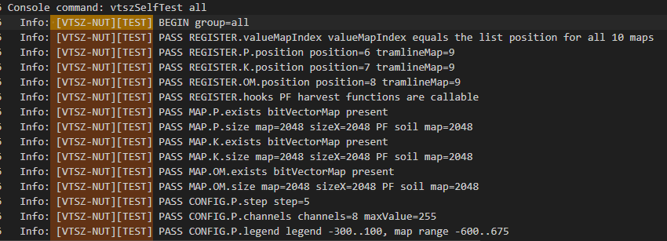

🇭🇺 [Magyar változat](HU-09-Konzolparancsok)

> [!WARNING]
> **In development (v0.1, testing).** The mod is still being built and may change, even reset the nutrient maps. Always keep a backup of your savegame.

# Console commands

**This page lists the mod's four console commands.** It is for anyone who wants to test the mod or track down a problem. You do not need them to play.

The commands let you see what the mod calculates, set a field for testing, and check that the mod loaded correctly. Most results go to `log.txt`, and the mod's lines start with `[VTSZ-NUT]`.

Open the developer console and type the command. (Whether the console is available depends on your game setup; this page does not cover that.) **Use a decimal point**, not a comma: `-0.5`, not `-0,5`.

> [!WARNING]
> `vtszNutrientSet` and `vtszSelfTest world … confirm` **write map data**, which also changes the yield. Use them on a real savegame only if you know what you are doing. `vtszSelfTest world … confirm` is for **throwaway test savegames** only.

## Who can run them?

- `vtszNutrientDebug` and `vtszNutrientSet` work in single player, for the player hosting a game, on a dedicated server console, and **from a multiplayer client as an admin** (log in as admin first). The client sends the command to the server, which checks the admin login, runs it, and sends the result line back to the console. `vtszSelfTest` exists only where the game runs a server.
- `vtszPerf` is registered on every instance in the code, but it is a developer tool.
- What a client is allowed to do in multiplayer has **not been tested yet**. Multiplayer as a whole is not tested yet either.

## vtszNutrientDebug

**Syntax:** `vtszNutrientDebug [on|off]`

Turns on logging of application and harvest values to `log.txt`. With no parameter (or any other parameter) it toggles. It is off by default and not saved. Logging is throttled to at most one line per second.

**Example:** `vtszNutrientDebug on`, the reply is `vtszNutrientDebug on`.

What you see in the log:

- Application: `[VTSZ-NUT] spray fillType=MANURE l/ha=... P=... K=... OM=...` (the value in map units, for that pass).
- Harvest: `[VTSZ-NUT] harvest P actual=... target=... factor=... | K ... | combined=... | pH=... | yieldScale=...`. `combined` is the overall yield factor from the P, K and OM factors, `yieldScale` is the yield scale (see [Technical details](EN-08-Technical-Details)).

## vtszNutrientSet

**Syntax:** `vtszNutrientSet <fieldId> <P|K|OM> <value>`

Sets **every pixel** of the given field to one value. The whole field becomes uniform (the variation between pixels is lost).

- **P, K:** the value is the **distance from the soil type target in kg/ha** (P₂O₅ or K₂O), like OM. `-120` means 120 kg/ha below the target, `0` is exactly the target, `50` is 50 above it. It is not the content in the soil.
- **OM:** the value is the **distance from the soil type target in percentage points**. `-0.5` means 0.5 points below the target, `0` is exactly the target, `0.5` is above it.
- The value is rounded to the map step (P 5, K 5, OM 0.0243) and cut to the allowed range: P −600 … +300 (the soft cap of spreading), K −600 … +675, OM −4.01 … +2.19 from the target.
- `<fieldId>` is the field number as the game numbers its fields.
- On an unsampled field the layer stays hidden: the field info box and the map show the new value only after soil sampling (harvest and the yield factor use the new value straight away).

**Examples:**

```
vtszNutrientSet 1 P -150
vtszNutrientSet 1 K -120
vtszNutrientSet 1 OM -0.5
vtszNutrientSet 1 OM 0
```

A reply looks like `P of field 1 set to -150 kg/ha P2O5 (level 90)`. For a wrong field number: `Field not found: …`. For an unknown nutrient: `Unknown nutrient: …`. With a missing parameter the command prints a usage message.

What it is good for:

- Trying out the yield curves, the field info colours and the "low" / "very low" labels (the colours are described in [Technical details](EN-08-Technical-Details)).
- Trying out decomposition and leaching: set the field below or above the target, then wait for one game period change.

## vtszSelfTest

**Syntax:** `vtszSelfTest [all|registration|maps|config|spray|harvest|yield|rounding|mineral|ph|auto|scale|rates|ui]` and `vtszSelfTest world <fieldId> confirm`

A self-test of the P, K and OM maps. The result is in `log.txt`, one line per check:

```
[VTSZ-NUT][TEST] PASS|FAIL|WARN|SKIP <id> <detail>
```

At the end there is a `SUMMARY` line, and the console prints a summary: `vtszSelfTest pass=… fail=… warn=… skip=… (… ms) - details in log.txt`. Without a parameter, `all` runs (without `world`).



<details>
<summary>Test groups and what they check</summary>

| Group | What it checks |
|---|---|
| `registration` | the three maps are registered in the PF map selector before the hidden tramline map, and PF's functions are reachable |
| `maps` | the maps exist and their size matches the PF soil map |
| `config` | the config values are sound (step, bit depth, legend, targets, starting values) |
| `spray` | the product nutrient contents match the intended values, the `baseFertilizer` switch |
| `harvest` | the harvest removals and OM changes match the intended values |
| `yield` | the yield curves and how the factors combine (minimum of P/K, OM multiplies) |
| `rounding` | the average of the random rounding |
| `mineral` | OM decomposition, K leaching and OM nitrogen release |
| `ph` | the pH availability curve and the pH cap |
| `auto` | the base nutrients and the formula of the automatic rate |
| `scale` | the yield scale |
| `rates` | the rate settings of products without nitrogen (`rateControl`) |
| `ui` | the legend bands, the formats, and that the language texts exist |

</details>

**FAIL** means an error. **WARN** is not necessarily an error: it can be a difference from the intended value after a deliberate rebalance.

### vtszSelfTest world

**`vtszSelfTest world <fieldId> confirm` writes map data. Use it only on a throwaway savegame.** Without `confirm` it does not run and only prints the usage message.

On one field it tests the real application path: it sets a value, then **applies 1000 l/ha of every product that contains that nutrient** and checks the change. Afterwards it **sets the field back to one uniform value** (the variation between pixels is lost), and the tests also change the product lock map. The `WORLD.….restore` warning lines are therefore normal.

## vtszPerf

**Syntax:** `vtszPerf start [label]`, `vtszPerf stop`, `vtszPerf report`, `vtszPerf reset`

A developer performance meter; players do not need it. `start` wraps the mod's hot paths (minimap update, sprayer update and HUD, application, harvest) and writes the numbers to `log.txt` with the prefix `[VTSZ-PERF]`. `stop` restores the original functions, so it costs nothing when no measurement runs. The numbers are for comparing identical situations; the measurement has a small cost of its own.

## How to check that the mod works

A quick check in single player on Szalók, with `FS25_precisionFarming` and `FS25_0_TRPFConfigurator` active. The full test list and its state is in `TESTS.md`.

1. **Loading.** On a new savegame the log contains the line `[VTSZ-NUT] P map 2048 x 2048, 8 bit, step 5, new` (K: 8 bit, step 5; OM: 8 bit, step 0.0243), and there is no `Error`. On a loaded savegame the line ends with `, loaded from savegame`.
2. **Map menu.** ESC › Map: the PF selector shows Phosphorus, Potassium and Organic matter. With a soil sampler you can uncover the layers, with a red-yellow-green legend.
3. **Setting a value.** `vtszNutrientSet 1 P -150`: with a crop on the field the Phosphorus (P2O5, vs. target) line shows `-150 kg/ha P2O5`, with a "low" label because the yield factor is about 0.91. `-250` gives "very low". For K, `vtszNutrientSet 1 K -120` shows `-120 kg/ha K2O`, on every crop.
4. **Application.** `vtszNutrientDebug on`, then spread manure: the log writes a `spray fillType=MANURE l/ha=... P=... K=... OM=...` line and the layer rises.
5. **Harvest.** The log writes a `harvest P actual=... target=... factor=...` line, the levels drop, and the yield is lower than the PF value only below the target.
6. **Saving.** Save, quit, load: the levels stay. The savegame folder holds `vtsz_pMap8.grle`, `vtsz_kMap8.grle`, `vtsz_omMap8.grle` and `vtsz_productMap.grle` (the last product applied, server only).
7. **Catch crops.** When you incorporate or mulch oilseed radish or mustard, OM rises a little.
   - **OM decomposition:** `vtszNutrientSet 1 OM 0` (sets it to the target), then after one game period (month) change the log contains an `[VTSZ-NUT] OM mineralisation period N: soil…=…` line. OM drops the most in the summer months; about −0.070 percentage points per game year on loam. `vtszSelfTest mineral` checks the calculation.
   - **K leaching:** set a soil type 1 field above the target (0), for example `vtszNutrientSet <fieldId> K 100` (100 kg/ha above the target), and wait for a period change: the log writes a `K leaching period N` line, and K loses about 40 kg/ha per year (soil type 1). A field below the target does not lose any.
8. **Dedicated server.** Repeat steps 4–6; the clients should see the same thing. This step is **not tested yet**, because multiplayer is not tested.

State according to `TESTS.md`: steps 1–3 are tested in game; the calculation of application (4) is confirmed by the self-test and the product lock is tested in game; the harvest log (5) exists in game, but most of the per-crop removals have not been walked through; catch crops are tested in game. Saving and loading (6) and the timing of decomposition and leaching (7) have not been tried through in game yet, their calculation is confirmed by the self-test. Step 8 is not tested because of multiplayer.

## See also

- [Technical details](EN-08-Technical-Details)
- [Getting started](EN-01-Getting-Started)
- [Known limitations](EN-10-Known-Limitations)
