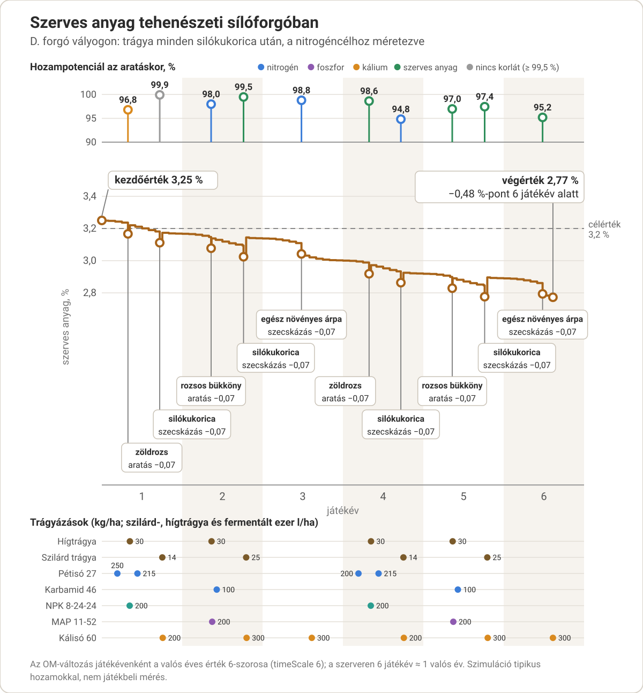
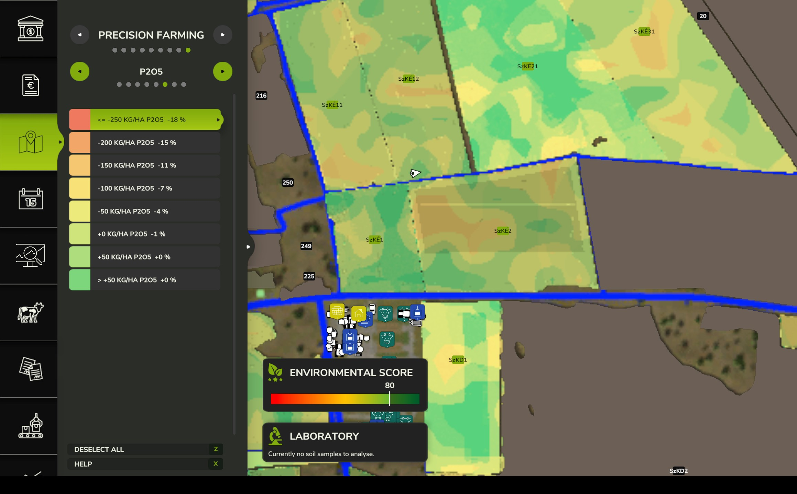
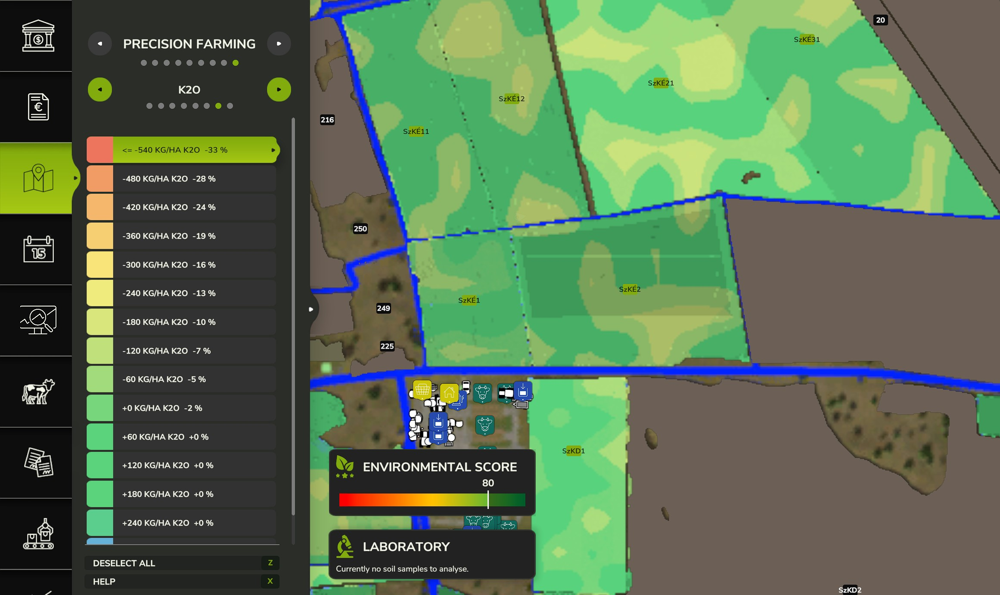

🇬🇧 [English version](Home)

> [!WARNING]
> **Fejlesztés alatt (v0.1, tesztelés).** A mod fejlesztés alatt áll, változások történhetnek. Mindig legyen biztonsági másolatod a mentésedről.

> [!NOTE]
> **Mesterséges intelligencia.** A mod és ez a dokumentáció jórészt Claude segítségével készült. A számok agronómiai becslések, ezért ellenőrizd őket, és jelezd, ha hibát találsz.

# VirtualTSZ Precision Farming Extension

**A talaj többé nem bírja végtelenül.** A Precision Farming a nitrogént és a pH-t követi, de azt nem, hogy a földből közben foszfor, kálium és humusz fogy. Ez a mod ezt a hiányzó részt adja hozzá.

## Mit kapsz? A lényeg röviden

- **Három új talajtérkép:** foszfor (P₂O₅), kálium (K₂O) és szerves anyag (OM), talajmintavétellel felfedhetők, a Precision Farming térképmenüjében és a mezőinfóban.
- **A térképek a céltól való távolságot mutatják:** a 0 minden talajtípuson a cél, a mínusz hiány, a plusz többlet. Hogy a növényednek mennyi kell még ráadásul (a cukorrépa és a burgonya több káliumot kér), azt a mezőinfó mutatja, ahogy a Precision Farming a nitrogént.
- **A talaj fogy, ha nem pótolod.** A siló, a burgonya és a cukorrépa sok tápanyagot visz el, és vele együtt csökken a hozam.
- **Sok mód a pótlásra:** műtrágya, trágya, aprított szalma, pillangósok, lucerna és takarónövények.
- **Soha nem ad extra hozamot:** a mod csak levon a Precision Farming hozamából, ha valami hiányzik a talajból.
- **11 bolti termék** valósághű NPK-tartalommal, **automatikus kijuttatási mennyiség** foszforra és káliumra, kijuttatás-HUD és minitérkép-réteg.
- **Játékbeli súgó** minden növény tápanyag-elvitelével (bálázott szalmával és szecskázással is), minden műtrágya tartalmával és **öt kidolgozott példa vetésforgó**.

## Miért készült?

A VirtualTSZ szerveren (Szalók térkép) elég reálisan játszunk. A tehenészetünk évente kétszer ugyanazokról a táblákról szedi le a silót. A Precision Farmingban ezt semmi nem büntette: a talaj nem lett szegényebb, akárhány tonna biomassza ment le róla.

A valóságban a siló a növény nagy részét elviszi, és vele együtt távozik a foszfor, a kálium és a humusz is. Ezt építettük meg. Valós agronómiai adatokból dolgoztunk (német VDLUFA humuszmérleg, bajor LfL táblák, magyar talajadatok), a játékhoz egyszerűsítve.

## Így fogy a humusz egy tehenészeti forgóban

Ez a [Vetésforgók](HU-06-Vetesforgok) oldal D forgója: tehenészet, kétszer silókukorica, minden silókukorica után trágya. Hat játékév alatt a szerves anyag 3,25 %-ról 2,84 %-ra esik, **pedig trágyázunk**. Ennek az az oka, hogy a nitrogén korlátozza, mennyi trágyát szabad kiszórni.

Hogyan fordíthatod meg a folyamatot? Azt a [Szerves anyag](HU-04-Szerves-anyag) oldalon, és az E forgó lucernás szünetében láthatod. A grafikon szimuláció tipikus hozamokkal, nem játékbeli mérés.

## A három térkép

Mindhárom beleszámít a hozamba, és mindhármat mintavétellel fedheted fel. Mindhárom térkép **relatív**: nem a talaj tartalmát, hanem a talajtípus célértékétől való távolságot mutatja. A 0 azt jelenti, hogy a talaj a célon van, a mínusz hiányt, a plusz többletet jelez, minden talajtípuson ugyanúgy.

### Foszfor (P₂O₅)

Minden betakarítás elviszi, vissza csak műtrágyával és trágyával kerül. A talaj pH-ja dönti el, mennyit tud felvenni belőle a növény. A célérték alatt csökken a hozam. A térkép a hiányt (mínusz) vagy a többletet (plusz) mutatja kg/ha-ban.

Részletek: [Foszfor](HU-02-Foszfor)

### Kálium (K₂O)

Az elvonás a növénytől függ: a siló, a burgonya és a cukorrépa sokat visz, a gabona keveset. A térkép csak a talaj állapotát mutatja a talajtípus céljához képest. A kálium célja minden növénynél ugyanaz, a növény csak azt változtatja meg, mennyit visz el egy aratás. A talajtípus célértéke fölött a kálium lassan kimosódik, főleg a könnyű talajokon.

Részletek: [Kálium](HU-03-Kalium)

### Szerves anyag (OM)

Minden hónapban lebomlik, nyáron a leggyorsabban, és közben nitrogént ad a Precision Farming nitrogéntérképének.

- **Csökkenti:** az egész növényes betakarítás és a lehordott szalma.
- **Növeli:** az aprított szalma, a trágya, a pillangósok, a lucerna és a takarónövények.
- Ha túl alacsony, csökken a hozam.

Részletek: [Szerves anyag](HU-04-Szerves-anyag)

## Még a modban

- 11 bolti termék valósághű NPK-tartalommal: [Termékek és kijuttatás](HU-05-Termekek-es-kijuttatas)
- Automatikus kijuttatási mennyiség foszforra és káliumra (a Precision Farming saját automatája csak a nitrogént kezeli).
- HUD, amely hektáronként mutatja a kijuttatott N, P₂O₅ és K₂O mennyiséget.
- Minitérkép-réteg, amely a permetezőben lévő terméket követi.
- Játékbeli súgóoldal minden növény tápanyag-elvitelével.
- Öt kidolgozott példa vetésforgó: [Vetésforgók](HU-06-Vetesforgok)

## Mi kell hozzá?

| Mire van szükség | Megjegyzés |
|---|---|
| Precision Farming DLC (`FS25_precisionFarming`) | |
| [TR] Precision Farming Configurator (`FS25_0_TRPFConfigurator`) | 2048 × 2048-as térképek |

Dedikált szerveren a modot a szerverre és minden kliensre fel kell tenni.

**Letöltés:** https://sharemods.com/3ezx9j54cuoa/FS25_VirtualTSZPrecisionFarmingExtension.zip.html

## Hol tart most? (őszinte állapot)

- **Játékban, egyjátékos módban kipróbálva:** a mod betöltődik, a három réteg megjelenik a PF térképválasztóban, a talajmintavétel és a jelmagyarázat, a mezőinfó sorok, a konzolparancsok, a kijuttatás szabályai (termékenként és menetenként egyszer), a takarónövények mulcsozása, valamint hígtrágyával a terméket követő minitérkép-réteg és a HUD „auto N" sora.
- **Csak számítással ellenőrizve (önteszt), játékban még nem:** a termékek tápanyagtartalma, a hozamtényezők, a lebomlás, a nitrogén-felszabadulás. A takarónövények bedolgozása ekével, ekeszárral, tárcsával, kultivátorral vagy direktvetéssel kódból olvasott, játékban nem tesztelt.
- **Még nincs tesztelve:** multiplayer és dedikált szerver, mentés és betöltés, a bolti termékek, a mennyiségi billentyűk, a HUD és a minitérkép többi része.

A teljes lista és a korlátok: [Ismert korlátok](HU-10-Ismert-korlatok). Hibát itt jelezhetsz: {{REPO_URL}}/issues

## A VirtualTSZ közösségnek készült

A mod a VirtualTSZ közösség játékmenetére készült a Szalók térképen, itt teszteljük és itt hangoljuk. A szerver-specifikus szabályokat az oldalakon külön jelöljük.

**Más térképen?** Elvileg bármely, a követelményeknek megfelelő térképen működik, de más térképen **nem teszteltük**. A térképkészítők a `map.xml`-ben felülírhatják a célértékeket, a kezdőértékeket, a növények elvonását és a termékeket. Lásd: [Térképkészítőknek](HU-07-Terkepkeszitoknek).

## Innen indulj

- [Első lépések](HU-01-Elso-lepesek)
- [Szerves anyag](HU-04-Szerves-anyag)
- [Vetésforgók](HU-06-Vetesforgok)
