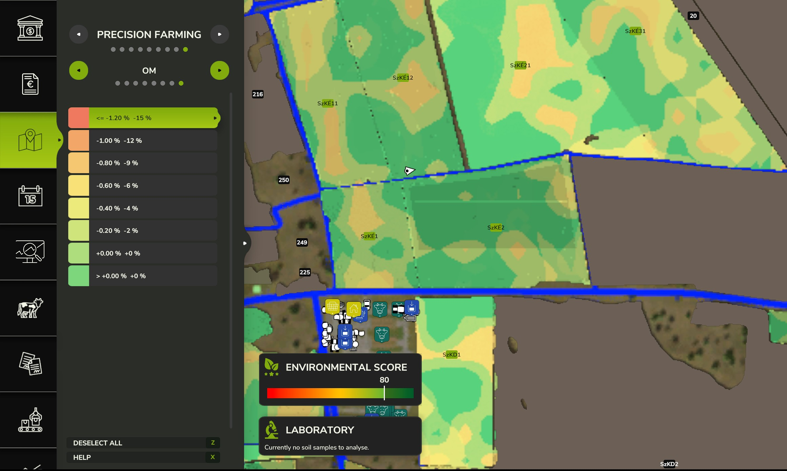
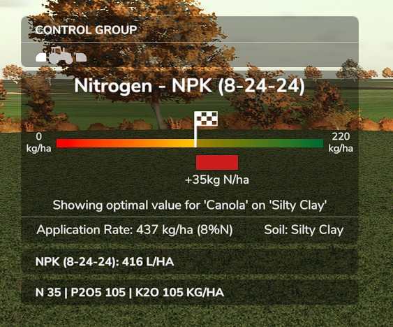

🇬🇧 [English version](EN-01-Getting-Started)

> [!WARNING]
> **Fejlesztés alatt (v0.1).** Változások történhetnek, és a tápanyagtérképek alaphelyzetbe állhatnak. Mindig legyen biztonsági másolatod a mentésedről.

# Első lépések

**A mod három új réteget ad a Precision Farminghez (foszfor, kálium, szerves anyag), és megmutatja, melyik tápanyag fogja vissza a terméseidet.**

- Kell hozzá a Precision Farming DLC és a [TR] Precision Farming Configurator.
- Új mentésen a térképek a talajtípus kezdőértékeiről indulnak.
- A rétegeket talajmintavétel után látod a térképmenüben és a mezőinfóban.
- A mezőinfó színe megmondja, mennyit ront a termésen az adott tápanyag.
- A mentés és a betöltés a játékban még nincs tesztelve.
- Folytasd itt: [Termékek és kijuttatás](HU-05-Termekek-es-kijuttatas)

## Telepítés

1. Töltsd le a modot: https://sharemods.com/3ezx9j54cuoa/FS25_VirtualTSZPrecisionFarmingExtension.zip.html
2. Tedd a zip fájlt a játék `mods` mappájába. Ne csomagold ki.
3. Kapcsold be a mentésed mod-listáján a modot **és a két előfeltételét**:
   - Precision Farming DLC (`FS25_precisionFarming`)
   - [TR] Precision Farming Configurator (`FS25_0_TRPFConfigurator`)
4. Dedikált szerveren a zipet a szerverre **és minden kliensre** fel kell tenni, ahogy a Precision Farmingot is.

Más térképen a mod elvileg működik, de nem teszteltük. Lásd: [Térképkészítőknek](HU-07-Terkepkeszitoknek).

## Mi történik az első indításkor

A mod három új térképet hoz létre (foszfor, kálium, szerves anyag), a Precision Farming talajtérképének méretében. A kezdőértéket a talajtípus adja: minden talajtípusnak van egy kis tartománya, és a mező pixelein ez zajszerűen oszlik el. Egy táblán belül ezért lesznek kicsit jobb és gyengébb foltok.

- **Új mentésen** a három térkép a kezdőértékekből indul.
- **Meglévő mentésen**, amelyben a mod még nem járt, ugyanez történik: a mod nem talál mentett térképet, ezért a kezdőértékekből készíti el őket. A mentésed addigi története (korábbi betakarítások, trágyázás) nem számít bele. A mező úgy indul, mintha most kezdődne a mod.
- **Már használt mentésen** a mod a mentett térképeket tölti be (`vtsz_pMap8.grle`, `vtsz_kMap8.grle`, `vtsz_omMap8.grle`). A foszfor és a kálium régi, 5 bites térképfájlját (`vtsz_pMap.grle`, `vtsz_kMap.grle`) a mod nem tölti be, ezért az ilyen mentésben a P és K újra a kezdőértékekről indul. A mentés és a betöltés a játékban még **nincs tesztelve** (egyjátékos módban és multiplayerben sem).

Ha azt akarod tudni, betöltődött-e a mod, keresd a `[VTSZ-NUT]` sorokat a `log.txt`-ben (a játék felhasználói mappájában):

```
[VTSZ-NUT] P map 2048 x 2048, 8 bit, step 5, new
```

A sor végén a `new` új térképet jelent, a `loaded from savegame` mentésből betöltöttet. Mindhárom térképnek (P, K, OM) van ilyen sora. Ha nincs `[VTSZ-NUT]` sor, vagy a közelében `Error` áll, a mod nem töltődött be rendesen. Nézd meg, hogy a két előfeltétel be van-e kapcsolva.

## Talajmintavétel

A három réteg addig rejtve marad, amíg nem veszel talajmintát, ugyanúgy, mint a Precision Farming nitrogén és pH rétege. Vegyél mintát a Precision Farming talajmintavevőjével a tábla azon részein, amelyeket látni akarsz. Mintavétel nélkül a térkép üres.

> [!NOTE]
> A mintavétel csak a **megjelenítést** nyitja fel. A kijuttatás, az aratás és a hozamtényező mindig a valós értékkel számol, akkor is, ha még nem vettél mintát. A mintavétel nélküli mező tehát nem "védett": csak te nem látod, mi van a talajában. A mezőn a mod saját automatikus P/K mennyisége sem ad értéket mintavétel nélkül, ilyenkor a gép a kézzel beállított mennyiséget használja.

## Így olvasd a rétegeket

### A térképmenüben

Nyisd meg az ESC menü Térkép oldalát, és válaszd ki a Precision Farming rétegválasztójában a **P2O5**, **K2O** vagy **SzA** (szerves anyag) réteget. A három bejegyzés a Vetőmag-mennyiség után áll. A jelmagyarázat minden sora a sáv felső határát és a hozam hozzávetőleges változását mutatja, például `-80 kg/ha  -4 %`. **A százalék a sáv közepén érvényes érték, nem a sáv minimuma vagy maximuma**: a sáv szélén álló mező kicsit többet vagy kevesebbet veszít. Növény- és pH-korrekció nélkül számol; a pontos értéket a mezőinfó mutatja.



A színek piros-sárga-zöld átmenetet adnak: piros a kevés, zöld a sok. Színtévesztő módban a játék a Precision Farming saját színtévesztő átmenetét használja. A jelmagyarázat ablaka rétegenként ennyit mutat:

| Réteg | Jelmagyarázat |
|---|---|
| Foszfor | −300 … +100 kg/ha P₂O₅ a céltól |
| Kálium | −600 … +300 kg/ha K₂O a céltól (+200-ig zöld, csak fölötte kék, ahol a túltrágyázás már hozamot visz) |
| Szerves anyag | −1,4 … +0,2 %-pont a céltól (mind a négy talajtípuson játékban még nincs ellenőrizve) |

**Mindhárom térkép relatív**: nem a talaj tartalmát mutatja, hanem azt, hogy a talajtípus célértékétől mennyire vagy távol. A **0 minden talajtípuson a célérték**, a **mínusz hiány**, a **plusz többlet**. A piros a mély hiányt jelzi. (A szerves anyagnál a kb. −0,6-nál lévő sárga és a kb. −1,2-nél lévő piros játékban még nincs ellenőrizve.) Így a színek ugyanazt jelentik agyagos homokon és iszapos agyagon is. A foszfor és a kálium relatív térképe az új változatban játékban még nincs végigpróbálva. Részletek: [Foszfor](HU-02-Foszfor), [Kálium](HU-03-Kalium), [Szerves anyag](HU-04-Szerves-anyag).

> [!NOTE]
> A térkép csak a **talaj** állapotát mutatja. A kálium célja minden növénynél ugyanaz. A foszfornál a savanyú vagy lúgos talaj csökkenti a hozamtényezőt, ezt a sor színe és a mezőinfó szövege mutatja (lásd lent).

### A mezőinfóban

Ha mintavételezett mezőn állsz, a mezőinfóban megjelenik három új sor. Példa káliumra:

```
Kálium (K2O, a céltól) (alacsony): -100 kg/ha K2O
```

- Ez a talaj állapota a talajtípus céljához képest (itt 100 kg/ha-ral a cél alatt, sárga „alacsony” jelzéssel), ugyanaz az érték, mint a térképen.
- A kálium célja minden növénynél ugyanaz, ezért csak ez az egy szám áll a sorban, és az automatikus mennyiség pontosan ezt a hiányt juttatja ki.
- A foszfor sora (`Foszfor (P2O5, a céltól)`) szintén egyetlen számot mutat: a talajtípus céljától mért egyszerű távolságot, például `-60 kg/ha P2O5`. A pH nem változtatja a számot, de a sor színét és a hozamtényezőt igen. Ha a talajban elég a foszfor, de a pH miatt a növény nem tudja felvenni, a sor ezt írja: `alacsony felvehetőség (pH)`. Ezt mésszel javítsd, több foszfor nem segít (lásd [Foszfor](HU-02-Foszfor)).

A szerves anyagnál nincs második szám, csak a céltól való távolság, például `Szerves anyag (a céltól): −0,32 %`.

A sor színe és az utána álló szöveg a **hozamtényezőt** mutatja, vagyis azt, hogy ez a tápanyag mennyire fogja vissza a termést:

| Szín | Hozamtényező | Szöveg |
|---|---|---|
| Zöld (színtévesztő módban kék) | 0,99 vagy több | nincs |
| Sárga | 0,90 – 0,99 | alacsony |
| Piros (színtévesztő módban narancs) | 0,90 alatt | nagyon alacsony, figyelmeztető jellel |

Ha a kurzor alatt nincs növény vagy talajtípus, a sor csak az aktuális értéket mutatja, célt nem.


### Kijuttatás közben

A permetezőn és a szórón a HUD mutatja a kijuttatási mennyiséget, és azt, hogy hektáronként mennyi N, P₂O₅ és K₂O kerül ki. A minitérkép a gépben lévő termékhez illő réteget mutatja. Minden részlet a [Termékek és kijuttatás](HU-05-Termekek-es-kijuttatas) oldalon van.



## Az első szezonod

1. **Végezz talajmintavételt** a táblán, és nézd meg mindhárom réteget a térképmenüben.
2. **Olvasd le a mezőinfót** a tábla közepén: melyik sor sárga vagy piros, és mennyivel van a térképi érték a 0 alatt? A hozamot a foszfor és a kálium közül a szűkösebb korlátozza, a szerves anyag ezen felül külön szorzó.
3. **Válassz terméket.** Foszforhiányra foszfortartalmú, káliumhiányra káliumtartalmú műtrágya kell. A szerves anyagot műtrágya nem emeli: ahhoz trágya, szalma, pillangós vagy takarónövény kell. A termékeket a [Termékek és kijuttatás](HU-05-Termekek-es-kijuttatas) oldal sorolja fel.
4. **Használd az automatikus mennyiséget.** A mod a P és K termékekhez saját automatikus kijuttatási mennyiséget ad (a Precision Farming sajátja csak a nitrogént kezeli). Pontosan a célig hiányzó mennyiséget juttatja ki.
5. **Takarítsd be a termést**, és nézd meg, mennyit vitt el a növény. A betakarítás csökkenti a foszfort és a káliumot, a szerves anyagot is.
6. **A következő szezonban mintázz újra**, és hasonlítsd össze az értékeket az előzővel. Így látod, elég volt-e a pótlás.

A mod a hozamot csak lefelé módosítja: soha nem növeli a Precision Farming által adott érték fölé.

## Lásd még

- [Foszfor](HU-02-Foszfor), [Kálium](HU-03-Kalium) és [Szerves anyag](HU-04-Szerves-anyag)
- [Termékek és kijuttatás](HU-05-Termekek-es-kijuttatas)
- [Ismert korlátok](HU-10-Ismert-korlatok)
