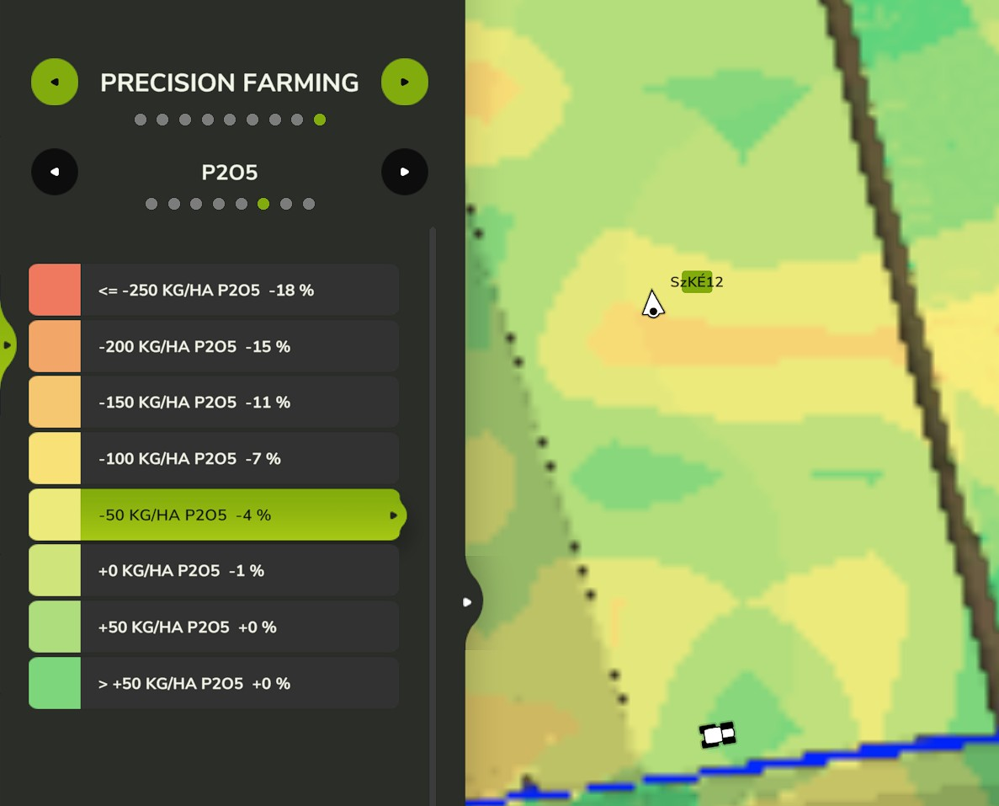
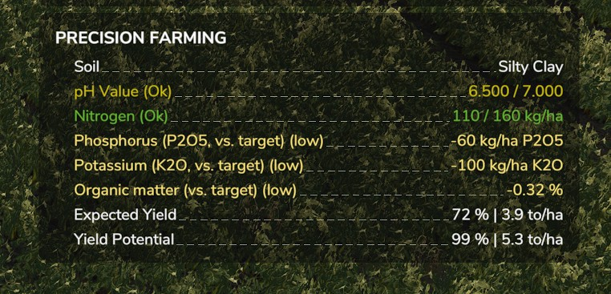
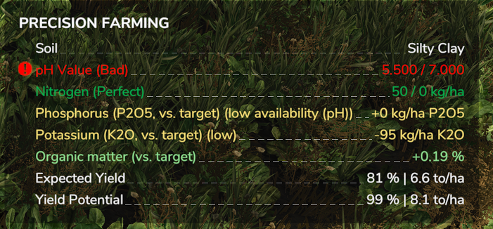

🇬🇧 [English version](EN-02-Phosphorus)

> [!WARNING]
> **Fejlesztés alatt (v0.1).** A mod fejlesztés alatt áll, változások történhetnek. Mindig legyen biztonsági másolatod a mentésedről.

# Foszfor (P₂O₅)

**Minden aratás elviszi a meződ foszforját, és ha a szint a célérték alá esik, kevesebb lesz a termés.**

## Röviden

- Minden mezőhöz tartozik egy **foszfortérkép**. A térkép **relatív**: azt mutatja, mennyivel vagy a talajtípus célértéke alatt (mínusz) vagy fölött (plusz), kg P₂O₅/ha-ban. A 0 a célérték, minden talajtípuson.
- **Minden aratás elvisz** belőle. Vissza csak foszfortartalmú műtrágyával vagy trágyával juttathatod.
- Ha a talaj foszforszintje a **célérték alatt** van, a hozam csökken.
- A célérték fölött nincs büntetés, de haszon sincs. A foszfor nem mosódik ki, és nem is árt.
- Foszforhiányt műtrágyával pótolj. A trágyákban alig van foszfor.

## Mennyit veszítesz, ha kevés a foszfor

Minden talajtípusnak van **célértéke**: ennél a szintnél a foszfor már nem korlátozza a hozamot. A térképen ez a **0**. Van **kezdőértéke** is, innen indul az új térkép, a céltól mért távolságként megadva. A kezdőérték mezőn belül négy szinten szór, mert a talaj nem egyenletes. A célérték minden növénynél ugyanaz, mert a kritikus foszforszintek a növények között alig térnek el.

A térkép a célt nem számként mutatja: a **céltól mért távolságot** tárolja és mutatja, ezért a `0` minden talajtípuson azt jelenti: „a célon". A cél a nullpont. A táblázat a célt talajtartalomként, a kezdőértéket a céltól mért távolságként adja meg:

| Talajtípus | Cél = 0 a térképen (kg P₂O₅/ha) | Kezdőérték a céltól (kg P₂O₅/ha) |
|---|--:|--:|
| Agyagos homok | 420 | −95 … +55 |
| Homokos vályog | 500 | −125 … +50 |
| Vályog | 600 | −150 … +75 |
| Iszapos agyag | 460 | −135 … +65 |

A célértékek és a kezdőértékek becslések. Magyar AL-P₂O₅ ellátottsági osztályokból számoltuk őket (1 mg/kg AL-kivonat kb. 4 kg/ha), ±20–30 % bizonytalansággal. A forrásokat a [Források](HU-11-Forrasok) oldalon találod.

Minél messzebb vagy a céltól, annál kisebb a hozamtényező. A köztes értékeket a mod lineárisan számolja:

| Különbség a céltól | Hozamtényező |
|--:|--:|
| 0 vagy fölötte | 1,00 |
| −100 kg | 0,95 |
| −200 kg | 0,87 |
| −300 kg | 0,80 |
| −600 kg és alatta | 0,65 |

A 0,65-ös alsó határ játékegyensúlyi döntés. A hosszú távú, foszfor nélküli kísérletek 20–40 % veszteséget mutatnak, a szerveren viszont a folyamatok a valóságnál gyorsabban mennek.

**A kulcsszabály:** a foszfor és a kálium közül **a szűkösebb korlátozza a hozamot** (Liebig minimumtörvénye). Ha mindkettő 0,95-ös tényezőt ad, az eredmény 0,95, nem 0,90. A szerves anyag külön szorzó. A mod csak levonni tud a hozamból, ha valami hiányzik. A Precision Farming (PF) saját hozamértéke fölé **soha nem emeli** a hozamot.

Állapot: a hozamgörbét önteszt igazolja (számítási szinten), játékban még nincs végigmérve.

## Mi viszi el a foszfort

### Betakarítás

Minden aratás foszfort visz el, a kaszálás vágásonként. Az alábbi számok **tipikus hozamra** vonatkoznak. A mod a tényleges hozamhoz igazítja őket: jobb termésnél több, gyengénél kevesebb megy el.

| Növény | Elvonás (kg P₂O₅/ha) | Ha a szalmát lehordják |
|---|--:|--:|
| Őszi búza | 64 | +19 |
| Őszi árpa | 56 | +15 |
| Szemes kukorica | 62 | |
| Silókukorica | 65 | |
| Repce | 55 | |
| Napraforgó | 56 | |
| Cukorrépa | 70 | |
| Burgonya | 56 | |
| Lóbab | 44 | |
| Fű (vágásonként) | 22 | |
| Lucerna (vágásonként) | 20 | |

Az összes növény elvonása

A fű, a lucerna és a here értéke vágásonkénti, évi 3 vágással számolva (ez a VirtualTSZ szerver gyakorlata). Más vágásszámnál át kell számolni az értékeket, lásd [Térképkészítőknek](HU-07-Terkepkeszitoknek).

| Növény | Elvonás (kg P₂O₅/ha) | Szalma lehordva (+) |
|---|--:|--:|
| Őszi búza | 64 | 19 |
| Őszi árpa | 56 | 15 |
| Zab | 44 | 13 |
| Rozs | 48 | 14 |
| Tritikálé | 52 | 16 |
| Tönkölybúza | 40 | 12 |
| Szemes kukorica | 62 | 0 |
| Silókukorica | 65 | 0 |
| Cirok (becslés) | 55 | 0 |
| Zöldrozs | 40 | 0 |
| Rozsos bükköny | 45 | 0 |
| Repce | 55 | 0 |
| Napraforgó | 56 | 0 |
| Cukorrépa | 70 | 0 |
| Burgonya | 56 | 0 |
| Szója | 42 | 0 |
| Borsó | 44 | 0 |
| Takarmányborsó | 44 | 0 |
| Lóbab | 44 | 0 |
| Fű, mezőfű, mezei fű (vágásonként) | 22 | 0 |
| Lucerna, here (vágásonként) | 20 | 0 |
| Minden más növény | 50 | 12 |

### Szalma lehordása

A gabonánál a lehordott (bálázott) szalma külön foszfort visz el. Az aprított szalma nem. A repce szalmáját a játékban nem lehet bálázni, az mindig a földön marad.

### Szecskázás és kaszálás

Ha a gabonát egész növényként takarítod be, a szalma is lekerül a földről. A foszforvesztés ilyenkor ugyanannyi, mintha lehordott szalmával aratnál. Ezt játékban még nem ellenőriztük.

### Kimosódás nincs

A foszfor nem mosódik ki, és nem bomlik le. A szintje csak kijuttatástól és betakarítástól változik. Ha egy mezőt nem használsz, a foszforszintje nem csökken.

Állapot: a kaszálás és a kombájn elvonása a logban rendben van. A legtöbb növény értékét játékban még nem mértük végig.

## Így pótolhatod

A mod a kijuttatott termék literei alapján írja a foszfort a térképre. Egy menetben ugyanazt a terméket pixelenként csak egyszer számolja (termékzár). A zárat a talajművelés, a vetés vagy az aratás oldja fel.

| Termék | kg P₂O₅ / 1000 l | Megjegyzés |
|---|--:|---|
| Tripleszuperfoszfát (0-46-0) | 506 | alap mennyiség 230 l/ha ≈ +116 kg/ha |
| MAP (11-52-0) | 499,2 | nitrogént is ad; 200 l/ha ≈ +100 kg/ha |
| NPK (8-24-24) | 252 | |
| Szuperfoszfát (0-18-0) | 189 | 300 l/ha ≈ +57 kg/ha |
| NPK (15-15-15) | 157,5 | |
| Carbolime (cukorgyári mésziszap, a Szalók térkép saját terméke) | 18 | |
| Fermentált | 3,0 | |
| Trágya | 1,75 | |
| Hígtrágya | 1,7 | |
| Élesztővinasz (3-0,5-5) | 3,78 | |

Az alapjáték szilárd műtrágyája (FERTILIZER) alapból csak nitrogént ad, foszfort nem. A Pétisó, a Karbamid és a Nitrosol szintén csak nitrogén. A termékekről, a mennyiség-billentyűkről és az automatikus mennyiségről a [Termékek és kijuttatás](HU-05-Termekek-es-kijuttatas) oldalon olvashatsz.

Példa: 25 000 l/ha hígtrágya +42 kg P₂O₅/ha. A trágyák foszfortartalma kicsi, ezért foszforhiányt velük nem pótolsz.

Állapot: a termékek foszfortartalmát önteszt igazolja. A kijuttatás szabályai (termékenként és menetenként egyszer) játékban működnek. A bolti termékeket játékban még nem próbáltuk ki.

## Így nézheted meg

1. **Talajmintavétel.** A PF nitrogén- és pH-rétegéhez hasonlóan a foszforréteg is rejtett, amíg nem mintavételezed a mezőt. Mintavétel nélkül a térkép üres.
2. **Térképréteg.** ESC › Térkép › PF választó › **Foszfor**. A térkép relatív: a jelmagyarázat −300 és +100 kg P₂O₅/ha között fut a céltól. A 0 a talajtípus célértéke, a mínusz hiány, a plusz többlet. Színtévesztő módban a PF saját színei látszanak.
3. **Mezőinfó.** Állj a mezőre, és ezt látod: `Foszfor (P2O5, a céltól): -60 kg/ha P2O5`. A szám a talajtípus céljától mért egyszerű távolság. A sor színe a hozamtényezőtől függ, ebben a pH hatása is benne van. Ha a talaj a célon vagy fölötte van, de a pH miatt mégis kisebb a hozam, a sor ezt írja: „alacsony felvehetőség (pH)” (lásd lent). A szín:
   - 0,99 vagy több: zöld
   - 0,90 és 0,99 között: sárga, „alacsony”
   - 0,90 alatt: piros, „nagyon alacsony”

A mintavételezés, a jelmagyarázat és a mezőinfó sorai az eredeti (abszolút) térképpel játékban ki voltak próbálva. A relatív változatot (a céltól mért távolság a mezőinfóban) játékban még nem próbáltuk végig. Részletek: [Első lépések](HU-01-Elso-lepesek).

## A foszfor különleges szabályai

### pH és felvehetőség

A foszfor felvehetősége a talaj pH-jától függ. Savanyú talajon az alumínium és a vas köti meg. Meszes (pH 7 fölötti) talajon kalcium-foszfátként tapad meg. A mod a PF pH-térképéből olvassa a talaj pH-ját, és a célértéket elosztja a pH-hoz tartozó **felvehetőségi aránnyal**. Az optimumtól távol tehát ugyanahhoz a hozamhoz nagyobb foszforkészlet kell. A térkép ettől nem változik (a térkép a talajt mutatja), és a mezőinfó száma sem: a pH hatása a **hozamtényezőben** (vagyis a sor színében) és egy figyelmeztető szövegben jelenik meg.

| pH | 5,0 és alatta | 5,5 | 6,2 – 7,2 | 7,8 | 8,2 és fölötte |
|---|--:|--:|--:|--:|--:|
| Felvehetőség | 70 % | 85 % | 100 % | 90 % | 80 % |

A köztes pH-értékeket a mod lineárisan számolja. **Ezek a százalékok becslések**, nem forrásból átvett adatok. Az irány viszont (savanyú és meszes talajon rosszabb) forrásokkal alátámasztott.

Példa: vályogon a cél 600 kg/ha, ez a térképen a 0. pH 5,5-nél a hozamhoz 600 / 0,85 = 706 kg/ha kell, vagyis a talajcélnál +106 kg/ha-ral több. Ha a talajban 525 kg/ha van (a térképen −75), a mezőinfó ezt írja: `-75 kg/ha P2O5`, a hozamtényező viszont kisebb, mint amit a hiány önmagában adna. Ilyen mezőn még a 0-n álló pixel sem ad teljes hozamot, mert a hozamtényezőt a magasabb (706 kg/ha-os) célhoz mérjük.

**A pH-figyelmeztetés.** Ha a talaj a célon vagy fölötte van, de a hozamtényező csak a pH miatt van 0,99 alatt, a sor kiegészítő szövege „alacsony” / „nagyon alacsony” helyett „alacsony felvehetőség (pH)”. A sor sárga 0,9 hozamtényezőtől, alatta piros, figyelmeztetéssel. A térkép ilyenkor mutathat 0-t vagy többletet, miközben a hozam 100 % alatt van.

**Mit tegyél.** A pH-t mésszel javítsd (lásd a mésztermékeket). Több foszfor nem segít. Az automatikus mennyiség csak a talajtípus céljáig tölti fel a hiányt, a pH-t nem veszi figyelembe, ezért savanyú vagy lúgos mezőn a hozamtényező 1 alatt marad, amíg a pH-t nem hozod rendbe.

**Korlát.** A pH-hoz igazított célt a mod legfeljebb a lágy plafon (+300) alatt egy lépéssel, +295 kg/ha-nál vágja le, hogy a teljesen feltrágyázott mező mindig elérhesse az 1,0-s tényezőt. A Szalók talajtípusain ez nem számít: a legsavanyúbb esetben (pH 5,0) a hozamtényező mögötti igazított cél agyagos homokon 600 (a talajcélnál +180), homokos vályogon 714 (+214), iszapos agyagon 657 (+197), vályogon 857 (+257). A vályog +257 még belefér a +300-as plafonba. Ezért a plafon nem állítható +260 alá.

Aratáskor a mod a gép alatti pixel pH-ját használja, ehhez nem kell talajmintavétel. A PF saját pH-hozamtényezője (a mész hatása) külön marad. A két hatást a mod mérsékli, hogy ne számoljon kétszer.

Állapot: a pH-szabály számítási szinten ellenőrzött (önteszt), játékban még nem.

> [!TIP]
> Mielőtt a foszfort hibáztatod egy gyenge mezőért, nézd meg a pH-t. Savanyú vagy meszes talajon ugyanaz a foszforszint kevesebb hozamot ad, és a mezőinfó „alacsony felvehetőség (pH)” szöveget írhat.

## Meddig tölthető fel a térkép

A foszfortérkép a céltól **−600 … +675 kg P₂O₅/ha** tartományt tárol, 5 kg-os lépésekben. A kijuttatás viszont **+300 kg/ha-nál megáll** (lágy plafon): ami ennél többet kerülne a talajba, elvész, vagyis a +300 fölé szórt foszfor pazarlás. Ez minden talajtípuson a céltól mért 300 kg tartalék. Kisebb feltöltésre és a pH-hoz igazított célra (legfeljebb +257) elég, tartós, nagy túlfeltöltésre nem.

Ez játékszabály. A valóságban a foszfor a talajban marad, és a feltöltő trágyázás szokásos gyakorlat.

## Tippek

- **Először a pH-t és a mintát nézd.** Savanyú vagy meszes talajon a növény kevesebbet tud felvenni a talaj foszforjából. Ezt a mész javítja, a több foszfor nem.
- **Ha lehordod a szalmát, számolj vele.** Az őszi búza 64 helyett 83 kg P₂O₅-t visz, az árpa 56 helyett 71-et. A B példa vetésforgóban (szalma lehordva, csak műtrágya) a foszfor az évek végén P-műtrágyával 600 és 634 kg/ha között maradt, a legrosszabb hozamtényező 0,98 és 1,00 között volt. Ez szimuláció, nem játékbeli mérés.
- **Ne építs a határ fölé.** A célnál +300 kg/ha fölött semmi nem marad meg. Elég a célt és az elvonást pótolni.
- **Trágya mellé foszforműtrágya kell.** A trágyák foszfortartalma csekély (1,7–3 kg 1000 literenként). A hiányt tripleszuperfoszfáttal, MAP-pel vagy szuperfoszfáttal pótold.
- **Az automatikus mennyiség segít.** A tripleszuperfoszfát és a szuperfoszfát automatikus mennyisége a térképből számol: pontosan a célig hiányzó mennyiséget juttatja ki. Lásd [Termékek és kijuttatás](HU-05-Termekek-es-kijuttatas).

Az elvonás számai becslések (±20–30 %), a források a [Források](HU-11-Forrasok) oldalon vannak.

## Lásd még

- [Termékek és kijuttatás](HU-05-Termekek-es-kijuttatas)
- [Vetésforgók](HU-06-Vetesforgok)
- [Kálium](HU-03-Kalium)
- [Technikai részletek](HU-08-Technikai-reszletek)
