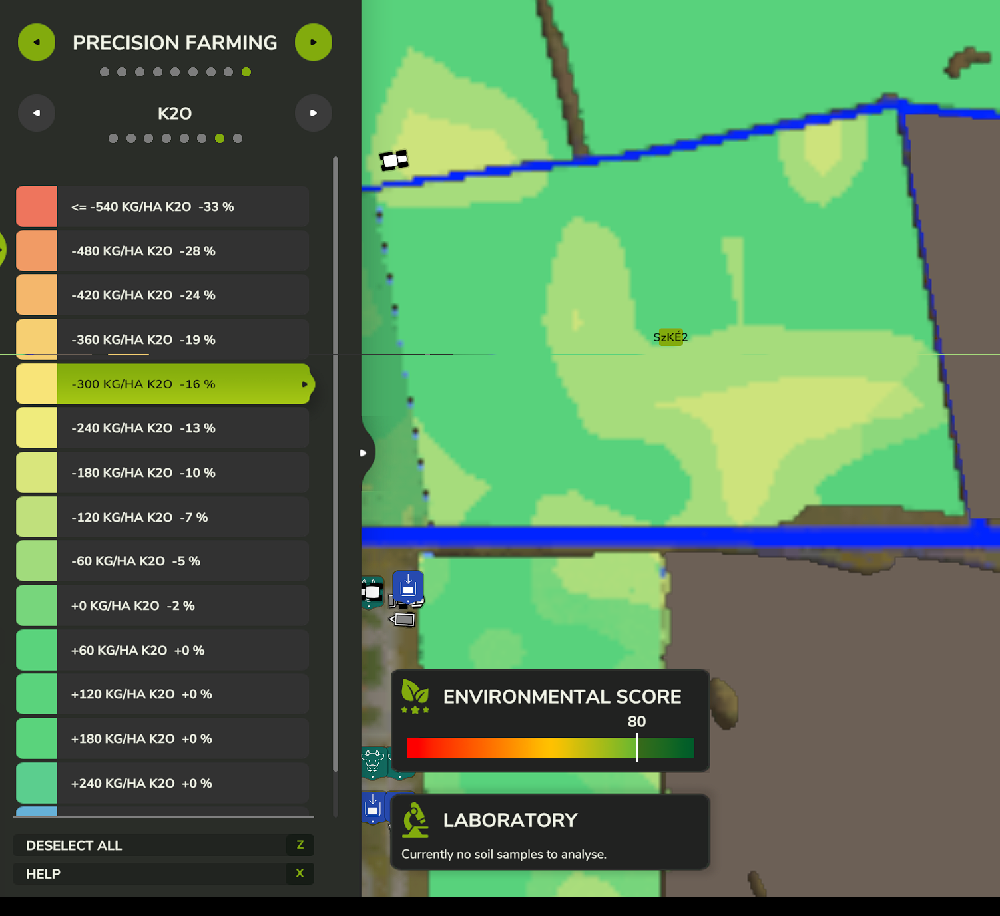

🇬🇧 [English version](EN-03-Potassium)

> [!WARNING]
> **Fejlesztés alatt (v0.1, tesztelés).** A mod instabil, változások történhetnek. Mindig legyen biztonsági másolatod a mentésedről.

# Kálium (K₂O)

## Dióhéjban

**Silókukorica, cukorrépa és burgonya után a kálium fogy a leggyorsabban, és ha elfogy, a hozam esik.**

- Minden mezőnek külön kálium (K₂O) térképe van. A térkép **relatív**: a talajtípus célértékétől mért távolságot mutatja kg K₂O/ha-ban (0 = a cél, mínusz = hiány, plusz = többlet).
- A cél minden növénynél ugyanaz. A növény csak azt változtatja meg, mennyit visz el egy aratás.
- Minden aratás elvisz belőle: a gabona keveset, a siló, a cukorrépa és a burgonya sokat.
- Trágya és kálitartalmú műtrágya pótolja.
- A talajcél fölötti rész lassan kimosódik.
- Ha a talaj kevés káliumot ad az adott növénynek, a hozam csökken.
- A mod csak levon a hozamból, a Precision Farming (PF) értéke fölé nem visz.

## Mit tesz a hozamoddal

A mod csak akkor von le a hozamból, ha a talaj kevés káliumot ad. A PF saját hozama fölé soha nem visz. A foszfor és a kálium közül a **szűkösebb** számít (Liebig minimum-törvénye): ha mindkettő 0,95-ös tényezőt adna, az eredmény 0,95, nem 0,90. A szerves anyag külön szorzó, lásd [Szerves anyag](HU-04-Szerves-anyag).

### Célértékek talajtípusonként

Minden talajtípusnak van **alapcélja**. A térkép ezt nem számként mutatja, hanem a **tőle mért távolságot**, ezért a `0` minden talajtípuson azt jelenti: „az alapcélon", és a színek mindenhol ugyanazt jelentik. A táblázat a célt talajtartalomként, a kezdőértéket a céltól mért távolságként adja meg (kg K₂O/ha). Új mentésnél a kezdőérték a mezőn belül négy lépcsőben szór.

| Talajtípus | Alapcél = 0 a térképen (kg K₂O/ha) | Kezdőérték a céltól (kg K₂O/ha) |
|---|--:|---|
| Agyagos homok | 500 | −140 … +60 |
| Homokos vályog | 700 | −180 … +100 |
| Vályog | 740 | −180 … +100 |
| Iszapos agyag | 820 | −180 … +100 |

### A cél minden növénynél ugyanaz

A K célja minden növénynél a talajtípus célja: a búza, a cukorrépa és a burgonya is ugyanahhoz a térképi 0-hoz méri magát. A növény csak azt változtatja meg, mennyit visz el egy aratás (lásd lent az elvonási táblát), és ezt kell pótolnod. A térképkészítő a konfigban még megadhat növényi többletet, de az alap konfig 0-t használ.

### A hozamtényező

A tényező attól függ, mennyivel van a tényleges K a talajtípus célja alatt vagy fölött. A köztes értékeket a mod lineárisan számolja.

| Különbség a céltól | Hozamtényező |
|---|--:|
| −600 kg vagy kevesebb | 0,65 |
| −400 kg | 0,80 |
| −250 kg | 0,88 |
| −100 kg | 0,95 |
| a cél | 1,00 |
| +200 kg | 1,00 |
| +400 kg | 0,97 |
| +600 kg vagy több | 0,95 |

Példa: vályogon a térkép −135-öt mutat (605 kg/ha a talajban, a cél 740). A tényező kb. 0,93, bármilyen növény áll a mezőn. A mezőinfó sora: `-135 kg/ha K2O`.

A cél fölötti enyhe büntetés (+400 kg-nál 0,97, +600 kg-nál 0,95) játékegyensúlyi szabály, kis valós alappal: a sok K akadályozza a magnézium felvételét. A mértéke becslés, mért adat nincs rá.

Állapot: a tényezőket számítás szintjén ellenőrzi a `vtszSelfTest`. Az aratási hozamtényezőt játékban még nem próbáltuk ki.

## Mitől csökken

### Aratás

Minden aratás (kaszálásnál vágásonként) levon K-t. Az elvonás **követi a tényleges hozamot**: gyenge hozamnál kevesebb, kiváló hozamnál több megy el. Az alábbi értékek tipikus hozamra vonatkoznak.

| Növény | K₂O elvonás (kg/ha) | + lehordott szalma |
|---|--:|--:|
| Őszi búza | 44 | +90 |
| Őszi árpa | 42 | +120 |
| Kukorica | 55 | |
| Repce | 30 | |
| Napraforgó | 84 | |
| Cukorrépa | 175 | |
| Burgonya | 240 | |
| Silókukorica | 190 | |
| Zöldrozs | 150 | |
| Rozsos bükköny | 155 | |
| Fű (vágásonként) | 87 | |
| Lucerna (vágásonként) | 93 | |

A fű és a lucerna értéke **vágásonként** értendő. A VirtualTSZ szerveren évente 3 vágás van, így az éves elvonás kb. 260–280 kg.

A teljes lista a gabonákkal, a hüvelyesekkel és a többi növénnyel:

Összes növény K₂O elvonása (kg/ha, tipikus hozamnál)

| Növény | K₂O | + szalma |
|---|--:|--:|
| Egyéb (DEFAULT) | 50 | +80 |
| Őszi búza | 44 | +90 |
| Őszi árpa | 42 | +120 |
| Zab | 31 | +62 |
| Rozs | 33 | +67 |
| Tritikálé | 36 | +73 |
| Tönköly | 28 | +56 |
| Kukorica | 55 | |
| Silókukorica | 190 | |
| Cirok (becslés) | 170 | |
| Zöldrozs | 150 | |
| Rozsos bükköny | 155 | |
| Repce | 30 | |
| Napraforgó | 84 | |
| Cukorrépa | 175 | |
| Burgonya | 240 | |
| Szója | 55 | |
| Borsó, takarmányborsó | 40 | |
| Lóbab | 56 | |
| Fű, szántóföldi fű, mezei fű (vágásonként) | 87 | |
| Lucerna (vágásonként) | 93 | |
| Here (vágásonként) | 100 | |

Források: LfL Bayern Basisdaten (2025), IPNI és Ohio State (szója), Embrapa (cirok); a lucerna és a here szénaértékekből számolva. A számok becslések, kb. ±20–30 % pontossággal.

### Szalma

A gabonánál a "+ lehordott szalma" érték csak akkor jön le, ha lehordod a szalmát. Ha a kombájn **aprít**, a szalma káliuma a földön marad: búzánál 90, árpánál 120 kg K₂O/ha megspórolható. Szecskázó fejjel vagy kaszával vágott gabonánál a termény és a szalma is lekerül, ott a szalmatag is levonódik.

### Kimosódás

A K, amely a **talajtípus célján (a térképen 0) vagy fölötte** van, lassan kimosódik, a könnyű talajon többet. Ami a cél alatt van, az megmarad. Az éves veszteség (becslés):

| Talajtípus | Évi veszteség (kg K₂O/ha) |
|---|--:|
| Agyagos homok | 40 |
| Homokos vályog | 25 |
| Vályog | 15 |
| Iszapos agyag | 10 |

A veszteség szétoszlik az év során: a nedves, hűvös hónapokban (tavasz elején, késő ősszel, télen) több, nyáron (július–augusztus) a legkevesebb. Az érték játékévre szól, a `timeScale` nem szorozza (az csak a szerves anyagra hat). A VirtualTSZ szerveren egy valós évre kb. 6 játékév jut, ezért a talaj valós évenként 6-szor ennyi K-t veszít.

Állapot: a kimosódás számítását ellenőrzi a `vtszSelfTest`, játékban még nem próbáltuk ki. A foszfor nem mosódik ki.

## Hogyan javíthatom

Az értékek 1000 literenként értendők (K₂O). A mod a kijuttatott literekből számolja, mennyi K kerül a talajba.

| Termék | K₂O kg / 1000 l | Megjegyzés |
|---|--:|---|
| Kálisó 60 (0-0-60) | 660 | a legtöbb K, olcsó (játékbeli ár kb. 3,5 / kg K₂O) |
| Patentkali (0-0-30) | 357 | szulfátos, klórmentes |
| NPK (8-24-24) | 252 | P-t is ad |
| NPK (15-15-15) | 157,5 | N-t és P-t is ad |
| Élesztővinasz (3-0,5-5) | 37,8 | melléktermék |
| Hígtrágya | 5,0 | |
| Fermentált (biogáz-iszap) | 5,0 | |
| Trágya | 4,2 | |
| Carbolime (cukorgyári mésziszap, a Szalók saját terméke) | 1,2 | gyakorlatilag nulla |

Az alapjáték szilárd műtrágyája (FERTILIZER) alapból **csak nitrogént** ad, mint a PF-ben. A káliumot a mod termékei adják. A térkép a `baseFertilizer` beállítással ezt megváltoztathatja.

Hektáronként: 25 000 l hígtrágya kb. +125 kg K₂O, 20 000 l trágya kb. +84 kg. A Kálisó alapadagja 230 l/ha (kb. 152 kg K₂O). A termékek árát, a kijuttatást és az automatikus mennyiséget a [Termékek és kijuttatás](HU-05-Termekek-es-kijuttatas) oldal írja le.

> [!NOTE]
> A PF saját automatikus mennyisége csak a nitrogént kezeli. A mod a káliumra (és a foszforra) is számol automatikus mennyiséget, lásd [Termékek és kijuttatás](HU-05-Termekek-es-kijuttatas). A mennyiségváltó billentyűket játékban még nem teszteltük.

## Hogyan látod?

1. **Talajmintavétel.** Mint a PF nitrogén- és pH-rétege, a K réteg is rejtett, amíg le nem mintázod a mezőt. Mintavétel nélkül a réteg üres.
2. **Térképréteg.** ESC › Térkép › PF választó › **Kálium**. Relatív térkép, piros-sárga-zöld a célig, +200-ig zöld (nincs büntetés), csak +200 fölött kék, ahol a hozambüntetés kezdődik; jelmagyarázat −600-tól +300 kg K₂O/ha-ig a céltól. A 0 a talajtípus célértéke.
3. **Mezőinfó.** A mezőn állva ezt látod: `Kálium (K2O, a céltól): -100 kg/ha K2O`. Egyetlen szám: a talaj távolsága a talajtípus céljától, itt 100 a hiány. Ha kevés a K, mellette "alacsony" vagy "nagyon alacsony" áll.

Egyjátékos módban az eredeti (abszolút) térképpel játékban kipróbáltuk: a réteg a PF választóban, a mintavétel, a jelmagyarázat és a mezőinfó sorok. A relatív változatot a mezőinfóban játékban még nem próbáltuk végig. A K hatását a mezőinfó "várható hozam" sorában még nem ellenőriztük.

## Különleges szabályok

### Minden növénynél ugyanaz a cél

A cél nem függ a növénytől. Sokat elvivő növény (silókukorica, cukorrépa, burgonya) előtt nézd meg, mennyivel van a térkép 0 alatt, és számolj az aratás elvonásával a fenti táblából. A mod súgója minden növény betakarításonkénti elvitelét listázza, bálázott szalmával és szecskázással is, ahol az eltér (ESC › Súgó › VirtualTSZ tápanyagok). A súgóoldalt játékban még nem ellenőriztük.

### A Kálisó klórtartalma

A Kálisó 60 kálium-klorid, tehát klórt is visz a talajba. A klórra érzékeny növények (burgonya, zöldségek) kb. 675 kg Cl/ha-t viselnek el szezononként, a szokásos növények kb. 140 kg Cl/ha-ig nem mutatnak kárt (APNI, K+S). Ezért a mod a Kálisót **legfeljebb 450 l/ha-ig** engedi menetenként (kb. 495 kg termék, 297 kg K₂O, kb. 230 kg klorid).

Egyetlen forrás sem ad kemény egyszeri határt, ezért a korlát engedékeny becslés, nem valós szabály. Ha többre van szükséged, két menetben szórd ki, vagy használj Patentkalit (szulfát). A mod a klórérzékenységet növényenként nem modellezi. A korlát az automatikus mennyiségre is érvényes: nagy hiánynál ezért több menet kell (lásd [Termékek és kijuttatás](HU-05-Termekek-es-kijuttatas)).

## Térképkorlát

A K térkép a céltól **−600 … +675 kg K₂O/ha** tartományt tárol, 5 kg-os lépésekben. Ami ezen felül kerülne a talajba, elvész, tehát a nagy feltöltés pazarlás. A K térképnek nincs külön lágy plafonja (a foszforé +300).

Ez játékszabály: a valóságban a feltöltő trágyázás szokásos, és a K nem tűnik el így. A cél fölé szórt K ráadásul lassan kimosódik, és nagyon magas szintnél a hozam is enyhén csökken.

## Tippek

- Silókukorica után számolj: a tipikus szecskázás 190 kg K₂O-t visz el, ezt kb. 290 l/ha Kálisó pótolja. A hígtrágya 25 000 l/ha-nál csak kb. 125 kg-ot ad vissza.
- Ha nem kell a szalma, aprítsd: búzánál 90, árpánál 120 kg K₂O/ha marad a földön.
- Könnyű talajon (agyagos homok, homokos vályog) ne építs a cél fölé, mert ott mosódik ki a legtöbb.
- Aratás után, vagy olyan mezőn, amely 0 alatt indul, csak azt pótold, ami hiányzik. A növény nem változtatja a célt. Az automatikus mennyiség pontosan a hiányt adja ki.
- Ha szűk a Kálisó 450 l/ha-s korlátja, szórd két menetben, vagy használj Patentkalit.

## Lásd még

- [Termékek és kijuttatás](HU-05-Termekek-es-kijuttatas)
- [Vetésforgók](HU-06-Vetesforgok)
- [Technikai részletek](HU-08-Technikai-reszletek)
- [Foszfor](HU-02-Foszfor)
