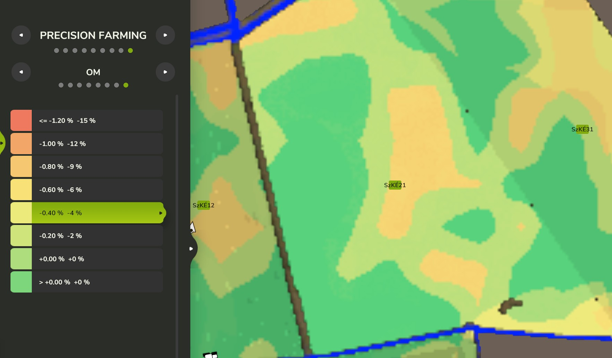

🇬🇧 [English version](EN-04-Organic-Matter)

> [!WARNING]
> **Fejlesztés alatt (v0.1, tesztelés).** A mod instabil, változások történhetnek. Mindig legyen biztonsági másolatod a mentésedről.

# Szerves anyag (OM)

## Dióhéjban

**A szerves anyag (humusz) lassan fogy a földedből, és ha a talajtípus célértéke alá esik, a hozam csökken.**

- A talaj szerkezetét és vízraktározását adja, és lassan nitrogént szabadít fel.
- A Precision Farming nem követi, ez a mod harmadik rétege.
- Nem tápanyag, hanem **külön hozamszorzó**.
- Fogyasztja: a havi lebomlás, a silókukorica, a szecskázás és a gyökérnövények (burgonya, cukorrépa).
- Építi: a trágya, az aprított szalma, a pillangósok, a lucerna és a takarónövények.
- A VirtualTSZ szerveren kb. 6 játékév telik egy valós év alatt, és a mod minden OM-változást megszoroz a 6-os `timeScale`-lel. Így a hatása egy valós éven belül látszik.

## Mit tesz a hozamoddal

A célérték talajtípusonként más. A kezdőértéket a céltól mért távolságban adjuk meg (%-pont), mert az OM térkép relatív (lásd lejjebb).

| Talajtípus | OM célérték | Kezdőérték a céltól (%-pont) |
|---|--:|---|
| Agyagos homok (Loamy Sand) | 1,8 % | −0,8 … 0 |
| Homokos vályog (Sandy Loam) | 2,5 % | −0,7 … +0,5 |
| Vályog (Loam) | 3,2 % | −0,8 … +0,8 |
| Iszapos agyag (Silty Clay) | 4,0 % | −0,8 … +0,8 |

A célértékek szakirodalmi tartományokból becsült értékek (±20–30 %). Új mentésnél a legrosszabb kezdőszint is csak 0,92-es hozamtényezőt ad, egyik talajtípuson sem megy 0,90 alá.

**Hozamtényező az OM-hez** (két érték között a mod lineárisan számol):

| Távolság a céltól | Hozamtényező |
|--:|--:|
| 0 vagy fölötte | 1,00 |
| −0,2 | 0,99 |
| −0,4 | 0,97 |
| −0,6 | 0,95 |
| −0,8 | 0,92 |
| −1,0 | 0,89 |
| −1,25 | 0,855 |
| −1,5 | 0,82 |
| −2,0 | 0,75 |
| −2,5 | 0,68 |

A görbe a célnál lapos, lejjebb meredekebb: kis hiány alig fáj, nagy hiány sokba kerül. Hogy a tényező hogyan kerül az aratás hozamába, a [Technikai részletek](HU-08-Technikai-reszletek) oldalon olvashatod.

Két alapszabály:

- **Az OM külön szorzó, nem része a foszfor és kálium „szűk keresztmetszetének".** A hozam: PF szorzó × min(P-tényező, K-tényező) × OM-tényező. A P és K közül a szűkebb számít (Liebig minimumtörvénye: 0,95 és 0,95 együtt 0,95, nem 0,90), az OM ezen felül külön szorzódik. Lásd [Foszfor](HU-02-Foszfor) és [Kálium](HU-03-Kalium).
- **A mod csak levon, soha nem ad hozzá.** A célérték fölött az OM-tényező 1,00, így a hozam nem lesz nagyobb annál, amit a Precision Farming egyébként adna.

## Mitől csökken

| Ok | OM változás |
|---|--:|
| Silókukorica (zöldrozs, rozsos bükköny és cirok is így számít) | −0,070 aratásonként |
| Burgonya | −0,120 aratásonként |
| Cukorrépa (a levél visszaad egy részt) | −0,036 aratásonként |
| Gabona **szecskázva vagy kaszával** (a termény és a szalma is lekerül) | −0,055 … −0,088 aratásonként (mint a lehordott szalma) |
| Gabona, **lehordott szalmával** | −0,055 … −0,088 aratásonként (az aprított érték mínusszal: a szalma OM-je lekerül a földről) |
| **Havi lebomlás** (mineralizáció) | lásd lejjebb |

Az összes növény OM-változása aratásonként (játékbeli érték, tipikus hozamnál)

Az értékek a config-értékek (valós éves alap) hatszorosai (`timeScale`). A havi lebomlás ezeken felül, külön megy.

| Növény | Szalma lehordva | Szalma aprítva | Szecskázás / kasza |
|---|--:|--:|--:|
| Őszi búza | −0,088 | +0,088 | −0,088 |
| Őszi árpa | −0,067 | +0,067 | −0,067 |
| Zab | −0,076 | +0,076 | −0,076 |
| Rozs | −0,074 | +0,074 | −0,074 |
| Tritikálé | −0,080 | +0,080 | −0,080 |
| Tönköly | −0,055 | +0,055 | −0,055 |
| Szemes kukorica | +0,068 | +0,068 | +0,068 |
| Silókukorica | −0,070 | −0,070 | −0,070 |
| Cirok, zöldrozs, rozsos bükköny | −0,070 | −0,070 | −0,070 |
| Repce | +0,082 | +0,082 | +0,082 |
| Napraforgó | +0,096 | +0,096 | +0,096 |
| Cukorrépa | −0,036 | −0,036 | −0,036 |
| Burgonya | −0,120 | −0,120 | −0,120 |
| Szója, borsó, takarmányborsó, lóbab | +0,110 | +0,110 | +0,110 |
| Fű, szántóföldi fű, mezei fű, lucerna, here (vágásonként) | +0,057 | +0,057 | +0,057 |

További: sárgarépa és paszternák −0,070, zöldbab és cékla 0 (gabonaszint). A cirok értékei becslések.

## Hogyan javíthatom

Az alábbi értékek **%-pont / ha, játékbeli értékek** (játékévenként a valós éves érték hatszorosa, `timeScale` 6). Alapjuk a német VDLUFA humuszmérleg (becslés, ±20–30 %), a részleteket a lap végén találod.

**Szerves trágyák és termékek** (1000 literenként, az N-tartalomtól függetlenül):

| Termék | OM / 1000 l (játékban) | Config-érték (×6 = játékban) | Példa |
|---|--:|--:|---|
| Trágya | +0,0048 | 0,0008 | 20 000 l/ha = +0,096 |
| Hígtrágya | +0,00204 | 0,00034 | 25 000 l/ha = +0,051 |
| Fermentált | +0,00228 | 0,00038 | 20 000 l/ha = +0,046 |
| Élesztővinasz | +0,0168 | 0,0028 | becslés |
| Carbolime (cukorgyári mésziszap, a Szalók térkép saját terméke) | +0,00216 | 0,00036 | becslés |

A hígtrágya kevesebb OM-et ad a trágyánál. A műtrágyák (Pétisó, NPK, Kálisó stb.) **nem emelik** az OM-et. A „config-érték" oszlop a configfájl valós éves alapja, a játék ezt szorozza 6-tal. Ugyanezek a termékek a [Termékek és kijuttatás](HU-05-Termekek-es-kijuttatas) oldalon is szerepelnek.

**Betakarítás és növények:**

| Forrás | OM változás aratásonként / vágásonként |
|---|--:|
| Lóbab, borsó, szója (magvas pillangósok) | +0,110 |
| Napraforgó | +0,096 |
| Repce | +0,082 |
| Szemes kukorica | +0,068 |
| Lucerna, here, fű (vágásonként; a szerveren évi 3 vágás) | +0,057 |
| Aprított szalma: őszi búza | +0,088 |
| Aprított szalma: őszi árpa | +0,067 |

**Takarónövények bedolgozása vagy mulcsozása** (olajretek és mustár +0,048, virágos keverék +0,042, humuszaktív keverék +0,072 mezőnként, egyszer). A takarónövény akkor számít, ha megsemmisíted. Ezekkel megy:
- *játékban kipróbálva:* a mulcsozó (a mulcsozás ugyanannyit ad, mint a bedolgozás),
- *kódból olvasva, játékban még nem tesztelve:* eke, ekeszár (subsoiler), tárcsa, kultivátor és direktvetés.
- Egy pixel csak egyszer számít: a már mulcsozott maradvány a második mulcsozó menetnél és egy későbbi szántásnál sem ad újra.
- Henger, gyomirtó borona, kőszedő és a betakarítás nem ad OM-et (kódból olvasva).

Az aratási értékek a hozamot csak félig követik: gyenge terméssel kevesebbet adnak vagy vesznek el, de nem arányosan.

## Hogyan látod

1. **Talajmintavétel.** Mint a PF nitrogén- és pH-rétege, az OM sem látszik, amíg nem mintáztad le a mezőt. Lásd [Első lépések](HU-01-Elso-lepesek).
2. **Térképréteg.** ESC > Térkép > a PF rétegválasztóban: *Szerves anyag*.
3. **Jelmagyarázat.** A térkép **relatív**: nem a százalékot mutatja, hanem azt, mennyi hiányzik a talajtípus céljához képest, vagy mennyi a többlet. Ezért a színek minden talajtípuson ugyanazt jelentik:
   - **zöld** = a célon vagy fölötte,
   - **sárga** ≈ −0,6 %-pont,
   - **piros** ≈ −1,2 %-pont és alatta.

   (A sárga és a piros jelölést játékban még nem ellenőriztük, lásd a lap végi megjegyzést.)

   A jelmagyarázat −1,4 és +0,2 között fut. Az agyagos homok 1,8 %-a és az iszapos agyag 4,0 %-a is zöld, ha a célon van. A tényleges százalékot a célértékből és a távolságból számolhatod ki (vályogon −0,5 = 2,7 %).

   A [foszfor](HU-02-Foszfor) és a [kálium](HU-03-Kalium) térképe ugyanígy működik: ők is a talajtípus céljától való távolságot mutatják (0 = a cél, mínusz = hiány, plusz = többlet). A különbség: a szerves anyagnál nincs a növénytől függő cél a térképi érték mellett, a káliumnál (és savanyú talajon a foszfornál) viszont a mezőinfó sora a növény célját is mutatja.
4. **Mezőinfó.** A „Szerves anyag (a céltól)" sor csak a távolságot mutatja, például `−0,32 %`. A szín a hozamtényezőtől függ: zöld 0,99 vagy több (kb. −0,2-ig), sárga „alacsony" 0,90 és 0,99 között, piros „nagyon alacsony" 0,90 alatt (színtévesztő módban saját színekkel).

## A különleges szabályok

### Havi lebomlás

A talaj szerves anyaga folyamatosan fogy: a mod minden játékhónap váltásakor levon az OM térképből. Az éves veszteség a talajtípus célértékének 0,365 %-a (a VDLUFA gabonára számolt humuszigénye). A játékban játékévenként ennek hatszorosa jön le (`timeScale` 6):

| Talajtípus | Lebomlás / játékév |
|---|--:|
| Agyagos homok | −0,039 %-pont |
| Homokos vályog | −0,055 %-pont |
| Vályog | −0,070 %-pont |
| Iszapos agyag | −0,088 %-pont |

A veszteség követi az évszakot: hűvös hónapokban alig, nyáron a legtöbb (június–augusztus az éves veszteség 43 %-a, december–február 6 %-a). A talajművelés nem gyorsítja, a mod ezt nem modellezi.

### A lebomlás nitrogént ad

A lebomló szerves anyag nitrogént szabadít fel, és a mod ezt hozzáadja a Precision Farming nitrogéntérképéhez. Évente 8 kg N/ha jut az OM-készlet (a talajtípus célja) minden %-ára:

| Talajtípus | N-felszabadulás évente |
|---|--:|
| Agyagos homok | kb. 14 kg N/ha |
| Homokos vályog | kb. 20 kg N/ha |
| Vályog | kb. 26 kg N/ha |
| Iszapos agyag | kb. 32 kg N/ha |

Ugyanúgy az évszak szerint oszlik el, nyáron a legtöbb. A PF automatikus adagolója a megnövekedett nitrogénszintet látja, ezért **kevesebb nitrogént ad ki**. Ez nettó becslés (a bruttó mineralizáció nagyobb, de nagy részét a maradványok újra megkötik), ezért ne várj tőle nagy nitrogénforrást.

### Időskála a szerveren

> [!NOTE]
> A configban az OM értékei valós éves értékek (VDLUFA). A szerver gyorsan pörgeti az időt: kb. 6 játékév telik egy valós év alatt. Hogy a talaj ehhez igazodjon, a 6-os `timeScale` minden OM-változást megszoroz, így **játékévenként az OM a valós éves érték hatszorosával mozdul**. A hatás egy valós éven belül látszik.
>
> Ez a VirtualTSZ szerverre jellemző: a `timeScale` a térkép beállítása, a térképkészítők megváltoztathatják (lásd [Térképkészítőknek](HU-07-Terkepkeszitoknek)), más szerveren lehet más. Ez játékszabály, nem a valóság.

A hatszoros időskálán is ugyanaz a mérleg: a kiegyensúlyozott forgó kiegyensúlyozott marad, csak hamarabb látod.

### Humuszmérleg (VDLUFA) két mondatban

A mod a német VDLUFA „Humusbilanzierung" (2014) módszerét használja: minden növény és minden szerves anyag humuszegyenértéket (Häq, 1 Häq = 1 kg humusz-C/ha) visz el vagy hoz, és a mod ezt %-pontra váltja át. A mérleg a gabona alapigényénél indul (ez a havi lebomlás), a többi növény a különbséget aratáskor viszi el vagy adja vissza.

A humuszegyenértékek táblázata (valós éves értékek)

| Tétel | VDLUFA érték | A modban (config-érték, valós éves alap; játékévenként ×6) |
|---|---|---|
| Gabona, olajnövény, napraforgó humuszigénye | −280 Häq/ha/év | a folyamatos havi lebomlás |
| Silókukorica, szemes kukorica, sárgarépa, paszternák | −560 | aratáskor −0,0117 %-pont |
| Cukorrépa, burgonya | −760 | aratáskor −0,0200 %-pont |
| Magvas pillangósok | +160 (maradvánnyal együtt) | aratáskor +0,0183 |
| Többéves szálastakarmány (fű, lucerna, here) | +400/év | vágásonként +0,0094 (3 vágás) |
| Szalma | 100 Häq/t (VDLUFA), hosszú távú kísérletek kb. 55 | a mod 55-tel számol |
| Cukorrépalevél | 8 Häq/t friss tömeg | |
| Szilárd trágya (20 % szárazanyag) | 28 Häq/t | 0,0008 %-pont / 1000 l |
| Hígtrágya (7 % szárazanyag) | 9 Häq/t | 0,00034 %-pont / 1000 l |
| Biogáz-iszap | kb. 10 Häq/t (durva) | 0,00038 %-pont / 1000 l |

1 % OM = 24 t C/ha, tehát 1 Häq = 0,0000417 %-pont. A szalma értékéhez a mod a hosszú távú kísérletek 55 Häq/t értékét használja (a VDLUFA alapérték 100 lenne), ezért az aprított gabonaszalma nagyjából csak a gabona saját humuszigényét fedezi, humuszt alig épít. A kukoricaszárra nincs külön forrás, ez feltételezés. Magyar talajokra külön humuszmérleg-táblázat nem volt elérhető, a német módszert vettük át. Források: [Források](HU-11-Forrasok).

## A térkép határai

Az OM térkép a célérték fölött legfeljebb **+2,19 %-pontot** tárol (vályogon kb. 5,4 %-ig), a cél alatt −4,01-ig. Ami ennél több lenne, az **elvész**, vagyis a határ fölé szórt trágya pazarlás.

Ez játékszabály: a valóságban a talaj humuszkészlete tovább is építhető, csak lassan. Nem érdemes tehát messze a célérték fölé építeni. A kis többlet viszont belefér, és védelmet ad a következő silóéveknek.

## Tippek

- **A trágya egyedül nem elég a silóforgóban.** A tehenészeti példa (D forgó, vályog) 6 játékév alatt 3,25 %-ról 2,84 %-ra csökken, pedig minden silókukorica után trágya megy ki. A nitrogén korlátozza, mennyi trágyát szórhatsz ki, mielőtt a túltrágyázás büntetni kezd. Ez szimuláció tipikus hozamokkal, nem játékbeli mérés.
- **A lucerna-szünet megfordítja.** Az E forgóban a lucernás év három kaszálással nettó kb. +0,17 %-pontot ad, és 8 év alatt az OM nagyjából szinten marad (3,25 % → 3,24 %). Lásd [Vetésforgók](HU-06-Vetesforgok).
- **Aprítsd a szalmát, ha tudod.** Lehordott szalma aratásonként −0,055 … −0,088 OM-et visz el, aprítva ugyanennyit ad vissza (+0,055 … +0,088). A szalma sorsa dönti el, hogy a gabona épít vagy veszít.
- **A gabonát ne szecskázd ok nélkül.** Szecskázva vagy kaszával −0,055 … −0,088, mint a lehordott szalmánál; aprított szalma visszaadja.
- **A pillangósok és takarónövények olcsó építők.** Lóbab +0,110, olajretek vagy mustár bedolgozva +0,048, humuszaktív keverék +0,072.
- **Nézd meg a mezőinfót aratás előtt.** Sárga „alacsony" jelzésnél már veszítesz a hozamból, de a szintet a következő forgóban visszaépítheted.

> [!NOTE]
> **Mi van tesztelve?** Egyjátékos módban a réteg, a jelmagyarázat és a mezőinfó játékban működik, a takarónövények mulcsozása is. Az eke, ekeszár, tárcsa, kultivátor és direktvetés általi bedolgozást kódból olvastuk, játékban nem teszteltük. A jelmagyarázat sárga (kb. −0,6) és piros (kb. −1,2) jelölését játékban még nem ellenőriztük.
>
> A termékeket, a hozamtényezőket, az aratási értékeket, a lebomlást és a nitrogén-felszabadulást számítási szinten ellenőrizte az önteszt, de **játékban még nem**. Multiplayerben és dedikált szerveren még nem teszteltük. A számok becslések, lásd [Ismert korlátok](HU-10-Ismert-korlatok).

## Lásd még

- [Termékek és kijuttatás](HU-05-Termekek-es-kijuttatas)
- [Vetésforgók](HU-06-Vetesforgok)
- [Technikai részletek](HU-08-Technikai-reszletek)
- [Források](HU-11-Forrasok)
