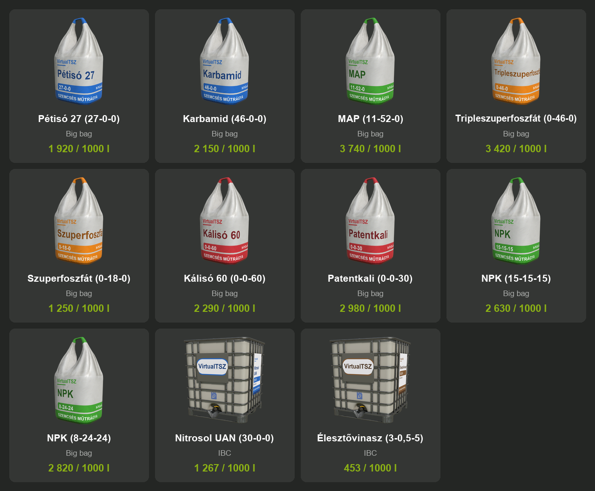
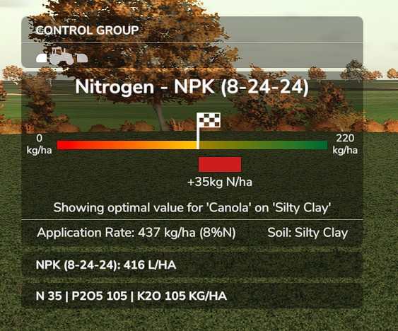
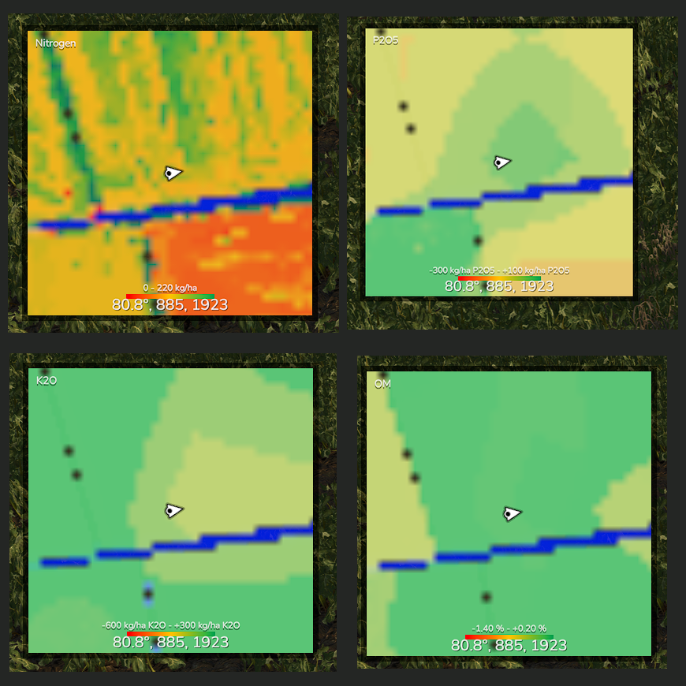
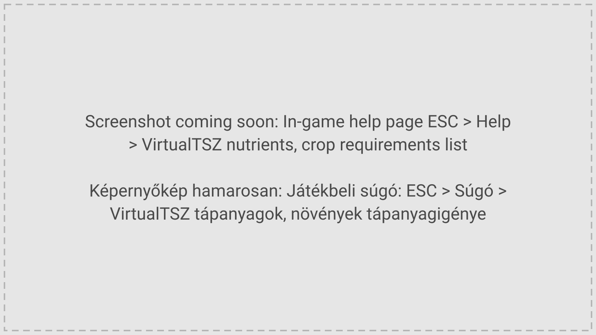

🇬🇧 [English version](EN-05-Products-and-Application)

> [!WARNING]
> **Fejlesztés alatt (v0.1).** Változások történhetnek, és a tápanyagtérképek alaphelyzetbe állhatnak. Mindig legyen biztonsági másolatod a mentésedről.

# Termékek és kijuttatás

**A boltban 11 új műtrágyát találsz, és te döntöd el, mennyit szórjon a gép: kézzel, vagy a térkép alapján automatikusan.**

- 9 szilárd és 2 folyékony termék, nitrogénnel, foszforral és káliummal.
- A nitrogén nélküli termékeknél a mennyiséget te állítod be (`Bal Alt + K` és `Bal Alt + M`).
- A foszfor és a kálium automatikus mennyiségét a mod számolja a felfedett térképből: pontosan a célig hiányzó mennyiséget juttatja ki.
- Ugyanaz a termék ugyanarra a pixelre egy menetben számít, ezért egyben szórd ki a teljes mennyiséget.
- A HUD, a minitérkép és a súgó megmutatja, mi kerül a talajba.
- A kézi és az automatikus mennyiség még nincs végig tesztelve játékban: ahol ez számít, jelezzük.
- Ha még nem vettél talajmintát: [Első lépések](HU-01-Elso-lepesek)

## Mit vehetsz

A mod 11 műtrágyát ad a bolthoz: a szilárdak big bagben (1000 l) a szórókhoz, a folyékonyak IBC-ben (1000 l) a permetezőkhöz. Az árak játékbeli árak, becsült 2026-os EU-árarányokból skálázva (nem hivatalos adatok); a pénznem a játéké.

| Termék | Forma | N-P₂O₅-K₂O % | Ár / 1000 l | Mire jó |
|---|---|---|--:|---|
| Pétisó 27 (27-0-0) | szilárd | 27-0-0 | 1920 | sima nitrogén, az alapjáték szilárd műtrágyájának árán |
| Karbamid (46-0-0) | szilárd | 46-0-0 | 2150 | töményebb nitrogén |
| MAP (11-52-0) | szilárd | 11-52-0 | 3740 | foszfor egy kis nitrogénnel |
| Tripleszuperfoszfát (0-46-0) | szilárd | 0-46-0 | 3420 | foszfor nitrogén nélkül |
| Szuperfoszfát (0-18-0) | szilárd | 0-18-0 | 1250 | olcsóbb foszfor nitrogén nélkül |
| Kálisó 60 (0-0-60) | szilárd | 0-0-60 | 2290 | a legolcsóbb kálium |
| Patentkali (0-0-30) | szilárd | 0-0-30 | 2980 | kálium, a legdrágább |
| NPK (15-15-15) | szilárd | 15-15-15 | 2630 | egyenletes háromtápanyagos |
| NPK (8-24-24) | szilárd | 8-24-24 | 2820 | főleg P és K, kevés N |
| Nitrosol UAN (30-0-0) | folyékony | 30-0-0 | 1267 | olcsó folyékony nitrogén |
| Élesztővinasz (3-0,5-5) | folyékony | 1,8-0,3-3 (lásd lent) | 453 | olcsó kálium, kis N, és egy kis szerves anyag |

Az árak 1000 literenként értendők (egy big bag vagy egy IBC ára), a játék pénznemében. Az Élesztővinasz neve a szárazanyag szerinti minőséget (3-0,5-5) mutatja; a talajba a kijuttatott, hígabb minőség kerül (1,8-0,3-3, a név 60 %-a).

Sűrűség és tápanyag kg / 1000 l

A termék tápanyagtartalma 1000 literben: sűrűség × 1000 × százalék. A sűrűségek becsültek (források: [Források](HU-11-Forrasok)).

| Termék | Sűrűség (t / 1000 l) | N kg | P₂O₅ kg | K₂O kg |
|---|--:|--:|--:|--:|
| Pétisó 27 (27-0-0) | 1,00 | 270 | – | – |
| Karbamid (46-0-0) | 0,75 | 345 | – | – |
| MAP (11-52-0) | 0,96 | 105,6 | 499,2 | – |
| Tripleszuperfoszfát (0-46-0) | 1,10 | – | 506 | – |
| Szuperfoszfát (0-18-0) | 1,05 | – | 189 | – |
| Kálisó 60 (0-0-60) | 1,10 | – | – | 660 |
| Patentkali (0-0-30) | 1,19 | – | – | 357 |
| NPK (15-15-15) | 1,05 | 157,5 | 157,5 | 157,5 |
| NPK (8-24-24) | 1,05 | 84 | 252 | 252 |
| Nitrosol UAN (30-0-0) | 1,275 | 382,5 | – | – |
| Élesztővinasz (3-0,5-5) | 1,26 | 22,7 | 3,78 | 37,8 |

Az Élesztővinasz 1000 literenként +0,0028 %-pont szerves anyagot is ad (az OM térkép egységében, lásd [Szerves anyag](HU-04-Szerves-anyag)).

A nitrogén a Precision Farming saját nitrogéntérképére kerül, ezt a mod nem módosítja.

### Mennyibe kerül egy kg hatóanyag?

Hatóanyag-kilogrammra a Nitrosol (kb. 3,3 /kg N) és a Kálisó 60 (kb. 3,5 /kg K₂O) a legolcsóbb. A foszforos termékek 6,6 és 7,5 /kg P₂O₅ között vannak, a Patentkali a legdrágább káliumforrás (kb. 8,3 /kg K₂O). Az árak becsültek, játékbeli pénznemben (a fenti számok játékpénz kg hatóanyagonként, nem euró): a Pétisó 27 az alapjáték szilárd műtrágyájának árát kapja, a többi szilárd termék ára becsült 2026-os EU-árarányokból és a sűrűségből van skálázva, a Nitrosol az alapjáték folyékony műtrágyájának kg N-ra jutó árához igazodik.

## Szerves trágya, hígtrágya, fermentált és az alapjáték műtrágyái

A Precision Farming trágyái is adnak P-t, K-t és szerves anyagot. A mennyiségek 1000 literenként:

| Termék | N kg (a Precision Farming értékei) | P₂O₅ kg | K₂O kg | OM %-pont (valós érték, a ×6 `timeScale` előtt) |
|---|--:|--:|--:|--:|
| Trágya | 7 | 1,75 | 4,2 | 0,0008 |
| Hígtrágya | 4 | 1,7 | 5,0 | 0,00034 |
| Fermentált | 5,5 | 3,0 | 5,0 | 0,00038 |

Két példa:
- **25 000 l/ha hígtrágya:** +100 kg N (ezt a PF írja a nitrogéntérképre), +42 kg P₂O₅, +125 kg K₂O, és +0,0085 %-pont szerves anyag × 6 (`timeScale`) = +0,051 %-pont.
- **20 000 l/ha trágya:** +140 kg N, +35 kg P₂O₅, +84 kg K₂O, és +0,016 %-pont szerves anyag × 6 = +0,096 %-pont.

A táblázat OM-értéke a valós érték játékévenként (VDLUFA humuszértékekből számolva); a játékban a mod 6-tal szorozza (`timeScale`), mert a VirtualTSZ szerveren kb. 6 játékév telik el egy valós év alatt. Részletek: [Szerves anyag](HU-04-Szerves-anyag).

**Az alapjáték szilárd műtrágyája** alapból csak nitrogént ad, ugyanúgy, mint a Precision Farmingben. A P és K a mod termékeiből jön. A `baseFertilizer` beállítással a P és K is bekapcsolható (300 l/ha ekkor +36 kg P₂O₅ és +36 kg K₂O): ez térképkészítői beállítás, lásd [Térképkészítőknek](HU-07-Terkepkeszitoknek). Az alapjáték **folyékony műtrágyája** csak nitrogén, a P, K és OM térképet nem érinti.

## Kijuttatási mennyiség kézzel (nitrogén nélküli termékek)

A Precision Farming csak a nitrogént tartalmazó termékek mennyiségét kezeli. A négy nitrogénmentes termékhez (Tripleszuperfoszfát, Szuperfoszfát, Kálisó 60, Patentkali) a mod saját l/ha beállítást ad:

| Termék | Alap l/ha | Lépés | Min | Max |
|---|--:|--:|--:|--:|
| Tripleszuperfoszfát (0-46-0) | 230 | 25 | 10 | 800 |
| Szuperfoszfát (0-18-0) | 240 | 25 | 10 | 800 |
| Kálisó 60 (0-0-60) | 230 | 25 | 10 | 450 |
| Patentkali (0-0-30) | 210 | 25 | 10 | 800 |

Az alapértékek kb. 250 kg/ha terméknek felelnek meg. Billentyűk: `Bal Alt + K` növel, `Bal Alt + M` csökkent (átköthetők). A mennyiség járművenként külön érvényes, multiplayerben szinkronizál (multiplayerben még nem teszteltük), és nem kerül a mentésbe: betöltés után az alapértékre áll.

**Miért csak 450 l/ha a Kálisó?** A Kálisó 60 kálium-klorid, a klorid pedig bizonyos növényeknek (burgonya, zöldségek) árt. 450 l/ha kb. 495 kg terméket, 297 kg K₂O-t és kb. 230 kg kloridot jelent menetenként. A források szezononkénti határokat adnak (a klorid-érzékeny növények kb. 675 kg Cl/ha-t viselnek el, a szokásos növények kb. 140 kg Cl/ha-ig nem mutatnak kárt), de **egyetlen forrás sem ad kemény egyszeri határt**, ezért a 450 l/ha engedékeny, becsült korlát. Nagyobb igényt oszd két menetre (ehhez kell talajművelés, vetés vagy betakarítás a menetek között, lásd a termékzárat lent), vagy használj Patentkalit. A mod nem modellez növényenkénti kloridérzékenységet.

## Automatikus mennyiség P-re és K-ra

A Precision Farming automatikus adagolója csak a nitrogénre figyel. A mod ezt kiegészíti: kiszámolja a szükséges l/ha mennyiséget a felfedett P vagy K térképből.

### Alap tápanyag

Az automata egy **alap tápanyag** (N, P vagy K) szerint számol. Alapértelmezés a termék legnagyobb tápanyagtartalma: a Tripleszuperfoszfát és a MAP alapja P, az NPK (8-24-24)-é is P, az NPK (15-15-15)-é N (egyenlőségnél N, mint a PF-nél). A szerves trágyák (Trágya, Hígtrágya, Fermentált) kivételek: az alapjuk N, mint a Precision Farmingben. `Bal Alt + B` körbeléptet a termékben lévő tápanyagok között, a HUD mutatja az aktuálisat. Terméket váltva visszaáll az alapértelmezésre.

### A képlet szavakkal

Kijuttatandó tápanyag (kg/ha) = célérték − jelenlegi érték, nullánál lejjebb nem megy.

Ez pontosan a mezőinfóban látható hiány: ha a mezőinfó P −200-at és K −150-et mutat, az automata 200 kg P₂O₅-öt és 150 kg K₂O-t juttat ki hektáronként (két külön termékből, mindegyik a saját alap tápanyagával). A P és a K célja egyaránt a talajtípus célja, minden növénynél ugyanaz, így a mennyiség a térképi érték ellentettje. A pH-t a mod nem veszi figyelembe: savanyú vagy lúgos mezőn is csak a talajtípus céljáig tölti fel a hiányt, a hozamtényező pedig 1 alatt marad, amíg a pH-t mésszel nem javítod. Nincs több évre elosztott építés, és a következő betakarítás elvonását sem adja hozzá. A cél fölött a mennyiség nulla. A l/ha ebből a termék tápanyagtartalmával számolódik, és felülről korlátos: legfeljebb 2500 l/ha, a kézi beállítású termékeknél pedig a saját maximumuk (például Kálisó: 450).

**Példa.** Cukorrépa alatt a mezőinfó `-100 kg/ha K2O`, a hiány 100. Az automatikus mennyiség 100 kg K₂O/ha. A Kálisó 60-ból ez kb. 152 l/ha, a termék 450 l/ha maximumán belül. Ennél nagyobb hiánynál (450 l/ha ≈ 297 kg K₂O) **több menet kell** (a menetek között talajművelés, vetés vagy betakarítás oldja a termékzárat). A betakarítás után az újabb elvonás új hiányként jelenik meg a mezőinfóban, a következő automatikus mennyiség ezt pótolja. Aratás után csak azt adod hozzá, ami hiányzik.

### Két út

| Termék | Hogyan kapcsolod be | Mi történik |
|---|---|---|
| Nitrogén nélküli (Tripleszuperfoszfát, Szuperfoszfát, Kálisó 60, Patentkali) | `Bal Alt + ,`: a mod saját automatája | A mennyiség a munkaterület alatti térképértékek átlagából jön, l/ha pontossággal. Bekapcsolt automatánál a kézi mennyiség nem érvényes. |
| Legalább két tápanyagot tartalmazó, N-nel (NPK 15-15-15, NPK 8-24-24, MAP, Élesztővinasz, Trágya, Hígtrágya, Fermentált) | a Precision Farming automata gombja | Alap N-nél a PF számol. Alap P vagy K esetén a mod számolja a mennyiséget, és a PF nitrogénértékét a ténylegesen kijuttatott literek N-tartalmára cseréli, így a PF nitrogéntérképe és a HUD összhangban marad. |
| Csak nitrogén (Pétisó, Karbamid, Nitrosol, az alapjáték műtrágyái) | a Precision Farming automata gombja | Csak a PF dolgozik, a mod nem avatkozik be. |

### Nitrogén-korlát

A P vagy K alapú mennyiség sosem juttat ki több nitrogént, mint amennyit a Precision Farming saját automatája az adott helyen kijuttatna. Ez véd attól, hogy egy foszforhiány miatt túltolj nitrogént (a túl sok N erősen büntet). Következmény: egy nitrogénben gazdag terméknél a P- vagy K-hiány gyakran nem pótolható, mert az N-korlát előbb eléri a határt. Ilyenkor nitrogénmentes vagy P/K-dús terméket használj.

### Pontosság és mintavétel nélküli talaj

- A PF a nitrogént 5 kg N/ha-os lépcsőkben kezeli, ezért az N-t tartalmazó termékeknél a mennyiség is lépcsőzik: az NPK (15-15-15)-nél egy lépcső kb. 32 l/ha, az NPK (8-24-24)-nél kb. 60 l/ha. Az eredmény így a kívánt értéktől kb. ±16–30 l/ha-ral térhet el. A nitrogénmentes termékeknél nincs ilyen kerekítés.
- Ahol a talajminta még nincs felfedve, a mod P/K automatája nem ad értéket, és a gép a kézi mennyiséget használja (a HUD ezt jelzi: „nincs adat, kézi”). Először mintavételezz: [Első lépések](HU-01-Elso-lepesek).
- A bekapcsolt állapot és az alap tápanyag multiplayerben szinkronizál; ezt még nem teszteltük multiplayerben.

## Termékzár

Egy pixel termékenként csak egyszer változik, amíg talajművelés, vetés vagy betakarítás nem oldja a zárat (ezt játékban teszteltük). Ugyanaz a termék ugyanarra a pixelre tehát második menetben nem számít. Ha többet akarsz kijuttatni, egy menetben állítsd be a teljes mennyiséget.

Két *különböző* termék egymás után a mod saját térképein (P, K, OM) mindkettő számít. A Precision Farming nitrogéntérképe viszont a talaj permetezési típusa szerint zár, és a mod termékei mind ugyanazt a típust használják. Egy második termék nitrogénje ezért ugyanarra a pixelre művelés nélkül várhatóan nem kerül a PF nitrogéntérképére. Ez **ismert korlát, és nem tervezzük megoldani**: külön talajtípus minden termékhez sokat rontana a futásteljesítményen.

Ha két különböző, nitrogént tartalmazó terméket akarsz egymás után szórni, a két menet közt használhatod a [FS25_NotSoEasyDeveloperControls](https://github.com/borondy/FS25_NotSoEasyDeveloperControls) modot. A cleaner mod leírása szerint az admin konzolparancsa, a `clearFertilizerState [mezőId]` törli a mező műtrágya-permetezési típusát (a trágyát és a meszet nem bántja; multiplayerben csak admin használhatja). A parancs a mod saját zárát is oldja, tehát utána ugyanaz a termék is újra számít. Magát a cleaner modot ezen az oldalon nem teszteltük.

> [!TIP]
> Jellemzően akkor kell tisztítani, ha az előző menet is nitrogént tartalmazó bolti terméket szórt (Pétisó, Karbamid, MAP, NPK, Nitrosol, Élesztővinasz), és azóta nem volt vetés, betakarítás vagy talajművelés. Nem kell tisztítani a trágyák (saját típusuk van) és a nitrogénmentes termékek (Kálisó, Tripleszuperfoszfát, Szuperfoszfát, Patentkali) mellett.

## HUD, minitérkép, súgó

**HUD.** Szórás közben a Precision Farming permetezőpanelének alján két sor látszik: a termék és a l/ha, alatta `N | P2O5 | K2O kg/ha`, vagyis hogy mennyi tápanyagot juttatsz ki hektáronként. Az alapjáték műtrágyájánál a P és K csak bekapcsolt `baseFertilizer` mellett látszik. Bekapcsolt automatánál a HUD az alap tápanyagot is mutatja, például `(auto K)`. A HUD-sort, valamint a HUD értéke és a ténylegesen kijuttatott mennyiség egyezését játékban még nem teszteltük.

**Műtrágyatartályos vetőgépek** (műtrágyázó vetőgépek) úgy működnek, mint a permetezők: a HUD, a kézi és az automata mennyiség gombjai és az alap tápanyag választása azonos, a tápanyag vetés közben kerül a térképekbe. Játékban még nem tesztelt.

**Minitérkép.** Ha mezőn vagy, és a gépben termék van, a minitérkép automatikusan a termék legnagyobb tartalmú tápanyagának rétegére vált: a MAP, a Tripleszuperfoszfát és az NPK (8-24-24) a P-t, a Kálisó és a Patentkali a K-t, a trágyák az N-t mutatják. `Bal Alt + .` lapoz a rétegek között: Automatikus › Nitrogén › Foszfor › Kálium › Szerves anyag. Terméket váltva visszaáll az automatikusra. Játékban eddig csak hígtrágya szórásánál próbáltuk (a réteg követte a terméket); a többit még nem teszteltük.

**Súgó.** ESC › Súgó › VirtualTSZ tápanyagok: itt minden növénynél azt találod, mennyit visz el a talajból egy betakarítás (N, P₂O₅, K₂O kg/ha-ban; szemestermés-betakarítás, a szalma aprítva a földön marad). A gabonáknál és azoknál a növényeknél, ahol számít, egy második sorban ott van az összeg bálázott szalmával, illetve szecskázással is. Célértékeket nem mutat, mert a térképek a talajtípus céljától való távolságot mutatják. Egy második súgóoldal, a "Műtrágyák tartalma", felsorolja a betöltött térkép minden műtrágyáját és mészét az 1000 literenkénti tartalmával (N, P₂O₅, K₂O kg-ban; az OM-növekedés százalékpontban és a pH-emelkedés csak ott, ahol a terméknek van ilyen hatása). Egy harmadik súgóoldal, a "Műtrágyák használata", sima szöveg: a munkarend, az egyes műtrágyacsoportok jellemző használata és l/ha sávja, éves naptár, növényenkénti tanácsok, a figyelendő játékszabályok és javasolt szerver házi szabályok. A rajta lévő valósághű tanácsok általános gyakorlatot jelentenek, nem a mod működését; a mod nem modellezi a bedolgozást, a kloridkárt és a felszíni veszteségeket. Az első két súgóoldal az adatokat megnyitáskor a betöltött térképből olvassa, ezért követi a konfigot és a map.xml-t. A súgóoldalakat játékban még nem teszteltük.

## Billentyűk

Mind átköthető a játék billentyűbeállításaiban. A mod saját akciókat használ, nem osztozik a Precision Farming billentyűivel.

| Billentyű | Akció a beállításokban | Mit csinál |
|---|---|---|
| `Bal Alt + K` | Kijuttatási mennyiség + | Kézi mennyiség növelése (nitrogén nélküli termékek) |
| `Bal Alt + M` | Kijuttatási mennyiség - | Kézi mennyiség csökkentése |
| `Bal Alt + ,` | Automata mennyiség (P/K termékek) | A mod saját automatájának be- és kikapcsolása (nitrogén nélküli termékek) |
| `Bal Alt + B` | Automata mennyiség alap tápanyaga | Alap tápanyag váltása (N, P, K) |
| `Bal Alt + .` | Minitérkép réteg | Minitérkép réteg lapozása |

## Lásd még

- [Foszfor](HU-02-Foszfor) és [Kálium](HU-03-Kalium): mit okoz a hiány
- [Szerves anyag](HU-04-Szerves-anyag): a trágyák hatása a humuszra
- [Vetésforgók](HU-06-Vetesforgok): példák a termékek használatára
- [Ismert korlátok](HU-10-Ismert-korlatok)
