🇬🇧 [English version](EN-06-Crop-Rotations)

> [!WARNING]
> **Fejlesztés alatt (v0.1, tesztelés).** A mod jelenleg instabil: hibákra és olyan változásokra is számíts, amelyek a mentésben lévő tápanyagtérképeket alaphelyzetbe állíthatják. Olyan mentésen ne használd, amelyet nem szeretnél elveszíteni.

# Vetésforgók

**Öt kiszámolt vetésforgó mutatja meg, merre viszi a foszfort, a káliumot és a szerves anyagot a gazdálkodásod, évekkel előre.**

- Mind az öt forgó vályogon indul, a játék átlagos kezdőértékeiről.
- Van állattartó, állat nélküli, tejelő és két silóforgó, az egyik lucernás szünettel.
- Látod, melyik forgóban fogy a humusz, és mi állítja meg.
- A számok szimulációból jönnek, nem játékbeli mérésből.
- A kijuttatási adagok példák, nem előírások.

## Mit tudsz meg ezekből a forgókból?

Öt forgót számoltunk végig a mod saját konfigurációjával, mind **vályogon**, a játék kezdőértékeinek átlagával indulva: **P₂O₅ 562, K₂O 700 kg/ha, szerves anyag (OM) 3,25 %**.

| Forgó | Gazdaság | Hossz |
|---|---|---|
| A | állattartó, silóforgó, szilárd trágya silókukorica után | 5 év |
| B | állat nélküli szántóföldi gazdaság, csak műtrágya, szalma lehordva | 4 év |
| C | tejelő, trágya és hígtrágya silókukorica után | 4 év |
| D | tehenészet, silóforgó, trágya minden silókukorica után | 6 év |
| E | tehenészet, mint D, de lucernás szünettel | 8 év |

Ezek **szimulációk tipikus hozamokkal**, nem játékbeli mérések. Egy lehetséges gazdálkodást mutatnak, nem az egyetlen jót: az adagokból azt tanulod meg, mire figyelj, nem kell lemásolnod őket. A számok szabályait (elvonás, lebomlás, hozamtényező) a `vtszSelfTest` konzolparancs számítási szinten ellenőrzi.

A képeken négy sáv van egymás alatt: nitrogén, foszfor, kálium és szerves anyag.

- Zöld háromszög: kijuttatás.
- Narancs háromszög: aratás vagy kaszálás.
- Piros szaggatott vonal: a célérték.
- Számozott kör: fontos pont, a magyarázata a kép alatt áll.

## Feltételezések

- **Talaj:** vályog (3-as talajtípus), a kezdőérték a négy zajérték átlaga. A célok: P₂O₅ 600, K₂O 740 kg/ha, OM 3,2 %.
- **pH:** a foszfor felvehetősége 1,00, vagyis a talaj pH-ja 6,2 és 7,2 között van. Savanyúbb vagy meszesebb talajon a foszfor hozamtényezője kisebb.
- **Abszolút értékek:** a táblázatok és a grafikonok a talaj tartalmát mutatják kg/ha-ban (a vályog céljával: P₂O₅ 600, K₂O 740). A játékbeli P és K térkép ugyanezt a céltól való távolságként mutatja (0 = cél), tehát például P₂O₅ 562 a térképen −38 kg/ha.
- **Térképplafonok:** a céltól P₂O₅ +300 (lágy plafon, efölé a kijuttatás nem visz), K₂O +675 kg/ha, az OM +2,19 %-pont. A példák ezek alatt maradnak.
- **Nincs K-kimosódás a szimulációban.** A játékban a talajcél fölötti kálium lassan csökken, ezért a táblázatok kálium-értékei a nagyon magas végén felső becslések.
- **Termékzár:** ugyanaz a termék ugyanarra a pixelre csak vetés, aratás vagy talajművelés után számít újra, ezért a részadagokat egy menetbe vontuk. A vegyes, nitrogént tartalmazó menetek között a példák feltételezik, hogy a trágyázási réteg törölve van (lásd [Ismert korlátok](HU-10-Ismert-korlatok)).

Hogyan olvasd a táblázatokat (teljes leírás)

**További feltételezések**

- **Hozamskála 1,0:** tipikus hozam. A valódi aratásnál az elvonás a hozamtól függ.
- **Nitrogénplafon:** a PF nitrogéntérképe 220 kg N/ha fölé nem megy (játékszabály), a fölösleg elvész. A túltrágyázás ráadásul hozamot visz el.
- **Egyszeri adagok:** ásványi műtrágyából egy menetben legfeljebb kb. 125 kg N/ha (például 400 l/ha Pétisó 27 = 108 kg N), szerves trágyából legfeljebb 30 000 l/ha. Nagyobb nitrogénigényt két különböző termékre bontottunk.
- **A VirtualTSZ szerveren:** tavasszal szilárd szervestrágya nem megy ki, csak hígtrágya (házi szabály, a mod nem kényszeríti). A szimuláció évi 3 lucernakaszálással számol, feltételezett kaszálási dátumokkal (április 25., július 10., október 10.). Az OM-változás játékévenként a valós éves érték 6-szorosa (`timeScale` 6), így 6 játékév kb. 1 valós év.

**Táblázatok**

- Az **év** a betakarítás éve. Az őszi vetésű növényt az előző őszön vetették, a táblázat csak a kijuttatásokat és az aratásokat sorolja.
- A **Δ** oszlopok a művelet hatása, a következő oszlopok a művelet *utáni* szintek (a mező átlaga, zaj nélkül; a zaj miatt a mezőn belül a kezdőérték foszforban kb. ±110, káliumban ±140 kg/ha-ral szór).
- **Szerves trágya (A, C, D, E):** az állattartó telepen a szilárd trágya és a hígtrágya korlátlanul áll rendelkezésre, ezért minden silókukorica szecskázása után trágya megy a földre. A mennyiséget a **következő növény nitrogéncélja** szabja meg, mert a trágya nitrogénje (szilárd 7, hígtrágya 4 kg N / 1000 l) a túltrágyázás büntetését hozza. Hígtrágyából ugyanahhoz a nitrogénhez több kell, és kevesebb szerves anyagot ad. A B forgó tisztán műtrágyás. A foszfor- és káliumműtrágya csak a trágya után megmaradó hiányt pótolja.
- **Időskála:** az OM-oszlopok `timeScale` 6-tal számolnak: játékévenként minden OM-változás a valós éves érték 6-szorosa, a szerveren kb. 6 játékév = 1 valós év. A foszfor, a kálium és a nitrogén nem skálázott.
- **Hozamtényező** = min(P-tényező, K-tényező) × OM-tényező × N-tényező az aratás előtti szintből. Az N-tényező a PF görbéje: 1,00 az N-célnál, −10 kg-nál 0,95, −40-nél 0,82, +20-nál 0,98, +40-nél 0,96, +60-nál 0,92, +120-nál 0,82 (a különbség az aratás előtti nitrogén és a növény N-célja). A K-tényező a növény K-céljához viszonyít: talajcél + 0,5 × a növény K-elvonása.
- **Növényi K-célok** (ezek a K 740 talajcélnál magasabbak): silókukorica 835, zöldrozs 815, rozsos bükköny 818, napraforgó 782, lucerna 787, lóbab 768, kukorica 768, őszi búza 762, őszi árpa 761, repce 755.
- **OM-lebomlás és nitrogén-felszabadulás:** a hónap első napján történik, a táblázatban a következő művelet sorában jelenik meg (az előző sor óta kezdődött hónapok összege). A **ΔN** kijuttatásnál a névleges adag nitrogénje, aratásnál a tényleges változás (a nitrogén nem mehet 0 alá).
- **Nitrogén:** a PF nitrogéntérképe szerinti számítás. Az N-cél és az elvonás a Szalók `map.xml`-ből való (3-as talajtípus, kg N/ha, cél / elvonás): zöldrozs 100/100, silókukorica 220/220, rozsos bükköny 100/80, kukorica 220/215, őszi árpa 180/160, őszi búza 200/180, repce 200/140, napraforgó 160/140, lóbab 60/20, lucerna 60/60 (kaszálásonként). Ha a kombájn aprítja a szalmát vagy a szárat (nincs lehordás), a PF +25 kg N-t ad vissza. A szecskázás és a kasza nem ad nitrogént. A műtrágya nitrogénje pontos, a szerves trágyáké a PF értéke (trágya 7, hígtrágya 4, fermentált 5,5 kg N / 1000 l). A PF automatikus nitrogénadagolását a táblázat nem modellezi.
- A talajból felszabaduló nitrogén (OM-mineralizáció) a „N talajból” oszlopban látszik. A példák nitrogénadagjait úgy állítottuk be, hogy a nitrogén az aratáskor a növény célja körül legyen (−10…+25 kg).
- Az OM-ban a lebomlás szerepel (−0,070 %-pont/játékév vályogon, évszakos súlyokkal); a foszfor nem mosódik ki.
- Nincs talajművelés-függő OM-lebomlás és nincs nitrogénveszteség. A hozam csak a mod és a PF nitrogéntényezőit tartalmazza, a PF gyom-, művelés- és egyéb tényezői nincsenek benne.
- **Aratási dátumok:** a Szalók növekedési ablakán belül vannak (az őszi árpa és a repce június végéig aratható, az őszi búza június–július, a lóbab május–július, a silókukorica szeptembertől novemberig). A hónapon belüli nap csak a sorrendet adja.
- **Lucerna:** a PF nitrogéntérképe célt ad neki (60 kg N, kaszálásonként 60 kg elvonás), a nitrogénkötést nem modellezi; a kaszálásonkénti hígtrágya ezt pótolja.

## Az öt forgó

### A. forgó: állattartó silóforgó

Állattartó jellegű, nagy tömegű silótermesztés: zöldrozs + silókukorica, rozsos bükköny + kukorica, őszi árpa, repce. Mindkét silókukorica után szilárd trágya megy ki, az őszi árpa szalmáját aprítják. Az 1. év megismétlődik az 5. évben, így látszik, hogy a forgó zárul-e.

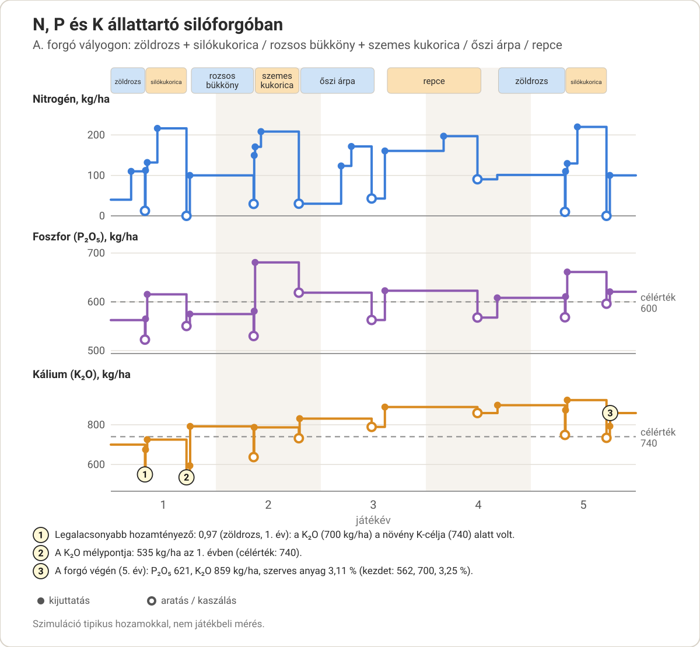

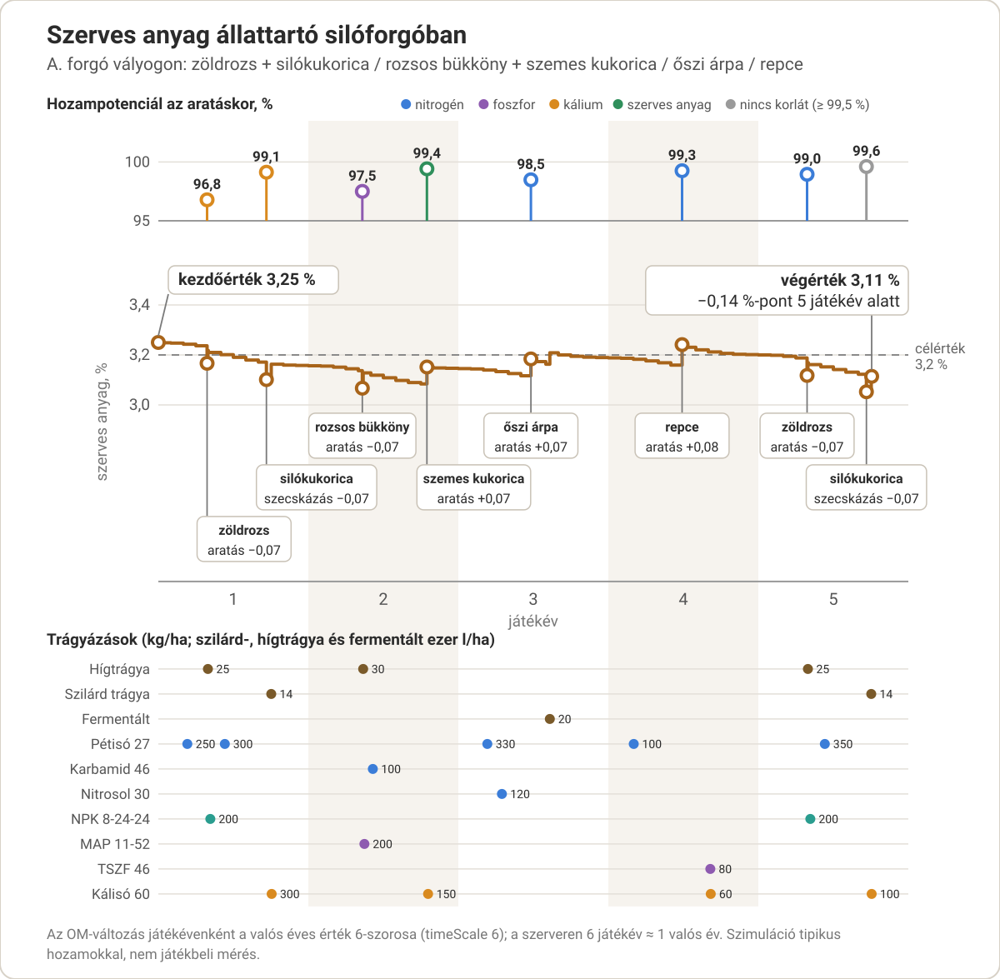

**Mire figyelj**

- A szerves anyag 3,25 %-ról 3,11 %-ra csökken 5 év alatt. A silóévek a legrosszabbak (az 1. évben −0,09, az 5. évben −0,10 %-pont), a szemes kukorica szára, az aprított árpaszalma és a repce ezt csak részben pótolja.
- A silókukorica utáni 14 000 l/ha szilárd trágya +98 kg N, +24 kg P₂O₅, +59 kg K₂O és +0,067 %-pont OM. Több nem fér bele: az adag a következő rozsos bükköny nitrogéncéljához (100 kg N) van méretezve, és a +120 kg/ha-os túltrágyázás csak 0,82-es hozamtényezőt adna.
- A legtöbb műtrágya-menetet a kálium adja: a Kálisó 60 adagja az első silókukorica után 300, a kukorica után 150, az 5. évben 100 l/ha. A kálium év végén 792 és 899 kg/ha között van.
- A legrosszabb hozamtényező 0,93 az 1. évben (zöldrozs): a kezdő K₂O (700) a növény K-célja (815) alatt van. A 2. évben 0,97, utána 0,98–0,99.

Műveletek és éves mérleg (a szimulációból)

<!-- gen:A-ops -->

| Idő | Művelet | ΔN | ΔP₂O₅ | ΔK₂O | ΔOM | OM lebomlás | N talajból | N | P₂O₅ | K₂O | OM % | Hozamtényező |
|---|---|--:|--:|--:|--:|--:|--:|--:|--:|--:|--:|--:|
| 1. év márc. 10. | Pétisó 27 (27-0-0) 250 l/ha | +68 | · | · | · | −0,007 | +3 | 110 | 562 | 700 | 3,24 |  |
| 1. év ápr. 28. | **Aratás:** zöldrozs | −100 | −40 | −150 | −0,070 | −0,006 | +2 | 12 | 522 | 550 | 3,17 | 0,97 |
| 1. év ápr. 30. | Hígtrágya 25 000 l/ha | +100 | +42 | +125 | +0,051 | · | · | 112 | 565 | 675 | 3,22 |  |
| 1. év máj. 5. | NPK (8-24-24) 200 l/ha | +17 | +50 | +50 | · | −0,008 | +3 | 132 | 615 | 725 | 3,21 |  |
| 1. év jún. 10. | Pétisó 27 (27-0-0) 300 l/ha | +81 | · | · | · | −0,009 | +3 | 216 | 615 | 725 | 3,20 |  |
| 1. év szept. 20. | **Szecskázás:** silókukorica | −220 | −65 | −190 | −0,070 | −0,029 | +11 | 0 | 550 | 535 | 3,10 | 0,99 |
| 1. év okt. 1. | Trágya 14 000 l/ha | +98 | +24 | +59 | +0,067 | −0,006 | +2 | 100 | 575 | 594 | 3,16 |  |
| 1. év okt. 2. | Kálisó 60 (0-0-60) 300 l/ha | · | · | +198 | · | · | · | 100 | 575 | 792 | 3,16 |  |
| 2. év máj. 10. | **Aratás:** rozsos bükköny | −80 | −45 | −155 | −0,070 | −0,026 | +9 | 30 | 530 | 637 | 3,07 | 0,97 |
| 2. év máj. 12. | Hígtrágya 30 000 l/ha | +120 | +51 | +150 | +0,061 | · | · | 150 | 581 | 787 | 3,13 |  |
| 2. év máj. 15. | MAP (11-52-0) 200 l/ha | +21 | +100 | · | · | · | · | 171 | 681 | 787 | 3,13 |  |
| 2. év jún. 5. | Karbamid (46-0-0) 100 l/ha | +34 | · | · | · | −0,009 | +3 | 208 | 681 | 787 | 3,12 |  |
| 2. év okt. 15. | **Aratás:** szemes kukorica | −190 | −62 | −55 | +0,068 | −0,035 | +13 | 30 | 619 | 732 | 3,15 | 0,99 |
| 2. év okt. 18. | Kálisó 60 (0-0-60) 150 l/ha | · | · | +99 | · | · | · | 30 | 619 | 831 | 3,15 |  |
| 3. év márc. 10. | Pétisó 27 (27-0-0) 330 l/ha | +89 | · | · | · | −0,012 | +4 | 123 | 619 | 831 | 3,14 |  |
| 3. év ápr. 15. | Nitrosol UAN (30-0-0) 120 l/ha | +46 | · | · | · | −0,006 | +2 | 172 | 619 | 831 | 3,13 |  |
| 3. év jún. 25. | **Aratás:** őszi árpa, szalma aprítva | −135 | −56 | −42 | +0,067 | −0,017 | +6 | 43 | 563 | 789 | 3,18 | 0,98 |
| 3. év aug. 10. | Fermentált 20 000 l/ha | +110 | +60 | +100 | +0,046 | −0,021 | +8 | 160 | 623 | 889 | 3,21 |  |
| 4. év márc. 1. | Pétisó 27 (27-0-0) 100 l/ha | +27 | · | · | · | −0,026 | +9 | 197 | 623 | 889 | 3,18 |  |
| 4. év jún. 28. | **Aratás:** repce | −115 | −55 | −30 | +0,082 | −0,023 | +8 | 90 | 568 | 859 | 3,24 | 0,99 |
| 4. év szept. 5. | Tripleszuperfoszfát (0-46-0) 80 l/ha | · | +40 | · | · | −0,029 | +11 | 101 | 608 | 859 | 3,21 |  |
| 4. év szept. 6. | Kálisó 60 (0-0-60) 60 l/ha | · | · | +40 | · | · | · | 101 | 608 | 899 | 3,21 |  |
| 5. év ápr. 28. | **Aratás:** zöldrozs | −100 | −40 | −150 | −0,070 | −0,024 | +9 | 10 | 568 | 749 | 3,12 | 0,99 |
| 5. év ápr. 30. | Hígtrágya 25 000 l/ha | +100 | +42 | +125 | +0,051 | · | · | 110 | 611 | 874 | 3,17 |  |
| 5. év máj. 5. | NPK (8-24-24) 200 l/ha | +17 | +50 | +50 | · | −0,008 | +3 | 129 | 661 | 924 | 3,16 |  |
| 5. év jún. 10. | Pétisó 27 (27-0-0) 350 l/ha | +94 | · | · | · | −0,009 | +3 | 220 | 661 | 924 | 3,15 |  |
| 5. év szept. 20. | **Szecskázás:** silókukorica | −220 | −65 | −190 | −0,070 | −0,029 | +11 | 0 | 596 | 734 | 3,05 | 1,00 |
| 5. év okt. 1. | Trágya 14 000 l/ha | +98 | +24 | +59 | +0,067 | −0,006 | +2 | 100 | 621 | 793 | 3,11 |  |
| 5. év okt. 2. | Kálisó 60 (0-0-60) 100 l/ha | · | · | +66 | · | · | · | 100 | 621 | 859 | 3,11 |  |

<!-- /gen:A-ops -->

Éves mérleg (kg/ha, OM %-pont):

<!-- gen:A-sum -->

| Év | N be | ebből a talajból | N ki | P₂O₅ be | P₂O₅ ki | K₂O be | K₂O ki | OM nettó | ebből lebomlás | Év végén N | P₂O₅ | K₂O | OM % | Legrosszabb hozamtényező |
|--:|--:|--:|--:|--:|--:|--:|--:|--:|--:|--:|--:|--:|--:|--:|
| 1 | 387 | 24 | 320 | 117 | 105 | 432 | 340 | −0,087 | −0,065 | 100 | 575 | 792 | 3,16 | 0,97 |
| 2 | 201 | 26 | 270 | 151 | 107 | 249 | 210 | −0,011 | −0,070 | 30 | 619 | 831 | 3,15 | 0,97 |
| 3 | 265 | 20 | 135 | 60 | 56 | 100 | 42 | +0,057 | −0,056 | 160 | 623 | 889 | 3,21 | 0,98 |
| 4 | 56 | 29 | 115 | 40 | 55 | 40 | 30 | +0,003 | −0,078 | 101 | 608 | 899 | 3,21 | 0,99 |
| 5 | 337 | 28 | 320 | 117 | 105 | 300 | 340 | −0,098 | −0,076 | 100 | 621 | 859 | 3,11 | 0,99 |

<!-- /gen:A-sum -->

### B. forgó: állat nélküli gazdaság

Szántóföldi gazdaság állatok nélkül: nincs szerves trágya, a szalmát eladják (lehordják). A szemes kukorica és a napraforgó szárát a kombájn aprítja, ezért a PF +25 kg nitrogént ad vissza. Minden tápanyag műtrágyából jön.

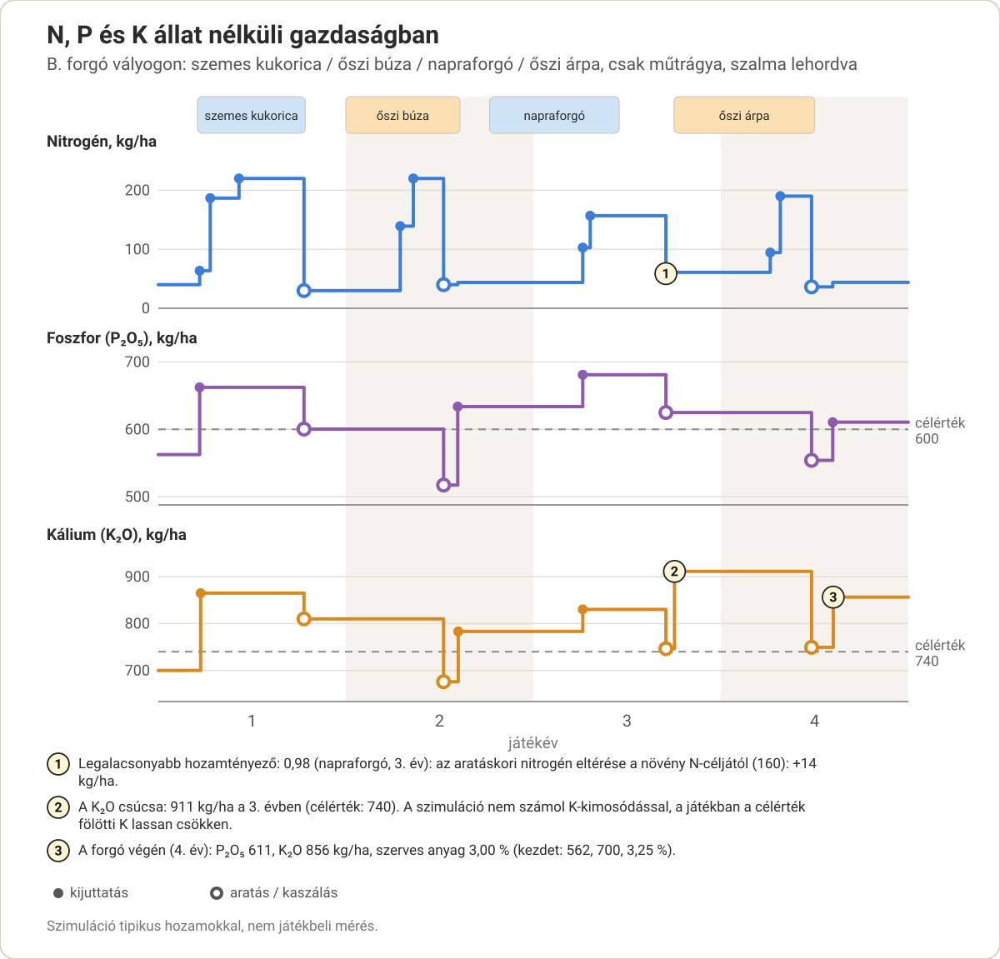

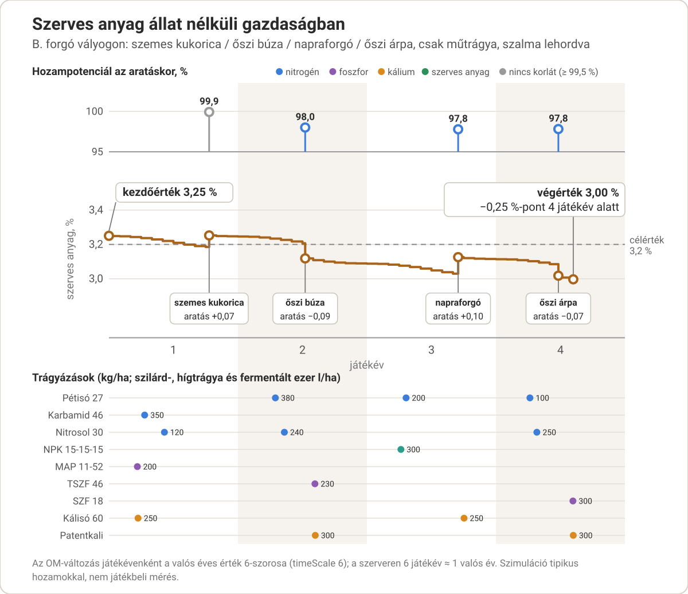

**Mire figyelj**

- A lehordott szalma drága: a búza és az árpa a szalmával együtt éves szinten 134, illetve 162 kg K₂O-t visz el (aprított szalmával csak 44 és 42).
- Műtrágyával a szintek a cél fölött tarthatók: év végén a foszfor 600–634, a kálium 783–911 kg/ha, a legrosszabb hozamtényező 0,98–1,00.
- A szerves anyag 4 év alatt 3,25 %-ról 3,15 %-ra csökken, mert mindkét gabona szalmáját lehordják. A szemes kukorica és a napraforgó szára csak részben fedezi ezt: a napraforgó éve nettó +0,012 %-pont.
- Egy menetben legfeljebb kb. 125 kg nitrogén megy ki, ezért a búza és az árpa nitrogénje két termékre oszlik (2. év: 380 l/ha Pétisó 27 + 240 l/ha Nitrosol UAN; 4. év: 100 l/ha Pétisó 27 + 250 l/ha Nitrosol UAN).

Műveletek és éves mérleg (a szimulációból)

<!-- gen:B-ops -->

| Idő | Művelet | ΔN | ΔP₂O₅ | ΔK₂O | ΔOM | OM lebomlás | N talajból | N | P₂O₅ | K₂O | OM % | Hozamtényező |
|---|---|--:|--:|--:|--:|--:|--:|--:|--:|--:|--:|--:|
| 1. év márc. 20. | MAP (11-52-0) 200 l/ha | +21 | +100 | · | · | −0,007 | +3 | 64 | 662 | 700 | 3,24 |  |
| 1. év márc. 22. | Kálisó 60 (0-0-60) 250 l/ha | · | · | +165 | · | · | · | 64 | 662 | 865 | 3,24 |  |
| 1. év ápr. 10. | Karbamid (46-0-0) 350 l/ha | +121 | · | · | · | −0,006 | +2 | 187 | 662 | 865 | 3,24 |  |
| 1. év jún. 5. | Nitrosol UAN (30-0-0) 120 l/ha | +46 | · | · | · | −0,017 | +6 | 220 | 662 | 865 | 3,22 |  |
| 1. év okt. 10. | **Aratás:** szemes kukorica | −190 | −62 | −55 | +0,068 | −0,035 | +13 | 30 | 600 | 810 | 3,25 | 1,00 |
| 2. év ápr. 15. | Pétisó 27 (27-0-0) 380 l/ha | +103 | · | · | · | −0,018 | +7 | 139 | 600 | 810 | 3,23 |  |
| 2. év máj. 10. | Nitrosol UAN (30-0-0) 240 l/ha | +92 | · | · | · | −0,008 | +3 | 220 | 600 | 810 | 3,23 |  |
| 2. év júl. 8. | **Aratás:** őszi búza, szalma lehordva | −180 | −83 | −134 | −0,088 | −0,020 | +7 | 40 | 517 | 676 | 3,12 | 0,98 |
| 2. év aug. 5. | Tripleszuperfoszfát (0-46-0) 230 l/ha | · | +116 | · | · | −0,011 | +4 | 44 | 634 | 676 | 3,11 |  |
| 2. év aug. 6. | Patentkali (0-0-30) 300 l/ha | · | · | +107 | · | · | · | 44 | 634 | 783 | 3,11 |  |
| 3. év ápr. 5. | NPK (15-15-15) 300 l/ha | +47 | +47 | +47 | · | −0,032 | +12 | 103 | 681 | 830 | 3,08 |  |
| 3. év ápr. 20. | Pétisó 27 (27-0-0) 200 l/ha | +54 | · | · | · | · | · | 157 | 681 | 830 | 3,08 |  |
| 3. év szept. 15. | **Aratás:** napraforgó | −115 | −56 | −84 | +0,096 | −0,046 | +17 | 59 | 625 | 746 | 3,13 | 0,98 |
| 3. év okt. 1. | Kálisó 60 (0-0-60) 250 l/ha | · | · | +165 | · | −0,006 | +2 | 61 | 625 | 911 | 3,12 |  |
| 4. év ápr. 5. | Pétisó 27 (27-0-0) 100 l/ha | +27 | · | · | · | −0,018 | +7 | 94 | 625 | 911 | 3,10 |  |
| 4. év ápr. 25. | Nitrosol UAN (30-0-0) 250 l/ha | +96 | · | · | · | · | · | 190 | 625 | 911 | 3,10 |  |
| 4. év jún. 25. | **Aratás:** őszi árpa, szalma lehordva | −160 | −71 | −162 | −0,067 | −0,017 | +6 | 36 | 554 | 749 | 3,02 | 0,98 |
| 4. év aug. 5. | Szuperfoszfát (0-18-0) 300 l/ha | · | +57 | · | · | −0,021 | +8 | 44 | 611 | 749 | 3,00 |  |
| 4. év aug. 6. | Patentkali (0-0-30) 300 l/ha | · | · | +107 | · | · | · | 44 | 611 | 856 | 3,00 |  |

<!-- /gen:B-ops -->

Éves mérleg (kg/ha, OM %-pont):

<!-- gen:B-sum -->

| Év | N be | ebből a talajból | N ki | P₂O₅ be | P₂O₅ ki | K₂O be | K₂O ki | OM nettó | ebből lebomlás | Év végén N | P₂O₅ | K₂O | OM % | Legrosszabb hozamtényező |
|--:|--:|--:|--:|--:|--:|--:|--:|--:|--:|--:|--:|--:|--:|--:|
| 1 | 212 | 24 | 190 | 100 | 62 | 165 | 55 | +0,002 | −0,065 | 30 | 600 | 810 | 3,25 | 1,00 |
| 2 | 215 | 20 | 180 | 116 | 83 | 107 | 134 | −0,144 | −0,056 | 44 | 634 | 783 | 3,11 | 0,98 |
| 3 | 132 | 31 | 115 | 47 | 56 | 212 | 84 | +0,012 | −0,084 | 61 | 625 | 911 | 3,12 | 0,98 |
| 4 | 143 | 20 | 160 | 57 | 71 | 107 | 162 | −0,123 | −0,056 | 44 | 611 | 856 | 3,00 | 0,98 |

<!-- /gen:B-sum -->

### C. forgó: tejelő gazdaság

Trágyaerős tejelő gazdaság: a silókukorica után 25 000 l/ha trágya és 10 000 l/ha hígtrágya megy ki (a búza nitrogéncéljához méretezve), a gabonaszalmát alomnak lehordják. A nyári fehérjenövény, a lóbab nitrogént hagy maga után. A silókukorica nitrogénje egy menetben nem juttatható ki, ezért az 1. év nyarán két termék megy ki: 400 l/ha Pétisó 27 és 210 l/ha Nitrosol UAN.

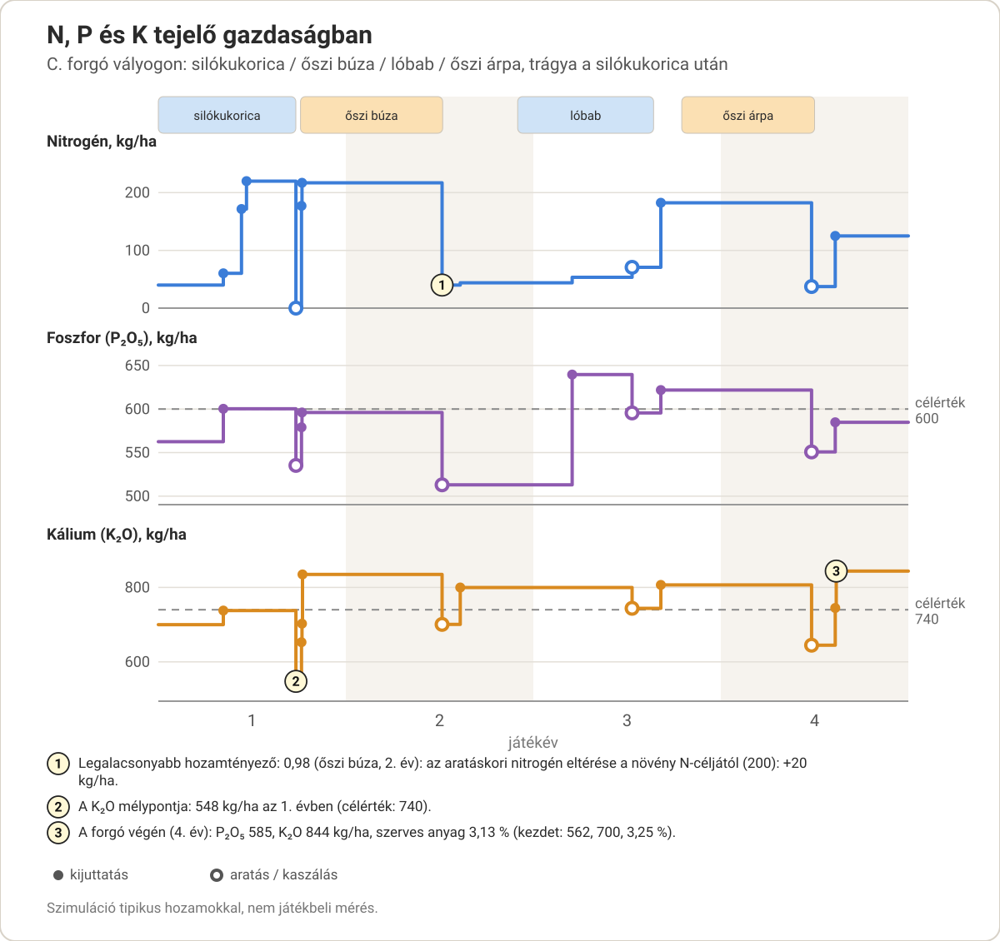

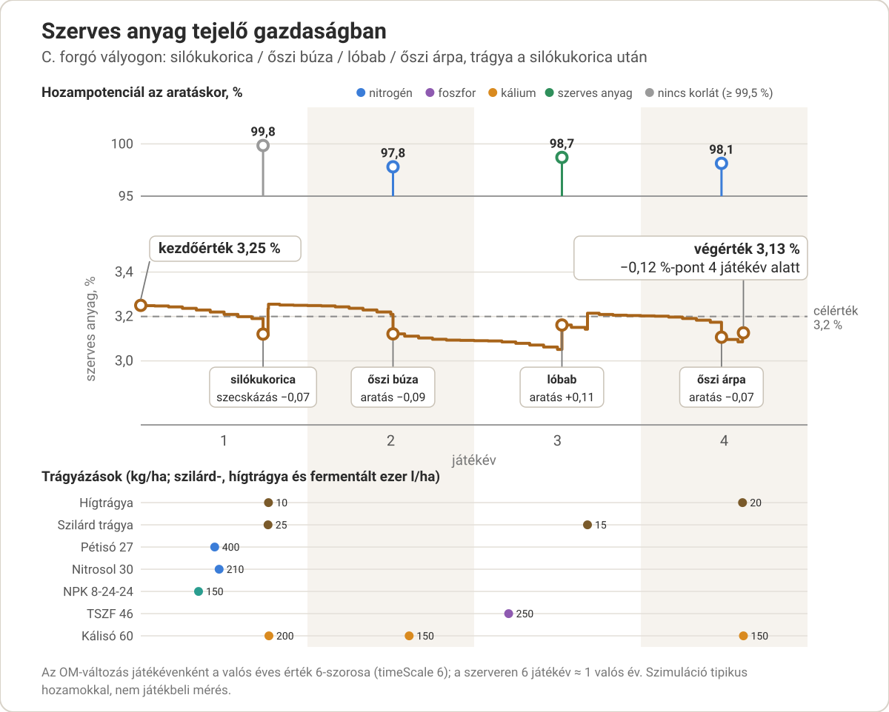

**Mire figyelj**

- A silókukorica utáni trágya és hígtrágya együtt 215 kg N a búza célához (200) méretezve, de a nitrogéntérkép 220-as plafonja korlátozza: a búza aratáskor 220 kg N-nel indul (+20, hozamtényező 0,98), tavaszi Pétisó nem kell.
- A lóbab +0,110 %-pont OM-et ad, az N-elvonása csak 20 kg, az aprított szalma +25 kg nitrogént ad vissza (nettó +5), ezért utána 15 000 l/ha szilárd trágya elég az árpához.
- A szerves anyag 3,25 %-ról 3,28 %-ra változik 4 év alatt: a trágya és a lóbab ellensúlyozza a lehordott szalmát és a silókukoricát. A 3. év nettó +0,103 %-pont.
- A trágya a foszfort és a káliumot is jórészt visszaadja, a műtrágya csak kiegészít (Tripleszuperfoszfát a 3. év tavaszán, Kálisó 60 az 1., 2. és 4. évben). A legrosszabb hozamtényező 0,95 az 1. évben (silókukorica, K₂O 738 az 835-ös növényi cél alatt), utána 0,98–0,99.

Műveletek és éves mérleg (a szimulációból)

<!-- gen:C-ops -->

| Idő | Művelet | ΔN | ΔP₂O₅ | ΔK₂O | ΔOM | OM lebomlás | N talajból | N | P₂O₅ | K₂O | OM % | Hozamtényező |
|---|---|--:|--:|--:|--:|--:|--:|--:|--:|--:|--:|--:|
| 1. év máj. 5. | NPK (8-24-24) 150 l/ha | +13 | +38 | +38 | · | −0,021 | +8 | 60 | 600 | 738 | 3,23 |  |
| 1. év jún. 10. | Pétisó 27 (27-0-0) 400 l/ha | +108 | · | · | · | −0,009 | +3 | 172 | 600 | 738 | 3,22 |  |
| 1. év jún. 20. | Nitrosol UAN (30-0-0) 210 l/ha | +80 | · | · | · | · | · | 220 | 600 | 738 | 3,22 |  |
| 1. év szept. 25. | **Szecskázás:** silókukorica | −220 | −65 | −190 | −0,070 | −0,029 | +11 | 0 | 535 | 548 | 3,12 | 1,00 |
| 1. év okt. 5. | Trágya 25 000 l/ha | +175 | +44 | +105 | +0,120 | −0,006 | +2 | 177 | 579 | 653 | 3,23 |  |
| 1. év okt. 6. | Hígtrágya 10 000 l/ha | +40 | +17 | +50 | +0,020 | · | · | 217 | 596 | 703 | 3,26 |  |
| 1. év okt. 7. | Kálisó 60 (0-0-60) 200 l/ha | · | · | +132 | · | · | · | 217 | 596 | 835 | 3,26 |  |
| 2. év júl. 5. | **Aratás:** őszi búza, szalma lehordva | −180 | −83 | −134 | −0,088 | −0,046 | +17 | 40 | 513 | 701 | 3,12 | 0,98 |
| 2. év aug. 10. | Kálisó 60 (0-0-60) 150 l/ha | · | · | +99 | · | −0,011 | +4 | 44 | 513 | 800 | 3,11 |  |
| 3. év márc. 15. | Tripleszuperfoszfát (0-46-0) 250 l/ha | · | +126 | · | · | −0,026 | +9 | 53 | 640 | 800 | 3,09 |  |
| 3. év júl. 10. | **Aratás:** lóbab | +5 | −44 | −56 | +0,110 | −0,034 | +12 | 71 | 596 | 744 | 3,16 | 0,99 |
| 3. év szept. 5. | Trágya 15 000 l/ha | +105 | +26 | +63 | +0,072 | −0,019 | +7 | 183 | 622 | 807 | 3,21 |  |
| 4. év jún. 25. | **Aratás:** őszi árpa, szalma lehordva | −160 | −71 | −162 | −0,067 | −0,041 | +15 | 37 | 551 | 645 | 3,11 | 0,98 |
| 4. év aug. 10. | Hígtrágya 20 000 l/ha | +80 | +34 | +100 | +0,041 | −0,021 | +8 | 125 | 585 | 745 | 3,13 |  |
| 4. év aug. 12. | Kálisó 60 (0-0-60) 150 l/ha | · | · | +99 | · | · | · | 125 | 585 | 844 | 3,13 |  |

<!-- /gen:C-ops -->

Éves mérleg (kg/ha, OM %-pont):

<!-- gen:C-sum -->

| Év | N be | ebből a talajból | N ki | P₂O₅ be | P₂O₅ ki | K₂O be | K₂O ki | OM nettó | ebből lebomlás | Év végén N | P₂O₅ | K₂O | OM % | Legrosszabb hozamtényező |
|--:|--:|--:|--:|--:|--:|--:|--:|--:|--:|--:|--:|--:|--:|--:|
| 1 | 440 | 24 | 220 | 99 | 65 | 325 | 190 | +0,005 | −0,065 | 217 | 596 | 835 | 3,26 | 1,00 |
| 2 | 20 | 20 | 180 | 0 | 83 | 99 | 134 | −0,144 | −0,056 | 44 | 513 | 800 | 3,11 | 0,98 |
| 3 | 134 | 29 | −5 | 153 | 44 | 63 | 56 | +0,103 | −0,078 | 183 | 622 | 807 | 3,21 | 0,99 |
| 4 | 103 | 23 | 160 | 34 | 71 | 199 | 162 | −0,088 | −0,062 | 125 | 585 | 844 | 3,13 | 0,98 |

<!-- /gen:C-sum -->

### D. forgó: tehenészet, silóforgó

Tehenészeti jellegű, nagy tömegű silótermesztés: zöldrozs + silókukorica, rozsos bükköny + silókukorica, egész növényes árpa (szecskázva). A ciklus kétszer fut le, ez **6 játékév, kb. 1 valós év** a szerveren. A telepi trágya korlátlan, de a nitrogén miatt az adag a következő növény nitrogéncéljához van méretezve. Nincs takarónövény és nincs lucerna-szünet. Az egész növényes árpa szalmája is lekerül a földről, ezért ott nincs szalmajóváírás, és trágya sem megy ki utána.

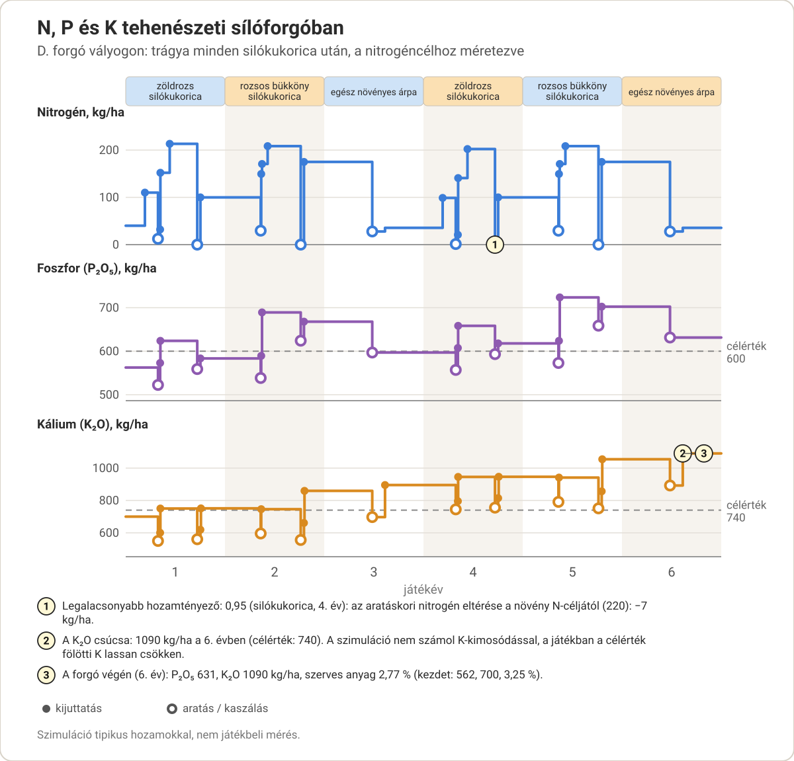

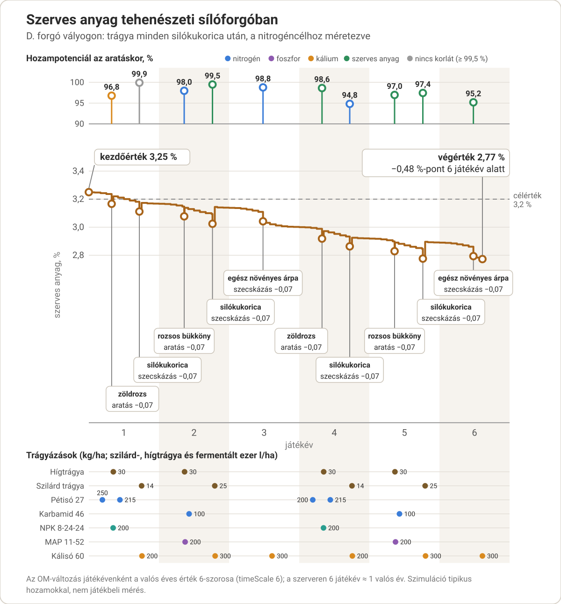

**Mire figyelj**

- A szerves anyag 6 játékév alatt 3,25 %-ról 2,84 %-ra esik (−0,41 %-pont, a mélypont 2,81). A silóévek mérlege −0,03 és −0,10 között van, az egész növényes árpa éve (nincs trágya, nincs szalma) −0,09.
- A nitrogén nem engedi, hogy több trágyát vigyél ki: a +120 kg N-es túltrágyázás 0,82-es hozamtényezőt adna, ezért a rozsos bükköny előtt legfeljebb kb. 100 kg N, az árpa előtt kb. 175 kg N jöhet a földre. Tavasszal csak hígtrágya mehet (a VirtualTSZ házi szabálya), az kevesebb OM-et ad: 30 000 l/ha hígtrágya +0,061 %-pont.
- A legrosszabb hozamtényező 0,93 az 1. évben (zöldrozs, a K₂O 700 az 815-ös növényi cél alatt). Az 1–2. évben a silókukorica és a rozsos bükköny is 0,95–0,96, a K₂O ott is a cél alatt van.
- A kálium év végén 751-ről 1090 kg/ha-ig nő. Ez kimosódás nélküli felső becslés, a játékban a talajcél (740) fölötti kálium lassan csökken.
- A leggyengébb pont az egész növényes árpa éve és a 4. év (−0,10). Ide nem N-igényes szerves anyag kell, erre jó az E forgó lucernás szünete.

Műveletek és éves mérleg (a szimulációból)

<!-- gen:D-ops -->

| Idő | Művelet | ΔN | ΔP₂O₅ | ΔK₂O | ΔOM | OM lebomlás | N talajból | N | P₂O₅ | K₂O | OM % | Hozamtényező |
|---|---|--:|--:|--:|--:|--:|--:|--:|--:|--:|--:|--:|
| 1. év márc. 10. | Pétisó 27 (27-0-0) 250 l/ha | +68 | · | · | · | −0,007 | +3 | 110 | 562 | 700 | 3,24 |  |
| 1. év ápr. 28. | **Aratás:** zöldrozs | −100 | −40 | −150 | −0,070 | −0,006 | +2 | 12 | 522 | 550 | 3,17 | 0,97 |
| 1. év máj. 5. | NPK (8-24-24) 200 l/ha | +17 | +50 | +50 | · | −0,008 | +3 | 32 | 573 | 600 | 3,16 |  |
| 1. év máj. 6. | Hígtrágya 30 000 l/ha | +120 | +51 | +150 | +0,061 | · | · | 152 | 624 | 750 | 3,22 |  |
| 1. év jún. 10. | Pétisó 27 (27-0-0) 215 l/ha | +58 | · | · | · | −0,009 | +3 | 213 | 624 | 750 | 3,21 |  |
| 1. év szept. 20. | **Szecskázás:** silókukorica | −220 | −65 | −190 | −0,070 | −0,029 | +11 | 0 | 559 | 560 | 3,11 | 1,00 |
| 1. év okt. 1. | Trágya 14 000 l/ha | +98 | +24 | +59 | +0,067 | −0,006 | +2 | 100 | 583 | 619 | 3,17 |  |
| 1. év okt. 3. | Kálisó 60 (0-0-60) 200 l/ha | · | · | +132 | · | · | · | 100 | 583 | 751 | 3,17 |  |
| 2. év máj. 10. | **Aratás:** rozsos bükköny | −80 | −45 | −155 | −0,070 | −0,026 | +9 | 30 | 538 | 596 | 3,08 | 0,98 |
| 2. év máj. 12. | Hígtrágya 30 000 l/ha | +120 | +51 | +150 | +0,061 | · | · | 150 | 589 | 746 | 3,14 |  |
| 2. év máj. 15. | MAP (11-52-0) 200 l/ha | +21 | +100 | · | · | · | · | 171 | 689 | 746 | 3,14 |  |
| 2. év jún. 5. | Karbamid (46-0-0) 100 l/ha | +34 | · | · | · | −0,009 | +3 | 208 | 689 | 746 | 3,13 |  |
| 2. év okt. 5. | **Szecskázás:** silókukorica | −220 | −65 | −190 | −0,070 | −0,035 | +13 | 0 | 624 | 556 | 3,02 | 0,99 |
| 2. év okt. 17. | Trágya 25 000 l/ha | +175 | +44 | +105 | +0,120 | · | · | 175 | 668 | 661 | 3,14 |  |
| 2. év okt. 19. | Kálisó 60 (0-0-60) 300 l/ha | · | · | +198 | · | · | · | 175 | 668 | 859 | 3,14 |  |
| 3. év jún. 25. | **Aratás:** őszi árpa, egész növény (szecskázás / kasza) | −160 | −71 | −162 | −0,067 | −0,035 | +13 | 28 | 597 | 697 | 3,04 | 0,99 |
| 3. év aug. 11. | Kálisó 60 (0-0-60) 300 l/ha | · | · | +198 | · | −0,021 | +8 | 35 | 597 | 895 | 3,02 |  |
| 4. év márc. 10. | Pétisó 27 (27-0-0) 200 l/ha | +54 | · | · | · | −0,026 | +9 | 99 | 597 | 895 | 2,99 |  |
| 4. év ápr. 28. | **Aratás:** zöldrozs | −100 | −40 | −150 | −0,070 | −0,006 | +2 | 1 | 557 | 745 | 2,92 | 0,99 |
| 4. év máj. 5. | NPK (8-24-24) 200 l/ha | +17 | +50 | +50 | · | −0,008 | +3 | 21 | 607 | 796 | 2,91 |  |
| 4. év máj. 6. | Hígtrágya 30 000 l/ha | +120 | +51 | +150 | +0,061 | · | · | 141 | 658 | 946 | 2,97 |  |
| 4. év jún. 10. | Pétisó 27 (27-0-0) 215 l/ha | +58 | · | · | · | −0,009 | +3 | 202 | 658 | 946 | 2,96 |  |
| 4. év szept. 20. | **Szecskázás:** silókukorica | −213 | −65 | −190 | −0,070 | −0,029 | +11 | 0 | 593 | 756 | 2,86 | 0,95 |
| 4. év okt. 1. | Trágya 14 000 l/ha | +98 | +24 | +59 | +0,067 | −0,006 | +2 | 100 | 618 | 814 | 2,93 |  |
| 4. év okt. 3. | Kálisó 60 (0-0-60) 200 l/ha | · | · | +132 | · | · | · | 100 | 618 | 946 | 2,93 |  |
| 5. év máj. 10. | **Aratás:** rozsos bükköny | −80 | −45 | −155 | −0,070 | −0,026 | +9 | 30 | 573 | 791 | 2,83 | 0,97 |
| 5. év máj. 12. | Hígtrágya 30 000 l/ha | +120 | +51 | +150 | +0,061 | · | · | 150 | 624 | 941 | 2,89 |  |
| 5. év máj. 15. | MAP (11-52-0) 200 l/ha | +21 | +100 | · | · | · | · | 171 | 724 | 941 | 2,89 |  |
| 5. év jún. 5. | Karbamid (46-0-0) 100 l/ha | +34 | · | · | · | −0,009 | +3 | 208 | 724 | 941 | 2,88 |  |
| 5. év okt. 5. | **Szecskázás:** silókukorica | −220 | −65 | −190 | −0,070 | −0,035 | +13 | 0 | 659 | 751 | 2,78 | 0,97 |
| 5. év okt. 17. | Trágya 25 000 l/ha | +175 | +44 | +105 | +0,120 | · | · | 175 | 702 | 856 | 2,90 |  |
| 5. év okt. 19. | Kálisó 60 (0-0-60) 300 l/ha | · | · | +198 | · | · | · | 175 | 702 | 1054 | 2,90 |  |
| 6. év jún. 25. | **Aratás:** őszi árpa, egész növény (szecskázás / kasza) | −160 | −71 | −162 | −0,067 | −0,035 | +13 | 28 | 631 | 892 | 2,79 | 0,95 |
| 6. év aug. 11. | Kálisó 60 (0-0-60) 300 l/ha | · | · | +198 | · | −0,021 | +8 | 35 | 631 | 1090 | 2,77 |  |

<!-- /gen:D-ops -->

Éves mérleg (kg/ha, OM %-pont):

<!-- gen:D-sum -->

| Év | N be | ebből a talajból | N ki | P₂O₅ be | P₂O₅ ki | K₂O be | K₂O ki | OM nettó | ebből lebomlás | Év végén N | P₂O₅ | K₂O | OM % | Legrosszabb hozamtényező |
|--:|--:|--:|--:|--:|--:|--:|--:|--:|--:|--:|--:|--:|--:|--:|
| 1 | 384 | 24 | 320 | 126 | 105 | 391 | 340 | −0,077 | −0,065 | 100 | 583 | 751 | 3,17 | 0,97 |
| 2 | 376 | 26 | 300 | 195 | 110 | 453 | 345 | −0,029 | −0,070 | 175 | 668 | 859 | 3,14 | 0,98 |
| 3 | 20 | 20 | 160 | 0 | 71 | 198 | 162 | −0,123 | −0,056 | 35 | 597 | 895 | 3,02 | 0,99 |
| 4 | 378 | 31 | 313 | 126 | 105 | 391 | 340 | −0,096 | −0,084 | 100 | 618 | 946 | 2,93 | 0,95 |
| 5 | 376 | 26 | 300 | 195 | 110 | 453 | 345 | −0,029 | −0,070 | 175 | 702 | 1054 | 2,90 | 0,97 |
| 6 | 20 | 20 | 160 | 0 | 71 | 198 | 162 | −0,123 | −0,056 | 35 | 631 | 1090 | 2,77 | 0,95 |

<!-- /gen:D-sum -->

### E. forgó: tehenészet, lucernás szünettel

Ugyanazok a növények és nitrogénadagok, mint a D forgóban (a Kálisó 60 silókukorica után 200 l/ha), de a 4. évben lucerna van, 3 kaszálással, feltételezett kaszálási dátumokkal (április 25., július 10., október 10.). A PF a lucernának is ad nitrogéncélt (60 kg N, kaszálásonként 60 kg elvonás), a nitrogénkötést viszont nem modellezi. Ezért tavasszal 5 000, a kaszálások után 13 000, 13 000 és 22 000 l/ha hígtrágya megy ki (az utolsó a következő zöldrozs nitrogéncéljához méretezve), tavasszal 300 l/ha Kálisó 60. A ciklus 4 év, a példa 8 év.

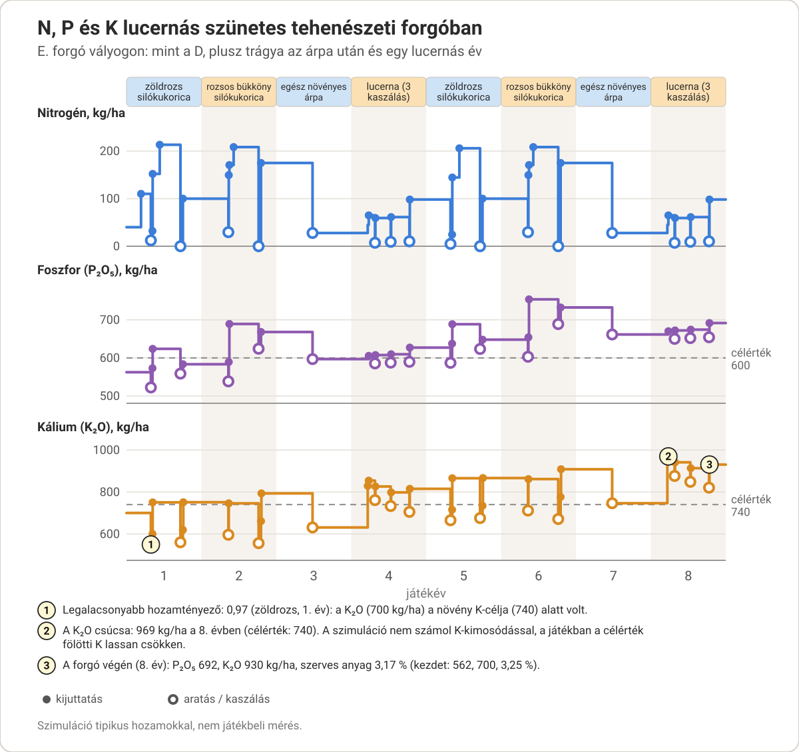

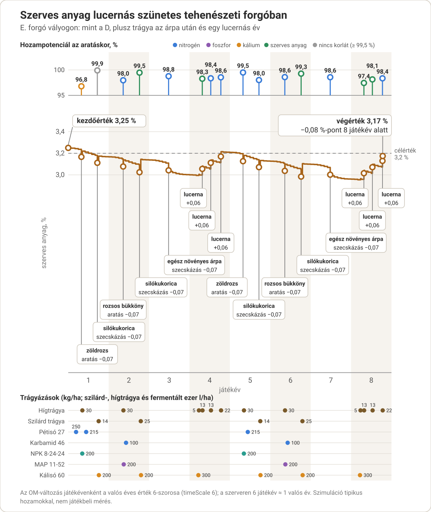

**Mire figyelj**

- A szerves anyag nagyjából szinten marad: 3,25 %-ról 3,24 %-ra 8 év alatt (3,02 és 3,25 között). A D forgó 6. évére 2,84 %, az E ugyanekkor 3,14 %.
- A lucerna éve nettó +0,17 %-pontot ad: három kaszálás × +0,057, a hígtrágyák együtt +0,11, mínusz kb. −0,10 lebomlás. Ez nagyjából kiegyenlíti az árpa −0,07-es évét és egy silóév hiányát.
- A nitrogén a lucernánál: a kaszálások utáni hígtrágya nélkül a nitrogén a 2. és 3. kaszálásnál 17, illetve 9 kg-ra esne (hozamtényező 0,80, illetve 0,75). A hígtrágyával 67–70 kg N van a kaszálásnál, a hozamtényező 0,99.
- A lucerna évente 279 kg K₂O-t visz el (3 × 93), a hígtrágyák 265-öt adnak vissza. A kálium az árpa éve után, a 3. évben 631 kg/ha-ra süllyed (a talajcél, 740, alatt), a 7. évben 746-ra. A modell a lucerna nitrogénkötésével nem számol.

Műveletek és éves mérleg (a szimulációból)

<!-- gen:E-ops -->

| Idő | Művelet | ΔN | ΔP₂O₅ | ΔK₂O | ΔOM | OM lebomlás | N talajból | N | P₂O₅ | K₂O | OM % | Hozamtényező |
|---|---|--:|--:|--:|--:|--:|--:|--:|--:|--:|--:|--:|
| 1. év márc. 10. | Pétisó 27 (27-0-0) 250 l/ha | +68 | · | · | · | −0,007 | +3 | 110 | 562 | 700 | 3,24 |  |
| 1. év ápr. 28. | **Aratás:** zöldrozs | −100 | −40 | −150 | −0,070 | −0,006 | +2 | 12 | 522 | 550 | 3,17 | 0,97 |
| 1. év máj. 5. | NPK (8-24-24) 200 l/ha | +17 | +50 | +50 | · | −0,008 | +3 | 32 | 573 | 600 | 3,16 |  |
| 1. év máj. 6. | Hígtrágya 30 000 l/ha | +120 | +51 | +150 | +0,061 | · | · | 152 | 624 | 750 | 3,22 |  |
| 1. év jún. 10. | Pétisó 27 (27-0-0) 215 l/ha | +58 | · | · | · | −0,009 | +3 | 213 | 624 | 750 | 3,21 |  |
| 1. év szept. 20. | **Szecskázás:** silókukorica | −220 | −65 | −190 | −0,070 | −0,029 | +11 | 0 | 559 | 560 | 3,11 | 1,00 |
| 1. év okt. 1. | Trágya 14 000 l/ha | +98 | +24 | +59 | +0,067 | −0,006 | +2 | 100 | 583 | 619 | 3,17 |  |
| 1. év okt. 3. | Kálisó 60 (0-0-60) 200 l/ha | · | · | +132 | · | · | · | 100 | 583 | 751 | 3,17 |  |
| 2. év máj. 10. | **Aratás:** rozsos bükköny | −80 | −45 | −155 | −0,070 | −0,026 | +9 | 30 | 538 | 596 | 3,08 | 0,98 |
| 2. év máj. 12. | Hígtrágya 30 000 l/ha | +120 | +51 | +150 | +0,061 | · | · | 150 | 589 | 746 | 3,14 |  |
| 2. év máj. 15. | MAP (11-52-0) 200 l/ha | +21 | +100 | · | · | · | · | 171 | 689 | 746 | 3,14 |  |
| 2. év jún. 5. | Karbamid (46-0-0) 100 l/ha | +34 | · | · | · | −0,009 | +3 | 208 | 689 | 746 | 3,13 |  |
| 2. év okt. 5. | **Szecskázás:** silókukorica | −220 | −65 | −190 | −0,070 | −0,035 | +13 | 0 | 624 | 556 | 3,02 | 0,99 |
| 2. év okt. 17. | Trágya 25 000 l/ha | +175 | +44 | +105 | +0,120 | · | · | 175 | 668 | 661 | 3,14 |  |
| 2. év okt. 19. | Kálisó 60 (0-0-60) 200 l/ha | · | · | +132 | · | · | · | 175 | 668 | 793 | 3,14 |  |
| 3. év jún. 25. | **Aratás:** őszi árpa, egész növény (szecskázás / kasza) | −160 | −71 | −162 | −0,067 | −0,035 | +13 | 28 | 597 | 631 | 3,04 | 0,99 |
| 4. év márc. 20. | Kálisó 60 (0-0-60) 300 l/ha | · | · | +198 | · | −0,047 | +17 | 45 | 597 | 829 | 2,99 |  |
| 4. év márc. 25. | Hígtrágya 5 000 l/ha | +20 | +8 | +25 | +0,010 | · | · | 65 | 605 | 854 | 3,01 |  |
| 4. év ápr. 25. | **Kaszálás:** lucerna | −60 | −20 | −93 | +0,057 | −0,006 | +2 | 7 | 585 | 761 | 3,06 | 0,98 |
| 4. év ápr. 27. | Hígtrágya 13 000 l/ha | +52 | +22 | +65 | +0,027 | · | · | 59 | 608 | 826 | 3,08 |  |
| 4. év júl. 10. | **Kaszálás:** lucerna | −60 | −20 | −93 | +0,057 | −0,027 | +10 | 9 | 588 | 733 | 3,11 | 0,98 |
| 4. év júl. 12. | Hígtrágya 13 000 l/ha | +52 | +22 | +65 | +0,027 | · | · | 61 | 610 | 798 | 3,14 |  |
| 4. év okt. 10. | **Kaszálás:** lucerna | −60 | −20 | −93 | +0,057 | −0,025 | +9 | 10 | 590 | 705 | 3,17 | 0,99 |
| 4. év okt. 12. | Hígtrágya 22 000 l/ha | +88 | +37 | +110 | +0,045 | · | · | 98 | 627 | 815 | 3,21 |  |
| 5. év ápr. 28. | **Aratás:** zöldrozs | −100 | −40 | −150 | −0,070 | −0,018 | +7 | 5 | 587 | 665 | 3,13 | 0,99 |
| 5. év máj. 5. | NPK (8-24-24) 200 l/ha | +17 | +50 | +50 | · | −0,008 | +3 | 24 | 637 | 716 | 3,12 |  |
| 5. év máj. 6. | Hígtrágya 30 000 l/ha | +120 | +51 | +150 | +0,061 | · | · | 144 | 688 | 866 | 3,18 |  |
| 5. év jún. 10. | Pétisó 27 (27-0-0) 215 l/ha | +58 | · | · | · | −0,009 | +3 | 206 | 688 | 866 | 3,17 |  |
| 5. év szept. 20. | **Szecskázás:** silókukorica | −217 | −65 | −190 | −0,070 | −0,029 | +11 | 0 | 623 | 676 | 3,07 | 0,98 |
| 5. év okt. 1. | Trágya 14 000 l/ha | +98 | +24 | +59 | +0,067 | −0,006 | +2 | 100 | 648 | 734 | 3,13 |  |
| 5. év okt. 3. | Kálisó 60 (0-0-60) 200 l/ha | · | · | +132 | · | · | · | 100 | 648 | 866 | 3,13 |  |
| 6. év máj. 10. | **Aratás:** rozsos bükköny | −80 | −45 | −155 | −0,070 | −0,026 | +9 | 30 | 603 | 711 | 3,04 | 0,99 |
| 6. év máj. 12. | Hígtrágya 30 000 l/ha | +120 | +51 | +150 | +0,061 | · | · | 150 | 654 | 861 | 3,10 |  |
| 6. év máj. 15. | MAP (11-52-0) 200 l/ha | +21 | +100 | · | · | · | · | 171 | 754 | 861 | 3,10 |  |
| 6. év jún. 5. | Karbamid (46-0-0) 100 l/ha | +34 | · | · | · | −0,009 | +3 | 208 | 754 | 861 | 3,09 |  |
| 6. év okt. 5. | **Szecskázás:** silókukorica | −220 | −65 | −190 | −0,070 | −0,035 | +13 | 0 | 689 | 671 | 2,98 | 0,99 |
| 6. év okt. 17. | Trágya 25 000 l/ha | +175 | +44 | +105 | +0,120 | · | · | 175 | 733 | 776 | 3,10 |  |
| 6. év okt. 19. | Kálisó 60 (0-0-60) 200 l/ha | · | · | +132 | · | · | · | 175 | 733 | 908 | 3,10 |  |
| 7. év jún. 25. | **Aratás:** őszi árpa, egész növény (szecskázás / kasza) | −160 | −71 | −162 | −0,067 | −0,035 | +13 | 28 | 662 | 746 | 3,00 | 0,99 |
| 8. év márc. 20. | Kálisó 60 (0-0-60) 300 l/ha | · | · | +198 | · | −0,047 | +17 | 45 | 662 | 944 | 2,95 |  |
| 8. év márc. 25. | Hígtrágya 5 000 l/ha | +20 | +8 | +25 | +0,010 | · | · | 65 | 670 | 969 | 2,96 |  |
| 8. év ápr. 25. | **Kaszálás:** lucerna | −60 | −20 | −93 | +0,057 | −0,006 | +2 | 7 | 650 | 876 | 3,02 | 0,97 |
| 8. év ápr. 27. | Hígtrágya 13 000 l/ha | +52 | +22 | +65 | +0,027 | · | · | 59 | 672 | 941 | 3,04 |  |
| 8. év júl. 10. | **Kaszálás:** lucerna | −60 | −20 | −93 | +0,057 | −0,027 | +10 | 9 | 652 | 848 | 3,07 | 0,98 |
| 8. év júl. 12. | Hígtrágya 13 000 l/ha | +52 | +22 | +65 | +0,027 | · | · | 61 | 674 | 913 | 3,10 |  |
| 8. év okt. 10. | **Kaszálás:** lucerna | −60 | −20 | −93 | +0,057 | −0,025 | +9 | 10 | 654 | 820 | 3,13 | 0,98 |
| 8. év okt. 12. | Hígtrágya 22 000 l/ha | +88 | +37 | +110 | +0,045 | · | · | 98 | 692 | 930 | 3,17 |  |

<!-- /gen:E-ops -->

Éves mérleg (kg/ha, OM %-pont):

<!-- gen:E-sum -->

| Év | N be | ebből a talajból | N ki | P₂O₅ be | P₂O₅ ki | K₂O be | K₂O ki | OM nettó | ebből lebomlás | Év végén N | P₂O₅ | K₂O | OM % | Legrosszabb hozamtényező |
|--:|--:|--:|--:|--:|--:|--:|--:|--:|--:|--:|--:|--:|--:|--:|
| 1 | 384 | 24 | 320 | 126 | 105 | 391 | 340 | −0,077 | −0,065 | 100 | 583 | 751 | 3,17 | 0,97 |
| 2 | 376 | 26 | 300 | 195 | 110 | 387 | 345 | −0,029 | −0,070 | 175 | 668 | 793 | 3,14 | 0,98 |
| 3 | 13 | 13 | 160 | 0 | 71 | 0 | 162 | −0,102 | −0,035 | 28 | 597 | 631 | 3,04 | 0,99 |
| 4 | 250 | 38 | 180 | 90 | 60 | 463 | 279 | +0,173 | −0,105 | 98 | 627 | 815 | 3,21 | 0,98 |
| 5 | 318 | 26 | 317 | 126 | 105 | 391 | 340 | −0,082 | −0,070 | 100 | 648 | 866 | 3,13 | 0,98 |
| 6 | 376 | 26 | 300 | 195 | 110 | 387 | 345 | −0,029 | −0,070 | 175 | 733 | 908 | 3,10 | 0,99 |
| 7 | 13 | 13 | 160 | 0 | 71 | 0 | 162 | −0,102 | −0,035 | 28 | 662 | 746 | 3,00 | 0,99 |
| 8 | 250 | 38 | 180 | 90 | 60 | 463 | 279 | +0,173 | −0,105 | 98 | 692 | 930 | 3,17 | 0,97 |

<!-- /gen:E-sum -->

## D és E egymás mellett: megéri a lucernás szünet?

Ugyanaz a tehenészet, ugyanazok a növények és a trágyázás. A különbség a lucerna-szünet: a D forgó 6 játékév alatt 3,25 %-ról 2,84 %-ra veszít, az E forgó 8 játékév alatt nagyjából szinten marad, 3,25 %-ról 3,24 %-ra. A 6. játékév végén az E 3,14 %-on áll, a D 2,84 %-on.

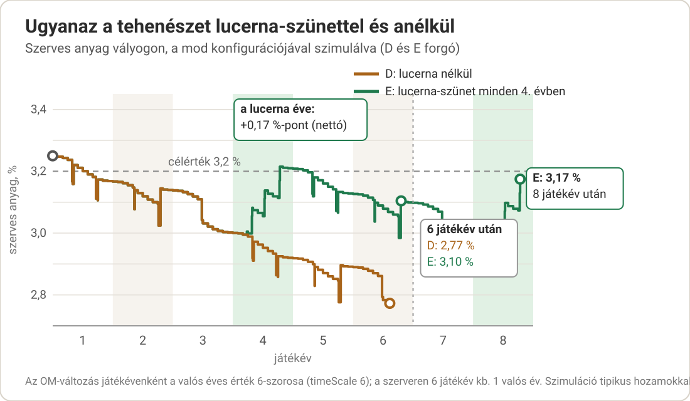

Nem csak a talaj minősége számít: ha a szerves anyag a célérték alá megy, a hozamtényező is csökken (lásd [Szerves anyag](HU-04-Szerves-anyag)).

## Mennyi humuszt visz vagy ad egy betakarítás?

A példák növényeinek **%-pont/ha** OM-változása egy betakarításkor, tipikus hozamnál, `timeScale` 6-tal. A folyamatos lebomlás (−0,070 %-pont/játékév vályogon) ezen felül, külön fut.

<!-- gen:omtable -->

| Növény | Szalma / szár lehordva | Aprított szalma | Szecskázás / kasza |
|---|--:|--:|--:|
| Zöldrozs | −0,070 | −0,070 | −0,070 |
| Rozsos bükköny | −0,070 | −0,070 | −0,070 |
| Silókukorica | −0,070 | −0,070 | −0,070 |
| Szemes kukorica | +0,068 | +0,068 | +0,068 |
| Őszi árpa | −0,067 | +0,067 | −0,067 |
| Őszi búza | −0,088 | +0,088 | −0,088 |
| Repce | +0,082 | +0,082 | +0,082 |
| Napraforgó | +0,096 | +0,096 | +0,096 |
| Lóbab | +0,110 | +0,110 | +0,110 |
| Lucerna (vágásonként) | +0,057 | +0,057 | +0,057 |

<!-- /gen:omtable -->

Mit jelent ez a gyakorlatban: egy silókukorica-betakarítás ugyanannyit visz el (−0,070), amennyit egy szemes kukorica szára vagy az aprított árpaszalma visszaad (+0,068, +0,067). A szecskázás és a kasza a gabonánál mindent levisz a földről, ezért az árpánál és a búzánál itt −0,035 van az aprított szalma +0,067, illetve +0,088 értéke helyett. Ha a hozam a tipikus fölött vagy alatt van, az OM-változás a hozameltérésnek csak a felét követi. `timeScale` 1-gyel minden érték hatod akkora (a valós éves érték).

## Számold ki te is

A szimulációt magad is lefuttathatod (kell hozzá a Python 3 és a tároló):

- `python tools/rotation_sim/gen.py --wiki`: újraépíti a képeket és a táblázatokat.
- `python tools/rotation_sim/check_config.py`: összeveti a szimulációt a configgal. Amíg a Szalók térkép nem frissül, 4 `N MISMATCH` sort ír (a repce, a napraforgó, a silókukorica és a kukorica nitrogéncélja).

További részletek: [Technikai részletek](HU-08-Technikai-reszletek).

Lásd még: [Szerves anyag](HU-04-Szerves-anyag) · [Termékek és kijuttatás](HU-05-Termekek-es-kijuttatas) · [Foszfor](HU-02-Foszfor) · [Kálium](HU-03-Kalium)
