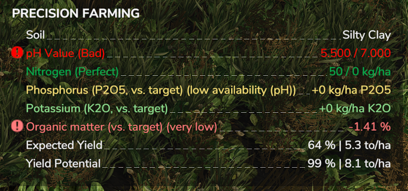
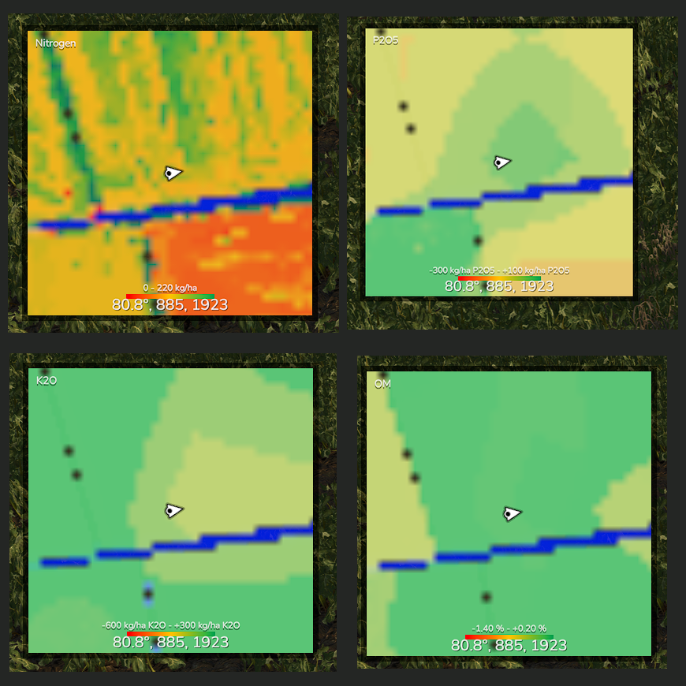

🇬🇧 [English version](EN-08-Technical-Details)

> [!WARNING]
> **Fejlesztés alatt (v0.1, tesztelés).** A mod fejlesztés alatt áll, változások történhetnek, akár a tápanyagtérképek alaphelyzetbe állása is. Mindig legyen biztonsági másolatod a mentésedről.

# Technikai részletek

**Ez az oldal azt magyarázza, miért viselkedik úgy a mod, ahogy látod.** Térképkészítőknek és a logot olvasóknak szól. Játszani nem kell hozzá.

Miért térnek el a szomszédos pixelek? Miért marad el egy kijuttatás? Mikor számít az aratás tényezője? Mikor fogy a szerves anyag? Erre válaszol az oldal.

Fejlesztői belsőségeket (hookok, függvénynevek) csak ott írunk, ahol a játékos vagy a térképkészítő tehet is valamit.

## Térképméret, bitmélység, értéktartomány

A három tápanyagtérkép **mérete mindig a Precision Farming talajtérképének mérete**, a mod nem köti fix számhoz. A Szalókon (a `FS25_0_TRPFConfigurator` mellett) ez 2048 × 2048 pixel. Ha a talajtérkép más méretű, a mod figyelmeztetést ír a logba, és igazodik hozzá.

| | Foszfor (P₂O₅) | Kálium (K₂O) | Szerves anyag (OM) |
|---|---|---|---|
| Egység | kg P₂O₅/ha a talajtípus céljától (**relatív**) | kg K₂O/ha a talajtípus céljától (**relatív**) | %-pont a talajtípus céljától (**relatív**) |
| Bitmélység, lépés | 8 bit, 5 kg | 8 bit, 5 kg | 8 bit, 0,0243 % |
| Tartomány | −600 … +675 a céltól (kijuttatás +300-ig) | −600 … +675 a céltól | −4,01 … +2,19 a céltól |
| Jelmagyarázat ablaka | −300 … +100 | −600 … +300 | −1,4 … +0,2 |
| Mentésfájl | `vtsz_pMap8.grle` | `vtsz_kMap8.grle` | `vtsz_omMap8.grle` |

- A tartomány **kemény korlát**. Ami fölé kerülne, elvész: a határ fölé szórt tápanyag pazarlás. Ez játékszabály, nem a valóság (a valóságban a foszfor a talajban marad).
- A foszfornak ezen felül **lágy plafonja** van: a kijuttatás (és a `vtszNutrientSet`) a célnál +300 kg/ha-nál megáll, a kemény korlát (+675) előtt. A pH-hoz igazított cél a plafon alatt egy lépéssel (+295) van levágva.
- Egy pixel értéke mindig a lépés többszöröse. Ezért mutathat egy talajminta 5 kg (P, K) eltérést a „valódi" értéktől.
- A három térkép mind **relatív**: a 0 a talajtípus célja. A térkép csak a talaj állapotát mutatja. A K célja minden növénynél a talajtípus célja, a foszfornál a pH-hatás a hozamtényezőben, a sor színében és az „alacsony felvehetőség (pH)” szövegben jelenik meg.
- A jelmagyarázat ablaka csak a megjelenítést érinti. A térkép színe az ablakon belül folytonos átmenet (piros, sárga, zöld). A 8 jelmagyarázat-sáv a szűrő és a színminták miatt van. Az ablakon kívüli érték a szélső színt kapja. Színtévesztő módban narancs, fehér, kék az átmenet.
- A térképek azért relatívak, hogy mind a négy talajtípuson ugyanaz a szín jelentse ugyanazt. Az OM részletei a [Szerves anyag](HU-04-Szerves-anyag), a P és K részletei a [Foszfor](HU-02-Foszfor) és a [Kálium](HU-03-Kalium) oldalon vannak.
- Indításkor a log ezt írja: `[VTSZ-NUT] P map 2048 x 2048, 8 bit, step 5, new`. Betöltött mentésnél a sor vége `loaded from savegame`.

## Kijuttatás

- **Csak a szerver számol.** A kliens csak látja az eredményt. Egyjátékos módban a játék a saját szervered.
- Minden szóró és permetező, amelyen van `sprayer` specializáció, a kijuttatott **liter** alapján ír a térképekbe. A mennyiség: a termék tartalma 1000 literenként × l/ha ÷ 1000. A termékek tartalma a [Termékek és kijuttatás](HU-05-Termekek-es-kijuttatas) oldalon van.
- A kijuttatás **0,5 km/h sebesség alatt vagy üres tartálynál kimarad**.

### Termékzár

Egy pixel **termékenként csak egyszer változik egy menetben**. Így nem duplázódik a kijuttatás, ha kétszer mész át ugyanazon a soron.

- A pixel zárt, ha a talajon van permetezési típus (spray type réteg), **és** az utolsó kijuttatott termék ugyanaz volt.
- A zárat a **talajművelés, a vetés vagy az aratás** oldja fel (játékban tesztelve). Addig ugyanaz a termék másodszor nem módosítja a P, K és OM térképet.
- Két **különböző** termék egymás után mindkettő számít a mod saját (P, K, OM) térképein.
- Az alapjáték minden bolti terméket ugyanazzal a `FERTILIZER` talajtípussal jelöl, ezért a mod pixelenként tárolja az utolsó terméket is, egy 5 bites térképen (`vtsz_productMap.grle`, a mentéssel együtt, csak a szerveren). Ez legfeljebb **31 terméket** tud megkülönböztetni; ennél többre hibasor kerül a logba.
- **Termék felvétele vagy törlése eltolja a termékazonosítókat** (a termékek név szerint rendezett sorszáma számít). A mentett térkép a régi azonosítókat tartalmazza, ezért egy menetre a zár tévedhet: egy pixel eggyel több vagy kevesebb kijuttatást kaphat. Új termék hozzáadása után ezt ne tévesszd össze hibával.

> [!NOTE]
> **Ismert korlát (szándékos): a Precision Farming nitrogéntérképe más szabály szerint zár.** A PF N térképe a talaj spray típusa szerint zár, és a bolti termékek ugyanazt a `FERTILIZER` típust használják. Ha két különböző, nitrogént tartalmazó terméket szórsz egymás után **talajművelés nélkül**, a második termék nitrogénje várhatóan nem kerül a PF N térképére. A P, K és OM ettől még mindkét terméknél rendben számít. Külön talajtípus minden termékhez sokat rontana a futásteljesítményen, ezért nem oldottuk meg. A [FS25_NotSoEasyDeveloperControls](https://github.com/borondy/FS25_NotSoEasyDeveloperControls) mod leírása szerint a `clearFertilizerState [mezőId]` admin parancsa törli a mező műtrágya-permetezési típusát, és ezzel a mod saját zárát is oldja (multiplayerben csak admin használhatja). Magát a cleaner modot ezen az oldalon nem teszteltük.

## Véletlen kerekítés (miért térnek el a pixelek)

A legtöbb változás nem pontosan a lépés többszöröse. Példa: 25 000 l/ha hígtrágya +42,5 kg P₂O₅ = 8,5 szint (a lépés 5 kg).

- A mod a változás **egész részét** minden pixelre ráteszi, a **maradékot** a pixelek negyed-negyed csoportjaira osztja, és ami egy negyednél is kisebb, azt **véletlenszerűen kerekíti**.
- Ezért egyenletes szórás után is eltérnek a pixelek (egyik +1, másik +2 szintet kap), a **mezőátlag viszont pontos**. Nagy mezőn a véletlen kiátlagolódik, kis foltokon nem.
- Ugyanez a szabály mindhárom térképen és minden változásnál érvényes: kijuttatás, aratás, lebomlás, kimosódás, nitrogén-felszabadulás, takarónövény.
- A négy csoport a **4 zajsáv** (2 bites Perlin-zaj, a pixelek negyed-negyede). A kezdőértékek is ezt használják, ezért a mezőn belül már az új mentésben is van szórás.

Gyakorlati következmény: ne a mezőinfó egyetlen pixelének értékéből ítélj. A trendet a mezőátlag és több minta mutatja.

## Aratás

Az aratás három dolgot tesz: elvon a térképből, megállapítja a **hozamtényezőt**, és beírja a hozamba. Az elvonás számait a [Foszfor](HU-02-Foszfor), [Kálium](HU-03-Kalium) és [Szerves anyag](HU-04-Szerves-anyag) oldalak tartalmazzák, a [Vetésforgók](HU-06-Vetesforgok) oldal pedig számpéldákat.

**A tényező a vágószerkezet alatti pixelekből jön.** A PF minden aratási lépésben megadja a learatott pixeleket; a mod ezekre számolja térképenként a hozamtényezőt (talajtípusonként, pixelszámmal súlyozva), a PF **saját szűrőjével**. A tényező a pH-hoz igazított célértékhez viszonyított különbségből adódik.

**Az utolsó aratási lépés tényezője érvényes.** Új tényező csak friss aratási lépés után keletkezik; két lépés között (például a gép egy pillanatra nem arat) az utolsó érték marad. Két menet ugyanazon a mezőn eltérő tényezőt kaphat, ha a térkép a két helyen eltér.

**Hogyan lesz belőle hozam:**

- **Hozam = PF szorzó × min(P-tényező, K-tényező) × OM-tényező**, mindegyik tényező legfeljebb 1.
- A P és K a **minimum törvénye** szerint számít: a szűkösebb korlátoz, a két hiány nem szorzódik (P 0,95 és K 0,95 együtt 0,95, nem 0,90). Az OM nem korlátozó tápanyag (talajszerkezet, víz), ezért szorzódik.
- A mod soha nem növeli a hozamot a PF értéke fölé.

**Hozamskála (az elvonás követi a hozamot):**

1. A mod az aratási lépés PF hozamszorzóját elosztja a `yieldReference` értékkel (alap 1,5; ez az a PF-szorzó, amelyre az elvonási számok vonatkoznak). A PF szorzójában benne van az N, a pH, a gyom, a művelés és a mod saját tényezője is.
2. Az eredmény **0,3 és 2,0 közé van szorítva**, és **0,1-es lépésre kerekítve**.
3. A P és K elvonása ezzel a skálával arányos: gyenge hozamnál (skála 0,5) feleannyi, a felső korlátnál (2,0) kétszer annyi.
4. Az **OM csak félig követi** (`yieldScaling` 0,5): a maradvány tömege részben függ a hozamtól.
5. `yieldReference="0"` kikapcsolja: az elvonás aratásonként rögzített. Ha a PF szorzója egy ritka hívási úton nem elérhető, a skála 1.

**Kaszálás és szecskázás.** Ha szecskázó vagy kaszálógép dolgozik, a mod ezt „egész növényes" betakarításnak veszi: azoknál a növényeknél, amelyeknek van `forageRemoval` értékük (a gabonák), a termény és a szalma is lekerül, szalma-jóváírás nincs. A fű, a lucerna és a here értékei vágásonként értendők.

## A talaj pH-ja

- **Aratáskor** a mod a pH-t a PF pH-térképéből olvassa, **a gép (kombájn, kaszálógép) helyén**. Ehhez **nem kell talajmintavétel**: a talajnak akkor is van pH-ja, ha te még nem fedted fel.
- **A mezőinfóban** a kurzor alatti pixel pH-ját használja.
- A pH a foszfor célértékét változtatja: a cél osztódik a pH-hoz tartozó felvehetőségi aránnyal. A mezőinfóban ez az „alacsony felvehetőség (pH)” szövegként jelenik meg, csak akkor, ha a talaj a célon vagy fölötte van, és a hozamtényező csak a pH miatt van 0,99 alatt. A számok és a példák a [Foszfor](HU-02-Foszfor) oldalon vannak.
- Az igazított célt a mod a lágy plafon mínusz egy lépésnél (P: +295 kg/ha a talajcélhoz képest) levágja, hogy a teljesen feltrágyázott tábla mindig elérhesse az 1,0 hozamtényezőt. A Szalók talajtípusain pH 5,0-nál a legnagyobb igazított cél +257 (vályog), ezért a vágás nem számít. Ez a szabály a hozamtényezőre érvényes. Az automatikus mennyiség nem veszi figyelembe a pH-t.
- Relatív térképen a pH-hatás a talajcél és a növény extrája együttesére számít: (talajcél + extra) / felvehetőség − talajcél. Ez jelenik meg a mezőinfó **célértékében**.

## Mezőinfó és mintavétel

- A mezőinfó színe és szövege a **hozamtényezőtől** függ, nem a nyers számtól:

| Hozamtényező | Szín | Szöveg |
|---|---|---|
| 0,99 vagy több | zöld | – |
| 0,90 és 0,99 között | sárga | „alacsony" |
| 0,90 alatt | piros, figyelmeztető jellel | „nagyon alacsony" |

- Színtévesztő módban a mod saját színeket használ.
- Mindhárom sor a **céltól való távolságot** mutatja: P és K `%+d kg/ha`, például `-100 kg/ha K2O`, OM `%+.2f %`, például −0,32 %.
- A P sora is egyetlen szám. A pH nem változtatja, de a sor színében és a hozamtényezőben benne van; az automatikus mennyiség az egyszerű távolságot használja, a pH-t nem. Az OM soránál sincs második szám. Ha a kurzor alatt nincs növény vagy talajtípus, a sor csak az aktuális értéket mutatja.
- **A felfedetlen (nem mintavételezett) talajt csak a felület rejti el**: a mezőinfó, a térkép és az automatikus mennyiség nem lát belőle semmit. A kijuttatás, az aratás és a hozamtényező mindig a **valós értékkel** számol, mintavétel nélkül is.
- A mod nem ír saját hozamadatot a PF mezőinfó dobozába (a PF ott csak N-adatot kezel). A tényező ettől még eljut a mezőinfó „várható hozam" sorába; ezt a sort játékban még nem ellenőriztük.

## Minitérkép

- Szóráskor a minitérkép a termék legnagyobb tartalmú tápanyagának rétegére vált. A szerves trágyáknál (trágya, hígtrágya, fermentált) alapból a nitrogén. A `Bal Alt + .` lapoz: Automatikus, N, P, K, OM. Termékváltáskor visszaáll Automatikusra.
- A réteget az irányított jármű láncának **első, termékkel teli permetezője** választja, **mezőn**. Lapozás után 3 másodpercig „Minitérkép réteg: …" üzenet látszik.
- Szórás közben a minitérkép a mod rétegét tartja, nem ugrál vissza a PF N vagy pH rétegére. Mezőről kilépve vagy a permetező lecsatolásakor a rétegek felszabadulnak.
- Ez kliens oldali: a minitérkép és a HUD a saját gépeden működik.
- Állapot: a réteg követi a terméket (hígtrágyás szórásnál játékban tesztelve). A minitérkép többi viselkedése, köztük az ismert hiba (NPK 8-24-24 és Élesztővinasz szórásakor a térkép ne váltogasson N és más réteg között), még nincs lefuttatva.

## Havi folyamatok: lebomlás, kimosódás, nitrogén-felszabadulás

Ezek **játékidőszakonként (havonta)**, a hónapváltáskor futnak le, **csak a szerveren**. A kliens a szinkronizált térképen látja az eredményt. Az 1. időszak március (északi félteke).

| Folyamat | Melyik térkép | Mit csinál |
|---|---|---|
| Lebomlás (mineralizáció) | OM | A talajtípus céljának éves törtrészét veszi el, évszakos súlyokkal: télen alig, nyár közepén a legtöbb. |
| Kimosódás | K | Csak a talajtípus **célján (a térképen 0) vagy fölötte** lévő tartalom mosódik ki, talajtípusonként (kg K₂O/ha/év), nedves hónapokban több. A hiányos talaj nem veszít. |
| Nitrogén-felszabadulás | OM → PF N térkép | A lebomló szerves anyag nitrogént ad a PF N térképének, ugyanazzal az évszakos eloszlással. |

- Mindhárom a [véletlen kerekítés](#véletlen-kerekítés-miért-térnek-el-a-pixelek) szabályát használja, ezért a mezőátlag pontos.
- A **nitrogén** a PF 5 kg N-es állapotlépcsőihez kerekítve kerül a PF térképére, és a PF látható maximuma fölé nem visz. A PF saját N-számításához a mod nem nyúl: csak a térkép pixeleit növeli, ezért a PF automatája a megnövekedett szintet látja, és kevesebb nitrogént ad. Ha az N térkép mérete eltér az OM térképétől, a mod kihagyja ezt a lépést, és figyelmeztetést ír a logba.
- A lebomlás, a kimosódás és a nitrogén-felszabadulás a `balance removalScale` értékével skálázódik; a lebomlás ezen felül az OM `timeScale` értékével (alap 6, a VirtualTSZ szerveren kb. 6 játékév telik el egy valós év alatt). A nitrogén játékévenként számol, nem skálázódik `timeScale`-lel.
- A számok és a háttér a [Szerves anyag](HU-04-Szerves-anyag) és a [Kálium](HU-03-Kalium) oldalon vannak.
- A log sorai, ha figyeled őket: `OM mineralisation period N: …`, `K leaching period N: …`, `OM nitrogen release into the N map: …`.
- Állapot: a lebomlás és a nitrogén-felszabadulás számítását az önteszt (`vtszSelfTest mineral`) igazolja. A játékbeli időzítés (a log sorai, az éves csökkenés, az N térkép növekedése) még nincs végigtesztelve.

## Többjátékos mód és szinkron

> [!WARNING]
> **A többjátékos mód még nincs tesztelve** (lásd `TESTS.md`). A mod úgy van megírva, hogy működjön, de játékbeli bizonyíték még nincs rá. Ami itt áll, az a kódból olvasott működés.

- **Számítás a szerveren:** kijuttatás, aratás, takarónövény-bedolgozás, lebomlás, kimosódás és nitrogén-felszabadulás csak a szerveren fut. A termékzár térképe is csak a szerveren él.
- **Térképek szinkronja:** a P, K és OM térképet a PF saját térképszinkronizálója viszi a kliensekhez. A késői csatlakozó ugyanazt kell hogy lássa; ez még nincs tesztelve.
- **Szóróbeállítások:** két saját üzenet szinkronizál. A `VtszSprayerRateEvent` az N nélküli termékek kijuttatási mennyiségét viszi (l/ha). A `VtszSprayerAutoEvent` az automatikus mennyiség be/ki állapotát és az alap tápanyagot viszi. Késői csatlakozónál ezek a szóró állapotával együtt mennek át.
- **Kliens oldalon marad:** a HUD és a minitérkép-réteg.
- **A mennyiség nincs mentve:** mentés és betöltés után a szóró visszaáll a termék alapértelmezett mennyiségére (szándékos).
- A konzolparancsok csak ott léteznek, ahol szerver fut: [Konzolparancsok](HU-09-Konzolparancsok).

## Mentésfájlok

A mentési mappában (a `.grle` fájlok):

| Fájl | Tartalom |
|---|---|
| `vtsz_pMap8.grle` | foszfor térkép (a `8` a bitmélység) |
| `vtsz_kMap8.grle` | kálium térkép (a `8` a bitmélység) |
| `vtsz_omMap8.grle` | szerves anyag térkép (a `8` a bitmélység) |
| `vtsz_productMap.grle` | az utolsó kijuttatott termék pixelenként (5 bit, csak szerveren) |

- A nem 5 bites térkép fájlnevében szerepel a bitmélység. A P és K térkép korábban 5 bites volt (`vtsz_pMap.grle`, `vtsz_kMap.grle`), az új relatív változat 8 bites. A régi fájlt a mod nem tölti be, ezért a korábbi mentésben a P és K a kezdőértékekről indul újra. Ha egy térképnél megváltoztatják a bitmélységet (térképkészítői beállítás), **új térkép indul a kezdőértékekből**, a régi fájl figyelmen kívül marad. Lásd a [Térképkészítőknek](HU-07-Terkepkeszitoknek) oldalt.
- Ha a mentett térkép mérete eltér a PF talajtérképétől, a mod figyelmeztet, és a kezdőértékekből újraépíti.
- Új mentésnél (vagy ha a mod egy meglévő mentéshez kerül) a térkép a kezdőértékekből indul, talajtípusonként 4 zajszinttel.
- A mod eltávolításának és a fájlok sérülésének kezelése még nincs tesztelve.

## Lásd még

- [Konzolparancsok](HU-09-Konzolparancsok)
- [Térképkészítőknek](HU-07-Terkepkeszitoknek)
- [Szerves anyag](HU-04-Szerves-anyag)
- [Termékek és kijuttatás](HU-05-Termekek-es-kijuttatas)
