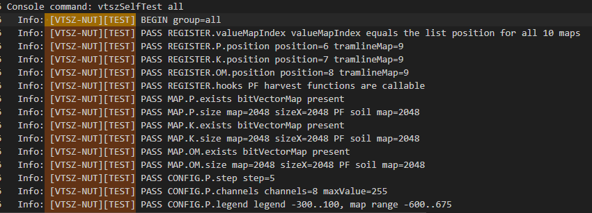

🇬🇧 [English version](EN-09-Console-Commands)

> [!WARNING]
> **Fejlesztés alatt (v0.1, tesztelés).** A mod fejlesztés alatt áll, változások történhetnek, akár a tápanyagtérképek alaphelyzetbe állása is. Mindig legyen biztonsági másolatod a mentésedről.

# Konzolparancsok

**Ez az oldal a mod négy konzolparancsát sorolja fel.** Annak szól, aki tesztelni vagy hibát keresni akar. Játszani nem kell hozzájuk.

A parancsokkal megnézheted, mit számol a mod, beállíthatsz egy mezőt tesztelésre, és ellenőrizheted, hogy a mod rendben betöltött. Az eredmény többnyire a `log.txt`-be kerül, a mod sorai `[VTSZ-NUT]` előtaggal kezdődnek.

Nyisd meg a fejlesztői konzolt, és írd be a parancsot. (Hogy a konzol elérhető-e, a játék beállításától függ. Ezt itt nem tárgyaljuk.) **Tizedespontot használj**, tizedesvesszőt ne, a magyar játékban is: `-0.5`, nem `-0,5`.

> [!WARNING]
> A `vtszNutrientSet` és a `vtszSelfTest world … confirm` **térképadatot ír**, és ezzel a hozamot is megváltoztatja. Éles mentésen csak akkor használd, ha tudod, mit csinálsz. A `vtszSelfTest world … confirm` kifejezetten **tesztmentésre való**.

## Ki futtathatja?

- A `vtszNutrientDebug` és a `vtszNutrientSet` működik egyjátékos módban, a játékot hosztoló játékosnál, a dedikált szerver konzolján, és **többjátékos kliensről adminként** (előbb jelentkezz be adminnak). A kliens elküldi a parancsot a szervernek, az ellenőrzi az admin jogosultságot, lefuttatja, és az eredménysort visszaküldi a konzolra. A `vtszSelfTest` csak ott létezik, ahol a játék szervert futtat.
- A `vtszPerf` a kódban minden példányon regisztrálódik, de fejlesztői eszköz.
- Hogy a kliens jogosultsága mit enged többjátékos módban, **még nincs tesztelve**. Ugyanígy a többjátékos mód egésze sincs még tesztelve.

## vtszNutrientDebug

**Szintaxis:** `vtszNutrientDebug [on|off]`

Bekapcsolja a kijuttatás és az aratás értékeinek naplózását a `log.txt`-be. Paraméter nélkül (vagy bármely más paraméterrel) átkapcsolja az állapotot. Alapból ki van kapcsolva, és nem mentődik. A napló korlátozott gyakoriságú: legfeljebb másodpercenként egy sor.

**Példa:** `vtszNutrientDebug on`, a válasz: `vtszNutrientDebug on`.

Amit a logban látsz:

- Kijuttatás: `[VTSZ-NUT] spray fillType=MANURE l/ha=... P=... K=... OM=...` (az érték térképegységben, az adott menetre).
- Aratás: `[VTSZ-NUT] harvest P actual=... target=... factor=... | K ... | combined=... | pH=... | yieldScale=...`. A `combined` a P, K és OM tényezőből kapott együttes hozamtényező, a `yieldScale` a hozamskála (lásd [Technikai részletek](HU-08-Technikai-reszletek)).

## vtszNutrientSet

**Szintaxis:** `vtszNutrientSet <mezőId> <P|K|OM> <érték>`

A megadott mező **minden pixelét** egyetlen értékre állítja. Az egész mező egyenletes lesz (a pixelek közötti szórás elvész).

- **P, K:** az érték a **talajtípus céljától való távolság kg/ha-ban** (P₂O₅ illetve K₂O; mindhárom térkép relatív). A `-120` azt jelenti: 120 kg/ha-ral a cél alatt, a `0` pontosan a cél, a `50` a cél fölött. Ez nem a talaj tartalma: a vályog foszforcélja 600, így a `0` 600 kg/ha-t jelent, nem nullát.
- **OM:** az érték a **talajtípus céljától való távolság %-pontban**. A `-0.5` azt jelenti: 0,5 %-ponttal a cél alatt, a `0` pontosan a cél, a `0.5` a cél fölött.
- Az érték a térkép lépéséhez kerekítődik (P és K 5, OM 0,0243), és a tárolt tartományra van vágva: P és K −600 … +675 a céltól, OM −4,01 … +2,19 a céltól. A foszfor a lágy plafonnál (+300) megáll, efölé a parancs sem visz.
- A `<mezőId>` a mező száma, ahogy a játék a mezőket számozza.
- A talajmintavétel nélküli mezőn a réteg továbbra is rejtett: a mezőinfó és a térkép csak mintavétel után mutatja az új értéket (az aratás és a hozamtényező viszont már az új értéket használja).

**Példák:**

```
vtszNutrientSet 1 P -150
vtszNutrientSet 1 K -120
vtszNutrientSet 1 OM -0.5
vtszNutrientSet 1 OM 0
```

A válasz például: `P of field 1 set to -150 kg/ha P2O5 (level 90)`. Hibás mezőszámnál: `Field not found: …`. Ismeretlen tápanyagnál: `Unknown nutrient: …`. Hiányzó paraméternél a parancs használati üzenetet ír.

Mire jó:

- A hozamgörbék, a mezőinfó színei és az „alacsony" / „nagyon alacsony" jelzés kipróbálására (a mezőinfó színeit lásd [Technikai részletek](HU-08-Technikai-reszletek)).
- A lebomlás és a kimosódás kipróbálására: állítsd a mezőt a cél alá vagy fölé, majd várj egy játékidőszak-váltást.

## vtszSelfTest

**Szintaxis:** `vtszSelfTest [all|registration|maps|config|spray|harvest|yield|rounding|mineral|ph|auto|scale|rates|ui]` és `vtszSelfTest world <mezőId> confirm`

Önteszt a P, K és OM térképekre. Az eredmény a `log.txt`-ben van, soronként egy ellenőrzés:

```
[VTSZ-NUT][TEST] PASS|FAIL|WARN|SKIP <azonosító> <részlet>
```

A végén egy `SUMMARY` sor van, a konzol pedig egy összegzést ír: `vtszSelfTest pass=… fail=… warn=… skip=… (… ms) - details in log.txt`. Paraméter nélkül az `all` fut le (a `world` nélkül).



<details>
<summary>Tesztcsoportok és amit ellenőriznek</summary>

| Csoport | Mit ellenőriz |
|---|---|
| `registration` | a három térkép be van jegyezve a PF térképválasztóba a rejtett vonalazótérkép elé, a PF függvényei elérhetők |
| `maps` | a térképek léteznek, és a méretük egyezik a PF talajtérképével |
| `config` | a config értékei épek (lépés, bitmélység, jelmagyarázat, célok, kezdőértékek) |
| `spray` | a termékek tápanyagtartalma a tervezett értékekkel egyezik, a `baseFertilizer` kapcsoló |
| `harvest` | az aratási elvonások és az OM-változások a tervezett értékekkel egyeznek |
| `yield` | a hozamgörbék és a tényezők összetétele (P/K minimuma, OM szorzója) |
| `rounding` | a véletlen kerekítés átlaga |
| `mineral` | az OM lebomlása, a K kimosódása és az OM nitrogén-felszabadulása |
| `ph` | a pH-felvehetőség görbéje és a pH-korlát |
| `auto` | az automatikus mennyiség alap tápanyagai és képlete |
| `scale` | a hozamskála |
| `rates` | az N nélküli termékek mennyiségbeállításai (`rateControl`) |
| `ui` | a jelmagyarázat sávjai, a formátumok, a nyelvi szövegek jelenléte |

</details>

A **FAIL** hibát jelent. A **WARN** nem feltétlenül hiba: lehet szándékos átállítás miatti eltérés a tervezett értéktől.

### vtszSelfTest world

**`vtszSelfTest world <mezőId> confirm` térképadatot ír, csak tesztmentésen használd.** A `confirm` nélkül nem fut le, csak a használati üzenetet írja ki.

Egy mezőn kipróbálja a valódi kijuttatási utat: beállít egy értéket, majd **minden, az adott tápanyagot tartalmazó termékkel kijuttat** 1000 l/ha-t, és ellenőrzi a változást. Utána a mezőt **egyetlen egyenletes értékre állítja vissza** (a pixelek közötti szórás elvész), a termékzár térképét pedig a próbák módosítják. A `WORLD.….restore` figyelmeztető sorok ezért normálisak.

## vtszPerf

**Szintaxis:** `vtszPerf start [címke]`, `vtszPerf stop`, `vtszPerf report`, `vtszPerf reset`

Fejlesztői teljesítménymérő, játékosnak nem kell. A `start` becsomagolja a mod forró útvonalait (a minitérkép frissítése, a szóró frissítése és HUD-ja, a kijuttatás, az aratás), és a számokat a `log.txt`-be írja `[VTSZ-PERF]` előtaggal. `stop` visszaállítja az eredeti függvényeket, tehát mérés nélkül nincs költsége. A számok azonos helyzetek összehasonlítására valók, a mérés saját kis költséggel jár.

## Hogyan ellenőrizd, hogy a mod működik

Gyors ellenőrzés egyjátékos módban Szalókon, aktív `FS25_precisionFarming` és `FS25_0_TRPFConfigurator` mellett. A teljes tesztlista és az állapot a `TESTS.md` fájlban van.

1. **Betöltés.** Új mentésnél a log tartalmazza a `[VTSZ-NUT] P map 2048 x 2048, 8 bit, step 5, new` sort (K: 8 bit, step 5; OM: 8 bit, step 0.0243), és nincs `Error`. Betöltött mentésnél a sor vége `, loaded from savegame`.
2. **Térképmenü.** ESC › Térkép: a PF választóban megjelenik a Foszfor, a Kálium és a Szerves anyag. Talajmintavevővel a rétegek felfedhetők, piros-sárga-zöld jelmagyarázattal.
3. **Érték beállítása.** `vtszNutrientSet 1 P -150`: ha növény áll a mezőn, a Foszfor (P2O5, a céltól) sor ezt mutatja: `-150 kg/ha P2O5`, „alacsony" jelzéssel, mert a hozamtényező kb. 0,91. A `-250` „nagyon alacsony"-at ad. K-nál a `vtszNutrientSet 1 K -120` ezt mutatja: `-120 kg/ha K2O`, minden növénynél.
4. **Kijuttatás.** `vtszNutrientDebug on`, szórj trágyát: a log `spray fillType=MANURE l/ha=... P=... K=... OM=...` sort ír, és a réteg nő.
5. **Aratás.** A log `harvest P actual=... target=... factor=...` sort ír, a szintek csökkennek, és a hozam csak a cél alatt kisebb a PF értékénél.
6. **Mentés.** Mentés, kilépés, betöltés: a szintek megmaradnak. A mentési mappában ott a `vtsz_pMap8.grle`, `vtsz_kMap8.grle`, `vtsz_omMap8.grle` és a `vtsz_productMap.grle` (az utolsó kijuttatott termék, csak szerveren).
7. **Takarónövény.** Olajretek vagy mustár bedolgozásakor vagy mulcsozásakor az OM kicsit nő.
   - **OM lebomlás:** `vtszNutrientSet 1 OM 0` (a célra állítja), majd egy játékidőszak (hónap) váltás után a log `[VTSZ-NUT] OM mineralisation period N: soil…=…` sort tartalmaz. Az OM a nyári hónapokban csökken a legtöbbet; egy játékév alatt kb. −0,070 %-pont vályogon. `vtszSelfTest mineral` a számítást ellenőrzi.
   - **K kimosódás:** állíts be egy 1. talajtípusú mezőt a cél fölé, például `vtszNutrientSet <mezőId> K 100` (100 kg/ha a cél fölött), és várj egy időszakváltást: a log `K leaching period N` sort ír, a K évente kb. 40 kg/ha-t veszít (1. talajtípus). A cél alatti (negatív értékű) mezőn nem csökken.
8. **Dedikált szerver.** Ismételd a 4–6. lépést; a kliensek ugyanazt kell lássák. Ez a lépés a többjátékos mód miatt **még nincs tesztelve**.

Az állapot a `TESTS.md` szerint: az 1–3. lépés játékban ki van próbálva; a kijuttatás (4.) számítását az önteszt igazolja, a termékzár játékban tesztelt; az aratási napló (5.) játékban megvan, de a növényenkénti elvonások többsége még nincs végigpróbálva, a takarónövény játékban tesztelt. A mentés/betöltés (6.), a lebomlás és a kimosódás időzítése (7.) játékban még nincs végigpróbálva, a számításukat az önteszt igazolja. A 8. lépés a többjátékos mód miatt nincs tesztelve.

## Lásd még

- [Technikai részletek](HU-08-Technikai-reszletek)
- [Első lépések](HU-01-Elso-lepesek)
- [Ismert korlátok](HU-10-Ismert-korlatok)
