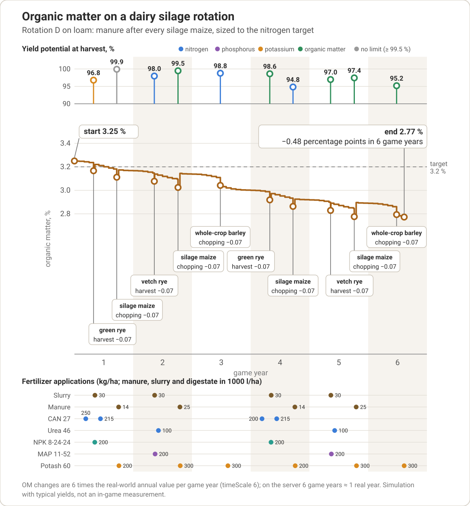
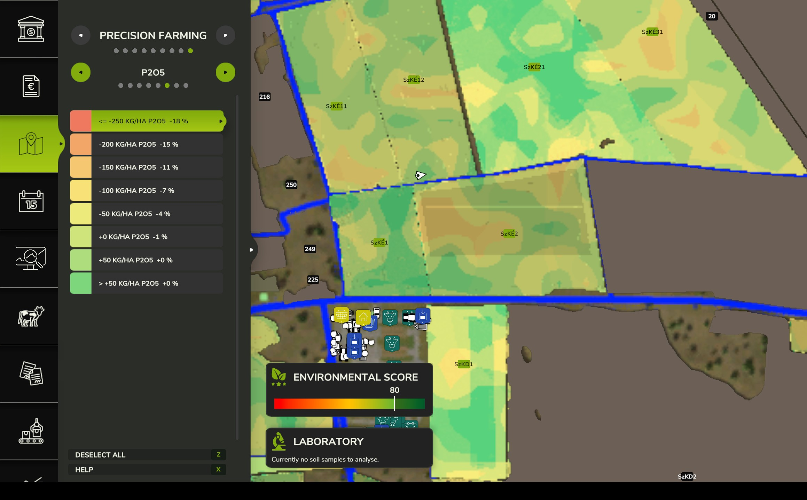
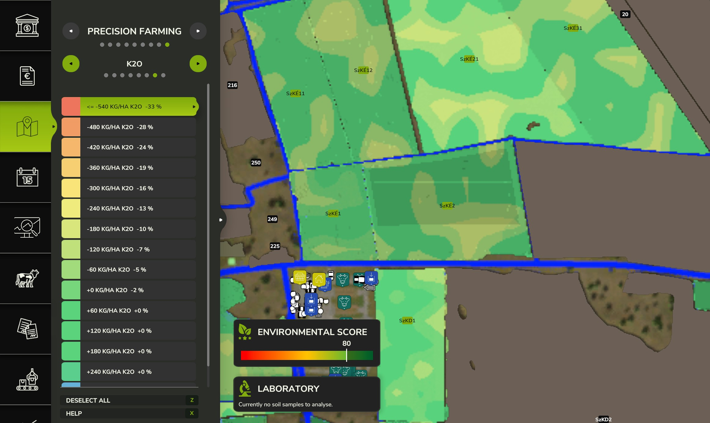

🇭🇺 [Magyar változat](HU-00-Kezdolap)

> [!WARNING]
> **In development (v0.1, testing).** The mod is in development and things may change. Always keep a backup of your savegame.

> [!NOTE]
> **AI disclaimer.** The mod and this documentation were made largely with Claude. The numbers are agronomic estimates, so double-check them and report any mistake you find.

# VirtualTSZ Precision Farming Extension

**Your soil no longer lasts forever.** Precision Farming tracks nitrogen and pH, but not the phosphorus, potassium and humus that leave the field with every harvest. This mod adds that missing part.

## What you get: the short version

- **Three new soil maps:** phosphorus (P₂O₅), potassium (K₂O) and organic matter (OM). You reveal them by soil sampling, and they show in the Precision Farming map menu and the field info box.
- **The maps show the distance from the target:** 0 is on target on every soil type, minus is a deficit, plus is a surplus. The potassium target is the same for every crop; the crop only changes how much a harvest takes out.
- **The soil runs down if you do not replace what you take.** Silage, potatoes and sugar beet remove a lot of nutrients, and the yield drops with them.
- **Many ways to put it back:** fertiliser, manure, chopped straw, legumes, alfalfa and catch crops.
- **Never extra yield:** the mod only takes yield away from what Precision Farming gives when the soil is short of something.
- **11 shop products** with realistic NPK contents, **automatic application rate** for phosphorus and potassium, an application HUD and a minimap layer.
- **In-game help page** with the nutrient removal of every crop (also with baled straw and forage harvest), a page with the content of every fertilizer, and **five worked example crop rotations**.

## Why was it made?

We play fairly realistically on the VirtualTSZ server (Szalók map). Our dairy farm takes silage from the same fields twice a year. With Precision Farming alone, nothing punished that: the soil never got poorer, however many tonnes of biomass left the field.

In real life silage takes most of the plant, and phosphorus, potassium and humus leave with it. We built that. We used real agronomy data (German VDLUFA humus balance, LfL Bavaria tables, Hungarian soil data), simplified for the game.

## How humus runs down on a dairy rotation

This is rotation D from the [Crop rotations](EN-06-Crop-Rotations) page: dairy farm, silage maize twice, manure after every silage maize. Over six game years organic matter falls from 3.25 % to 2.84 %, **even though we spread manure**. The reason is that nitrogen limits how much manure you may spread.

How do you turn it around? See the [Organic matter](EN-04-Organic-Matter) page and the alfalfa break in rotation E. The chart is a simulation with typical yields, not an in-game measurement.

## The three maps

All three count towards the yield, and you reveal all three by soil sampling. All three maps are **relative**: they show not the content of the soil but the distance from the target value of the soil type. 0 means the soil is on target, minus is a deficit, plus is a surplus, the same on every soil type.

### Phosphorus (P₂O₅)

Every harvest removes it, and it only comes back with fertiliser and manure. Soil pH decides how much of it the crop can take up, and the field info box shows what is still missing. Below the target value the yield drops. The map shows the deficit (minus) or the surplus (plus) in kg/ha.

Details: [Phosphorus](EN-02-Phosphorus)

### Potassium (K₂O)

Removal depends on the crop: silage, potatoes and sugar beet take a lot, grain takes little. Each crop needs its own amount over the soil type's target, and the field info box shows that target. Above the soil type's target, potassium slowly leaches out, especially on light soils.

Details: [Potassium](EN-03-Potassium)

### Organic matter (OM)

It decomposes every month, fastest in summer, and releases nitrogen into the Precision Farming nitrogen map.

- **Lowers it:** whole-crop harvesting and baled (removed) straw.
- **Raises it:** chopped straw, manure, legumes, alfalfa and catch crops.
- If it gets too low, the yield drops.

Details: [Organic matter](EN-04-Organic-Matter)

## Also in the mod

- 11 shop products with realistic NPK contents: [Products and application](EN-05-Products-and-Application)
- Automatic application rate for phosphorus and potassium (Precision Farming's own automatic rate only handles nitrogen).
- A HUD that shows the N, P₂O₅ and K₂O you apply per hectare.
- A minimap layer that follows the product in the sprayer.
- An in-game help page with the nutrient removal of every crop.
- Five worked example crop rotations: [Crop rotations](EN-06-Crop-Rotations)

## What do you need?

| What you need | Note |
|---|---|
| Precision Farming DLC (`FS25_precisionFarming`) | |
| [TR] Precision Farming Configurator (`FS25_0_TRPFConfigurator`) | 2048 × 2048 maps |

On a dedicated server the mod must be installed on the server and on every client.

**Download:** https://sharemods.com/3ezx9j54cuoa/FS25_VirtualTSZPrecisionFarmingExtension.zip.html

## Where does it stand? (honest status)

- **Tried in game, in single player:** the mod loads, the three layers appear in the PF map selector, soil sampling and the legends, the field info lines, the console commands, the spreading rules (once per product and pass), mulching catch crops, and, with slurry, the minimap layer following the product and the auto N line of the HUD.
- **Checked at calculation level (self-test), not yet in game:** the nutrient content of the products, the yield factors, decomposition, nitrogen release. Incorporating catch crops with plough, subsoiler, disc harrow, cultivator or direct seeding is read from code, not tested in game.
- **Not tested yet:** multiplayer and dedicated server, saving and loading, the shop products, the application rate keys, and the rest of the HUD and the minimap.

The full list and the limits are on [Known limitations](EN-10-Known-Limitations). Report bugs here: {{REPO_URL}}/issues

## Built for the VirtualTSZ community

The mod is made for the gameplay of the VirtualTSZ community on the Szalók map, and that is where it is tested and balanced. Rules that are specific to the VirtualTSZ server are labelled as such on the pages.

**Other maps?** In principle the mod works on any map that meets the requirements, but other maps are **not tested**. Map makers can override targets, starting values, crop removal and products in their `map.xml`. See [For map makers](EN-07-For-Map-Makers).

## Start here

- [Getting started](EN-01-Getting-Started)
- [Organic matter](EN-04-Organic-Matter)
- [Crop rotations](EN-06-Crop-Rotations)
